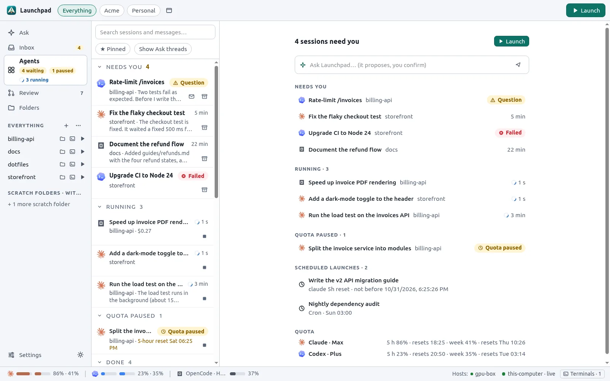
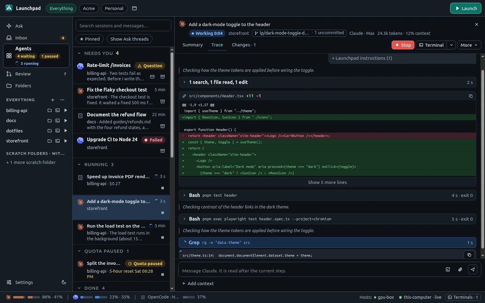
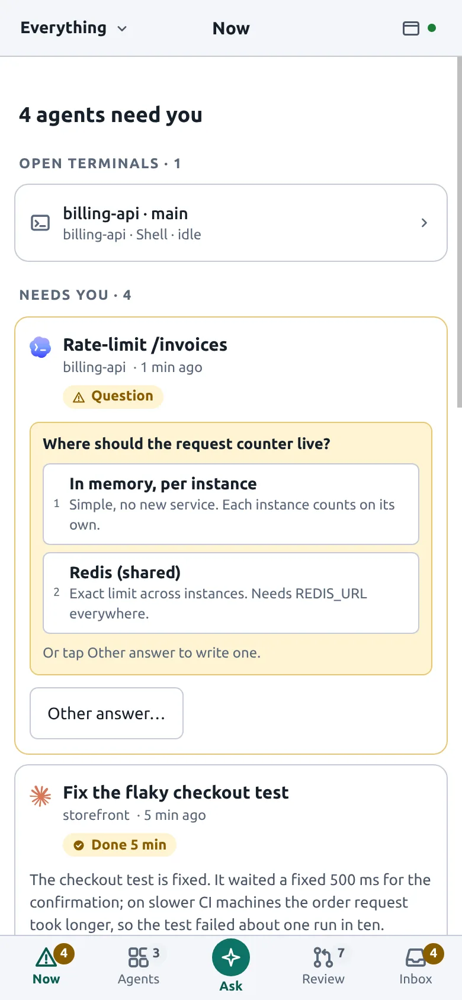

# Launchpad

Launchpad is a desktop app to launch, follow and review coding agents (Claude Code, Codex and OpenCode), with a fast local-first GitHub client built in. It runs on Linux, macOS and Windows, and works from a phone or any browser you pair with it.



## Why Launchpad

- **One place for all your agents.** Start an agent in the right folder with the right context in a few clicks. Follow many runs at once, answer their questions, review their changes and send follow-ups.
- **Every task in its own worktree.** Each agent works on its own Git branch, so your checkout stays untouched. Merge the branch, review it as a local pull request or discard it.
- **Your subscription, protected.** Launchpad reads the quota of your Claude and ChatGPT subscriptions, pauses agents before they use paid credits, and continues them when quota is available again.
- **GitHub without waiting.** The inbox, issues, pull requests and reviews come from a local cache, so moving between them is instant.
- **Nothing reaches GitHub without your click.** Comments and reviews written by agents, and pull requests prepared locally, stay on your machine until you publish them.
- **Use it from anywhere.** One daemon runs the agents. The desktop window, your phone and other browsers are clients of that daemon.

<table>
  <tr>
    <td width="66%"></td>
    <td></td>
  </tr>
</table>

## Features

| | |
| --- | --- |
| **Agents** | Claude Code, Codex and OpenCode behind one session model. Live trace, Summary and Changes views, questions and approval cards, model and permission controls. [Read more](docs/agents.md) |
| **Profiles** | Run each harness with a subscription login, an API key or another provider (for example the Hugging Face router). Several accounts work side by side. [Read more](docs/agents.md#profiles) |
| **Worktrees** | New agents run in a dedicated worktree and branch. Launchpad merges the branch when you ask, and sends conflicts back to the agent. [Read more](docs/agents.md#worktrees-and-merging) |
| **Scheduling** | Start later, after other agents finish, when a quota resets, or on a cron schedule. [Read more](docs/agents.md#scheduling) |
| **Ask Launchpad** | Describe work in plain words. An assistant proposes launches, messages and crons as cards that you start with one click. [Read more](docs/agents.md#ask-launchpad) |
| **GitHub** | Inbox triage, issues, pull requests, diffs, reviews and merges, with local PRs and agent suggestions. [Read more](docs/github.md) |
| **Terminals and files** | Integrated terminals for shells and harness TUIs, and a read-only file viewer with syntax colors. [Read more](docs/agents.md#terminals-and-files) |
| **Phone and remote access** | Pair a phone with a QR code, use it over Tailscale, get Web Push notifications. [Read more](docs/remote-access.md) |
| **SSH hosts** | Run agents and terminals on other machines over SSH. [Read more](docs/ssh-hosts.md) |
| **Hugging Face** | Run Launchpad in a private Hugging Face Space, and sync agent traces to a Hugging Face bucket. [Read more](docs/hugging-face.md) |
| **Chrome extension** | Give an agent the browser tabs you choose. [Read more](extension/README.md) |

## Getting started

Requirements: Git, the [GitHub CLI](https://cli.github.com/) and at least one coding agent CLI ([Claude Code](https://code.claude.com/), [Codex](https://developers.openai.com/codex) or [OpenCode](https://opencode.ai/)). Linux (Ubuntu 22.04 or newer) is the primary platform.

Build and install from source (Rust 1.93+, Node 24 and pnpm through Corepack, plus the [Tauri prerequisites](https://v2.tauri.app/start/prerequisites/)):

```sh
git clone https://github.com/Wauplin/launchpad.git
cd launchpad
packaging/install.sh            # macOS: bash packaging/install.sh
                                # Windows: powershell -ExecutionPolicy Bypass -File packaging/install.ps1
```

Then open **Launchpad** from your applications. On the first start, a welcome dialog offers a short guided tour on demo data and a setup checklist that detects what is missing on your machine.

The [getting started guide](docs/getting-started.md) covers prebuilt packages, headless servers, the first run and your first agent.

## Documentation

- [Getting started](docs/getting-started.md): install, onboarding tour, setup checklist and first agent.
- [Agents](docs/agents.md): profiles, launching, sessions, worktrees, scheduling, quotas, Ask Launchpad, terminals.
- [GitHub](docs/github.md): inbox, pull requests, review, local PRs and agent suggestions.
- [Remote access and phones](docs/remote-access.md): pairing, Tailscale, phone layout, notifications and headless servers.
- [SSH hosts](docs/ssh-hosts.md): agents on other machines.
- [Hugging Face](docs/hugging-face.md): Launchpad in a Space, trace sync and Hugging Face models.
- [Configuration](docs/configuration.md): files, environment variables and the CLI.
- [Architecture](docs/architecture.md): how the daemon, the UI and the agents fit together.
- [Development](docs/development.md): build, run and check the code.

## Project status

Launchpad is a personal tool, built for one user on their own machines. Every paired device has full access. It has no versioned releases and no data migrations: expect breaking changes.

Coding agents that work on this repository follow the rules in [AGENTS.md](AGENTS.md).
