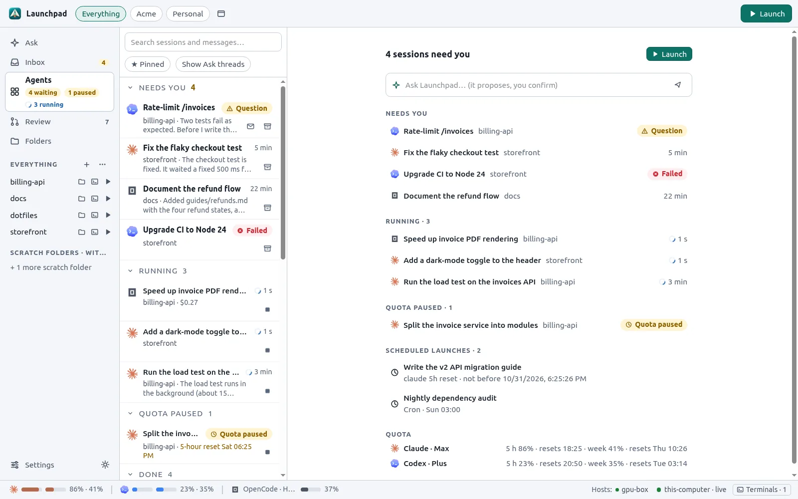
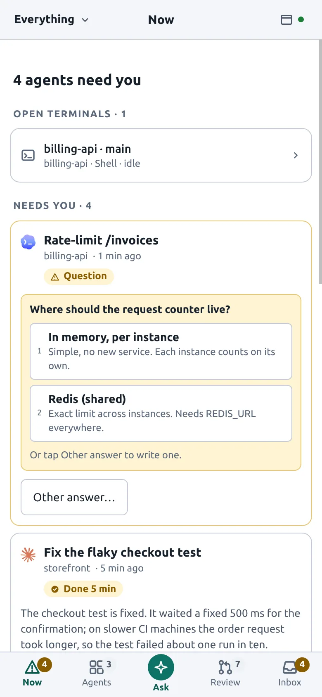

# Launchpad

Launchpad is a desktop app to launch, follow and review coding agents (Claude Code, Codex and OpenCode), with a fast local-first GitHub client built in. It runs on Linux, macOS and Windows, and works from a phone or any browser you pair with it.



## Why Launchpad

- **One place for all your agents.** Start an agent in the right folder with the right context in a few clicks. Follow many runs at once, answer their questions, review their changes and send follow-ups.
- **Every task in its own worktree.** Each agent works on its own Git branch, so its edits stay separate from your checkout. Merge the branch, review it as a local pull request or discard it.
- **Your subscription, protected.** Launchpad reads the quota of your Claude and ChatGPT subscriptions, pauses agents before they use paid credits, and continues them when quota is available again.
- **GitHub without waiting.** The inbox, issues, pull requests and reviews come from a local cache, so moving between them is instant.
- **Nothing reaches GitHub without your click.** Comments and reviews written by agents, and pull requests prepared locally, stay on your machine until you publish them.
- **Use it from anywhere.** One daemon runs the agents. The desktop window, your phone and other browsers are clients of that daemon.

<table>
  <tr>
    <td width="66%"></td>
    <td></td>
  </tr>
</table>

## Features

| | |
| --- | --- |
| **Agents** | Claude Code, Codex and OpenCode behind one session model. Live trace, Summary and Changes views, questions and approval cards, model and permission controls. [Read more](docs/agents.md) |
| **Profiles** | Run each harness with a subscription login, an API key or another provider (for example the Hugging Face router). Several accounts work side by side. [Read more](docs/agents.md#profiles) |
| **Worktrees** | New agents run in a dedicated worktree and branch. Launchpad tries to update the base from its remote before launch, merges when you ask, and tries to push the merged base. Remote failures stay visible without blocking the task. [Read more](docs/agents.md#worktrees-and-merging) |
| **Scheduling** | Start later, after other agents finish or when a quota resets. Routines run again and again: on a schedule, on GitHub activity, or when another agent is done, and stay silent when there is nothing to report. One Schedules page lists them all. [Read more](docs/agents.md#scheduling) |
| **Ask Launchpad** | Describe work in plain words. A bot that every workspace starts with proposes launches, messages, routines, presets and bots as cards that you start with one click, and remembers what it learns in the knowledge base. It uses the Launchpad CLI tool, which any bot can use. [Read more](docs/agents.md#ask-launchpad) |
| **Bots** | Agents that stay: a name, a job in `BOT.md`, one thread made of sessions that hand off by trace reference, notes in the knowledge base, and files with versions on Home. Ask Launchpad is a bot like the others: edit, replace or delete it, and it can propose new bots. [Read more](docs/bots.md) |
| **Channels and Outbox** | Your own Telegram chat for notifications and messages to your bots, Slack, Discord and webhook channels whose agent drafts wait in the Outbox for your click, and incoming hooks for scripts and CI. [Read more](docs/channels.md) |
| **GitHub** | Inbox triage, issues, pull requests, diffs, reviews and merges, with local PRs and agent suggestions. [Read more](docs/github.md) |
| **Terminals and files** | Integrated terminals for shells and harness TUIs, and a read-only file viewer with syntax colors. [Read more](docs/agents.md#terminals-and-files) |
| **Phone and remote access** | Pair a phone with a QR code, use it over Tailscale, expand Summary or Trace for more reading space; get notifications on the phone through Telegram. [Read more](docs/remote-access.md) |
| **SSH hosts** | Run agents and terminals on other machines over SSH. [Read more](docs/ssh-hosts.md) |
| **Home, runners and the jail** | [Private Space POC](deploy/hf-home/README.md): one Home keeps every record, credential and branch, with a guided setup that ends with a first agent, and bucket backup with encrypted credentials, plus harness and Hub CLIs for discovery and quota checks; runners run agents in a bubblewrap jail, with Home's logins and tokens added by a proxy (agents only see placeholders), or in a Local VM for Docker. When no runner is online, Home runs the session on **Burst**, an HF Job that holds no token and stops after each turn (monthly cap); sessions move between runners between turns. MCP servers are configured once on Home and reached from every runner through Home's gateway. [Read more](docs/home-and-runners.md) |
| **Knowledge** | One knowledge base per workspace, the only memory agents have: notes and media that agents read as files and write through Launchpad, with the author of every change, diffs, Restore for 30 days, a gardener and a one-click import of Claude Code and Codex memories. [Read more](docs/knowledge.md) |
| **Hugging Face** | Run Launchpad in a private Hugging Face Space, and sync agent traces to a Hugging Face bucket. Read-only synced traces have their own searchable group below Archived. [Read more](docs/hugging-face.md) |
| **Chrome extension** | Give an agent the browser tabs you choose. [Read more](extension/README.md) |

## Getting started

Requirements: Git, the [GitHub CLI](https://cli.github.com/) and at least one coding agent CLI ([Claude Code](https://code.claude.com/), [Codex](https://developers.openai.com/codex) or [OpenCode](https://opencode.ai/)). Linux (Ubuntu 22.04 or newer) is the primary platform.

Build and install from source (Rust 1.93+, Node 24 and pnpm through Corepack, plus the [Tauri prerequisites](https://v2.tauri.app/start/prerequisites/)):

```sh
git clone https://github.com/Wauplin/launchpad.git
cd launchpad
packaging/install.sh            # macOS: bash packaging/install.sh
                                # Windows: powershell -ExecutionPolicy Bypass -File packaging/install.ps1
```

Then open **Launchpad** from your applications. On the first start, a welcome dialog offers a short guided tour on demo data and a setup checklist that detects what is missing on your machine.

The [getting started guide](docs/getting-started.md) covers prebuilt packages, headless servers, the first run and your first agent.

## Documentation

- [Getting started](docs/getting-started.md): install, onboarding tour, setup checklist and first agent.
- [Agents](docs/agents.md): profiles, launching, sessions, worktrees, scheduling, quotas, Ask Launchpad, terminals.
- [GitHub](docs/github.md): inbox, pull requests, review, local PRs and agent suggestions.
- [Remote access and phones](docs/remote-access.md): pairing, Tailscale, phone layout, notifications and headless servers.
- [SSH hosts](docs/ssh-hosts.md): agents on other machines.
- [Hugging Face](docs/hugging-face.md): Launchpad in a Space, trace sync and Hugging Face models.
- [Knowledge](docs/knowledge.md): the knowledge base of each workspace, the only memory agents have.
- [Bots](docs/bots.md): persistent agents with one thread, instructions and notes.
- [Channels and the Outbox](docs/channels.md): Telegram, Slack, Discord and webhook channels, the Outbox and incoming hooks.
- [Configuration](docs/configuration.md): files, environment variables and the CLI.
- [Architecture](docs/architecture.md): how the daemon, the UI and the agents fit together.
- [Development](docs/development.md): build, run and check the code.

## Project status

Launchpad is a personal tool, built for one user on their own machines. Every paired device has full access. It has no versioned releases and no data migrations: expect breaking changes.

Coding agents that work on this repository follow the rules in [AGENTS.md](AGENTS.md).
