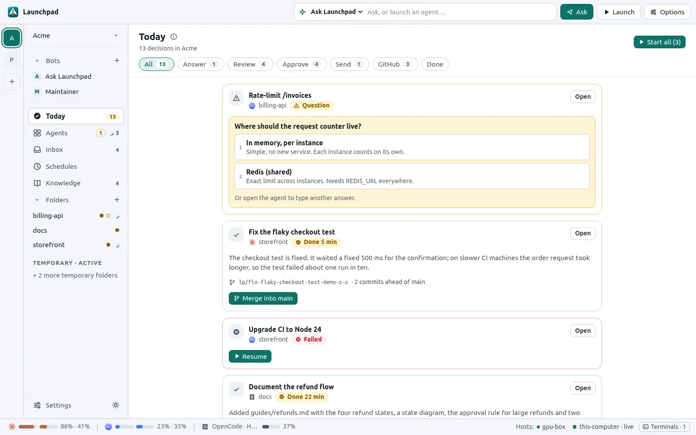
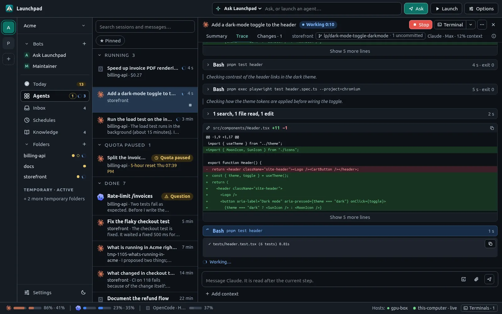
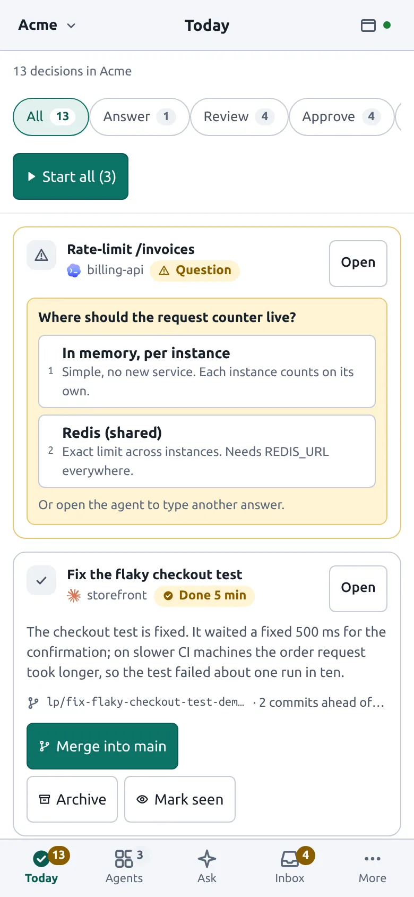

# Launchpad

Launchpad is a web app to launch, follow and review coding agents (Claude Code, Codex and OpenCode), alongside GitHub: github.com keeps your notifications, issues and pull requests, and the Chrome extension brings your agents there. One **Home** keeps your records, credentials and branches. Agents run on **runners**: your Linux machines, a Local VM, or Burst jobs on Hugging Face. Use it from any browser or phone you pair with Home, and install it as an app (PWA).



## Try it yourself

Deploy your own Launchpad Home as a private Hugging Face Space with one command. You need the [hf CLI](https://huggingface.co/docs/huggingface_hub/guides/cli), signed in with `hf auth login`:

```sh
curl -fsSL https://raw.githubusercontent.com/Wauplin/launchpad/main/deploy/hf-home/deploy.sh | bash
```

The script checks your tools and sign-in, creates a private backup bucket and a private Docker Space (`<your user>/launchpad-home`), deploys the latest release, waits for the build and checks that Home answers. Then open the Space URL it prints and follow the setup page. Run the same command again to update to the newest release. Add `bash -s -- --main` to deploy the latest `main` instead (CI's package of the newest built commit), and `--help` for the other options. See [deploy/hf-home/README.md](deploy/hf-home/README.md).

## Why Launchpad

- **One place for all your agents.** Start an agent in the right folder with the right context in a few clicks. Follow many runs at once, answer their questions, review their changes and send follow-ups. An agent that must wait (for CI, a deploy, a time) sleeps and Launchpad wakes it later in the same conversation.
- **One list of decisions.** Today shows what waits for you: questions, finished agents, proposals, drafts to send and GitHub suggestions. Each row has one button, for example Answer, Merge, Review or Start, and the other actions in ⋯.
- **Every task in its own worktree.** Each agent works on its own Git branch, so its edits stay separate from your checkout. Merge the branch, review it as a local pull request or discard it.
- **Your subscription, protected.** Launchpad reads the quota of your Claude and ChatGPT subscriptions, pauses agents before they use paid credits, and continues them when quota is available again. Work that starts without you (routines, hooks, auto-mode cards) waits until a fresh reading confirms quota.
- **Review from any device.** Review Local PRs and an agent’s suggested review from the laptop or phone, then post it with one click.
- **Nothing reaches GitHub without your click.** Comments and reviews written by agents, and pull requests prepared locally, stay on Home until you publish them.
- **One workspace at a time.** Group folders into workspaces such as "Work" and "Personal". A window shows one workspace; the others show only how many items wait in them.
- **Use it from anywhere.** Home keeps everything, so your laptop can sleep: Home moves a session to another runner, or to Burst, when you send it a message. Your browsers and phone are clients of Home.

<table>
  <tr>
    <td width="66%"></td>
    <td></td>
  </tr>
</table>

## Features

| | |
| --- | --- |
| **Today** | Every decision of the workspace in one list, with filters and a 30-day Done history. The sidebar, the workspace menu and the phone count only this list. [Read more](docs/today.md) |
| **Agents** | Claude Code, Codex and OpenCode behind one session model. Live trace, Summary and Changes views, questions and approval cards, model and permission controls. Temporary folders for work that needs no folder, saved on Home and deleted 30 days after Archive unless you keep them. [Read more](docs/agents.md) |
| **Profiles** | Run each harness with a subscription login, an API key or another provider (for example the Hugging Face router). A provider profile offers only its own models. Several accounts work side by side. [Read more](docs/agents.md#profiles) |
| **Worktrees** | Each agent runs in its own worktree and branch. Launchpad tries to update the base from its remote before launch, merges when you ask, and tries to push the merged base. Remote failures stay visible without blocking the task. A slow merge on Home shows as waiting, never as failed, and an outcome Home lost is shown as uncertain, never retried. [Read more](docs/agents.md#worktrees-and-merging) |
| **Scheduling** | Start later, after other agents finish or when a quota resets. Routines run again and again: on a schedule, when another agent is done, or on a new channel message, and stay silent when there is nothing to report. A loop guard and an hourly limit stop routines that feed each other. One Schedules page lists them all. [Read more](docs/agents.md#scheduling) |
| **Folios** | Reports, plans, audits and sketchbooks that agents write as Markdown with typed blocks (roadmaps, findings, decisions, checklists, charts, Mermaid diagrams and sandboxed UI sketches) instead of static websites. Launchpad renders them with one design on the laptop and the phone, checks every write, keeps every rev with diff and Restore, and lets you comment, set verdicts, pick options and tick items on the page; **Send feedback** gives your marks to the agent in one message. Folios are context for launches and questions, archive themselves after 30 quiet days, and can be shared as a private snapshot Space that expires after 30 days. [Read more](docs/folios.md) |
| **Oracles** | Small Python checks that answer True, False or Failed (“is CI red on main?”), run on Home in the Monty sandbox, without a model. A routine gated on an oracle starts its bot only when the answer calls for it and otherwise records a quiet check, with no session and no quota. Oracles reach the outside only through four read-only tools (http, github, huggingface, launchpad) that Home checks and logs, and Home pre-checks every file with Ruff before it is saved or run. A failing or broken oracle has one Today row until it is fixed. Agents run oracles with `launchpad oracle run`, test drafts on Home with `launchpad oracle test` and propose new ones as cards. [Read more](docs/oracles.md) |
| **Ask Launchpad** | Describe work in plain words in the top-bar field, with the page you look at as context, and the answer opens in a side panel. A bot that every workspace starts with proposes launches, messages, routines, presets and bots as cards, prepares merges, posts and sends as ready clicks, changes folder and shared settings directly, diagnoses Launchpad's own failures (logs of Home and runners, Burst jobs, health) and can be told about them by a routine, and remembers what it learns in its own memory. It uses the Launchpad CLI tool, which any bot can use. [Read more](docs/agents.md#ask-launchpad) |
| **Bots** | Agents that stay: a name, a job in `BOT.md`, parallel threads (one per GitHub item, channel, hook, agent or Telegram chat, one per routine run, and the ones you start from the bot's tile; at most `max_threads` at work), each one session (a thread whose session cannot go on continues in a new thread by trace reference) and shown as a chat of messages, not traces (per turn the answer, one quiet steps line with a receipt per change, and its cards as one line each, with Details for the full card), one message box that also answers its questions, a header with the chat's automatic title, its bots in the order they joined and a status line in words, a settings page per bot with `BOT.md`, its triggers (routines, hooks, Telegram) and one Pause all, its profile and model, its access, its memory and its versions, quick-chip starters from `bot.toml` and the messages that wait for their thread's turn or a free slot, a memory of its own (notes it writes with `launchpad bot memory`, up to 100 lines loaded at start), a `BOT.md` edit that reaches each thread with its next message, a new thread when the model, effort or permission mode changes (the chat says why), messages from other bots and agents that arrive under a header naming their sender and show as such in the chat, conversations of several bots (a bot that messages another from a thread brings it into that conversation, each bot in its own thread, its final answer going back to the asker; one merged timeline where your leading @-mentions pick the bots, one row in the Chats list and one card in Today), messages sent once even after a double tap or a lost response, **What it sees at start** to read a new session's instructions and first prompt, routines as files (`routines/<name>.toml`, edited on the page or as a file), and files with versions on Home. The bot proposes changes to its `BOT.md` and routines in one card, one diff per file. Agents a bot started on its own archive themselves once they finished cleanly with nothing left for you (failures, questions and pending merges, Local PRs or Suggestions stay). A Git folder is optional: a bot without one starts each session in a temporary folder and adds worktrees of the folders it needs. Ask Launchpad is a bot like the others: edit, replace or delete it, and it can propose new bots. So is the Librarian, which tends the knowledge base. [Read more](docs/bots.md) |
| **Bot channels and DMs** | Bots of a workspace talk to each other in named channels and in DMs, with you in every one: a message wakes the bots it mentions and the members that follow every message, waits while a bot works, arrives framed as another agent's words, and stops at a loop guard (3 hops, 30 bot messages an hour) that your own messages reset. You read and post in them from the Bots area and the phone's Chats, with an amber count and a Today row (Reply in place) only when a bot mentions or asks you. A bot in mode digest gets one daily summary at 08:00 instead of every message. Bots send and forward files there (`--attach`, `--forward`): the receiving bot gets local copies, and you see and download them on the channel page. You create channels and pick each member's mode; a bot proposes a channel or asks to join one with a card you accept. [Read more](docs/channels.md) |
| **Slack** | Named Slack profiles (“Read as me”, “Post as Release bot”), each a user or bot token kept on Home with a description agents read. Agents run `launchpad slack --profile <handle> …`, the commands of [slackline](https://github.com/co42/slackline); Home runs them with the token, so agents and runners never hold one. Profiles are off unless you make one on by default or switch it on for a bot or a launch; messages can end with Launchpad's attribution line. [Read more](docs/slack.md) |
| **Connections and Outbox** | A Telegram chat per workspace for notifications and messages to its bots, Slack, Discord and webhook connections whose agent drafts wait in Today for your click, and incoming hooks for scripts and CI, with a loop guard for bots that call them. [Read more](docs/connections.md) |
| **GitHub** | Local PRs, agent comments and reviews as suggestions you post with one click (with the actions the agent recommends: close with a reason, reopen, request reviewers, ready for review or draft, update branch), agents that may approve a fork's waiting CI runs after Home's checks, private notes about an issue or pull request, agents that continue a pull request, and GitHub items as context for agents. Links to issues and pull requests open github.com. Everything agents publish ends with “Written by” and the harness or bot’s name, followed by a Launchpad link. [Read more](docs/github.md) |
| **Links and references** | Every agent, chat, channel and DM, each of their messages, folio sections and the other objects have a link and a short ID (`lp:chat/…`). Copy a message's link, paste it into any message box, and the receiving agent reads exactly that message with a few around it (`launchpad ref read`), within its own workspace. **Go to** (Ctrl+K) opens a link or ID at the exact message, loading older messages as needed. [Read more](docs/links.md) |
| **Topics** | Collect related sessions across folders in a workspace. Assign topics individually or in bulk, then filter related work. Attach a topic’s history to the next agent, or launch a summary with source links. An agent launched with other agents’ traces joins their topics, or gets a new, automatically named topic together with them. Archived sessions stay in their topics. [Read more](docs/agents.md#topics) |
| **Files and terminals** | A read-only file viewer with syntax colors, for folders, worktrees and branches, also while the runner is away. Shells and the harness's own TUI open from Home's window and run on the agent's runner, relayed through its link. [Read more](docs/agents.md#terminals-and-files) |
| **Desktop companion** | A small Linux app for Ubuntu 26.04 GNOME: a Spotlight on Ctrl+Alt+Space to ask a bot and read its answer, go to any agent, chat, folio or link, or quick launch an agent; a top-bar icon with the count of what waits for you, a menu of questions, running agents and busy bots that open in your browser, desktop notifications, a dock badge and start at login. It links to a Space with Sign in with Hugging Face, or to a self-hosted Home with a pairing code, and keeps its secret in the keyring. Each release has a `.deb` package; the menu offers new versions and installs them on your click, after checking their checksums. [Read more](docs/desktop.md) |
| **Phone and remote access** | Pair a phone with a QR code, use it over Tailscale, expand Summary or Trace for more reading space; get notifications on the phone through each workspace's Telegram chat. [Read more](docs/remote-access.md) |
| **Home, runners and the jail** | One Home keeps every record, credential and branch (in a private Space, see [deploy/hf-home](deploy/hf-home/README.md), or self-hosted), with a guided setup and backups with encrypted credentials. Home runs no agents. Linux runners run agents in a bubblewrap jail, with Home's logins and tokens added by a proxy (agents only see placeholders), or in a Local VM for Docker. The runner never follows a link that an agent plants in its folders. A network capture below the HTTP libraries sends every connection of every tool through that proxy, so a tool works the same in the jail, a Local VM and Burst (**Check network** verifies a runner). Runners are low-trust workers: Home checks what they and their agents send, and each workspace is a boundary for agents. Only you grant permissions: agents never answer an approval and never loosen a permission mode or raise a bot's access. When no runner is online, Home runs the session on **Burst**, an HF Job that holds no token and stops after each turn (monthly cap). A session continues on its own runner, else on another runner, else on Burst; every turn is saved on Home, and a runner never pushes over a branch you restored there. MCP servers are configured once on Home and reached from every runner through Home's gateway. Ready-made tools: GitHub CLI and Hugging Face CLI. [Read more](docs/home-and-runners.md) |
| **Exit routes** | Reach a GitHub organization behind an IP allow list, or a service on your tailnet, from Home, Burst and every runner: an exit route sends the organization's or the URLs' traffic out through the one runner that can reach them. Tokens never reach that runner. While it is offline, those requests fail at once with a clear message, and everything else keeps working. Clone from GitHub offers the route when GitHub refuses Home's address. [Read more](docs/exit-routes.md) |
| **Knowledge** | One knowledge base per workspace, the memory agents share: notes and media that agents read as files and write through Launchpad, with the author of every change, diffs, Restore for 30 days, a read-only list of each bot's memory, the Librarian (a bot every workspace starts with, which tidies the notes and keeps your preferences about them) and a one-click import of Claude Code and Codex memories from a runner. [Read more](docs/knowledge.md) |
| **Hugging Face** | Run Home in a private Hugging Face Space. Home copies the original conversation of every agent to its bucket, one file per trace, readable in the bucket's trace viewer. [Read more](docs/hugging-face.md) |
| **Chrome extension** | Launchpad inside github.com and a chat about any page, connected to your Home with Sign in with Hugging Face. On GitHub it shows your agents, suggestions and Local PRs where you look at a repository, issue or pull request, asks a bot about a comment or about selected diff lines, and puts an agent's reply, review summary or line comments into GitHub's own fields when you click **Insert**: you post with GitHub's button. Private notes from your agents, and your own notes to them, show inside the item's GitHub timeline but never leave Launchpad; a suggested comment there has one button that names what it does (**Post this comment**, **Comment and close**, **Comment and request reviews**…), which Launchpad runs after your confirmation, with the agent's actions ticked under it. Suggested reviews offer **Post review**, **Post review and merge** or **Post review and run CI**, according to the agent’s suggestion. It also pushes an agent's commits to a pull request after your confirmation. [Read more](extension/README.md) |

## Getting started

The easiest Home is a private Hugging Face Space (see [Try it yourself](#try-it-yourself)). Its setup page leads you from an empty Home to a first agent.

To host Home yourself on a Linux machine, build and install it from source (Rust 1.98+, Node 24 and pnpm through Corepack):

```sh
git clone https://github.com/Wauplin/launchpad.git
cd launchpad
packaging/install.sh
```

This installs Home as a systemd user service (`launchpad daemon`). Home runs no agents: add a runner (a Linux machine), or turn on Burst on a Home in a Space. Open Home in a browser with `launchpad url`, then follow **Finish setup**.

The [getting started guide](docs/getting-started.md) covers runners, prebuilt packages, headless servers, the first run and your first agent.

## Documentation

- [Getting started](docs/getting-started.md): install Home, add a runner, onboarding tour, setup and first agent.
- [Today](docs/today.md): every decision that waits for you, one row each.
- [Agents](docs/agents.md): profiles, launching, sessions, worktrees, scheduling, quotas, Ask Launchpad and files.
- [Home and runners](docs/home-and-runners.md): where agents run, how sessions move and how work is saved on Home.
- [GitHub](docs/github.md): GitHub items as context, agent suggestions, private notes, local PRs and the extension.
- [Remote access and phones](docs/remote-access.md): pairing, Tailscale, phone layout, notifications and a self-hosted Home.
- [Desktop companion](docs/desktop.md): the Linux Spotlight, top-bar menu, notifications, install and updates.
- [Hugging Face](docs/hugging-face.md): Home in a Space, trace copies and Hugging Face models.
- [Exit routes](docs/exit-routes.md): reach a GitHub organization behind an IP allow list, or a tailnet service, through one runner.
- [Links and references](docs/links.md): copy links to agents, chats, channels and their messages, paste them as context, and Go to.
- [Knowledge](docs/knowledge.md): the knowledge base of each workspace, the memory agents share.
- [Bots](docs/bots.md): persistent agents with parallel threads, instructions and their own memory.
- [Oracles](docs/oracles.md): deterministic checks that answer True, False or Failed, and gate routines.
- [Bot channels and DMs](docs/channels.md): bots that talk to each other, with you in every conversation.
- [Slack](docs/slack.md): Slack profiles and `launchpad slack`.
- [Connections and the Outbox](docs/connections.md): Telegram, Slack, Discord and webhook connections, the Outbox and incoming hooks.
- [Configuration](docs/configuration.md): files, environment variables and the CLI.
- [Architecture](docs/architecture.md): how Home, runners, the UI and the agents fit together.
- [Development](docs/development.md): build, run and check the code.

## Project status

Launchpad is a personal tool, built for one user. Home may run anywhere; agents run only on Linux. Every paired device has full access. Releases are dated snapshots (`vYYYY.MM.DD.N`), not stable versions, and there are no data migrations: expect breaking changes.

Coding agents that work on this repository follow the rules in [AGENTS.md](AGENTS.md).

Sessions linked to a GitHub item automatically join a workspace topic named `repository#number` (for example, `huggingface_hub#5352`). Agents can link their own session with `launchpad link --repo owner/repo --number 5352 --session-id <id>` and optionally `--comment-url <url>`. Creating a suggested comment or review also links its session. Repository references without an item number do not create topics. Agents cannot rename or delete topics or link other sessions.

A Local PR body can name issues in its folder’s repository with `Fixes #5352`, `Closes #5352`, or `Resolves #5352`. These references link its session to each issue and show the Local PR beside the session trace and suggestions in the Chrome extension’s box on that issue. Set or edit the body with `launchpad pr create|update --body-file <file>`. Removing a closing reference removes the Local PR from that issue’s box; the session’s historical link remains.
