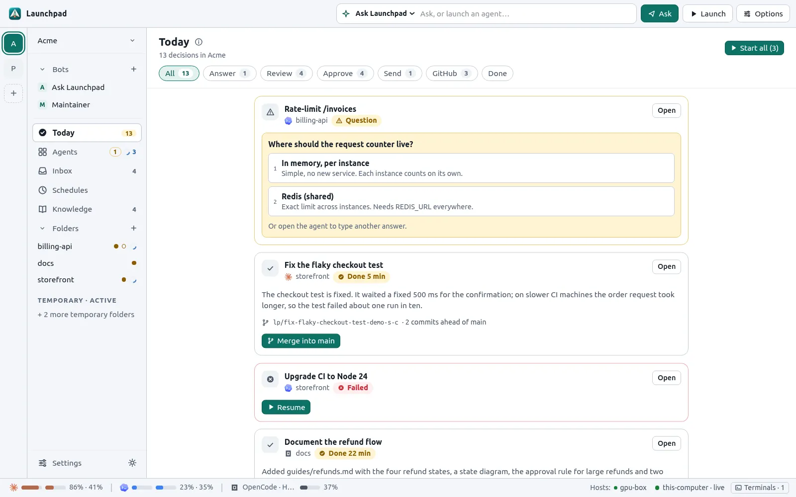
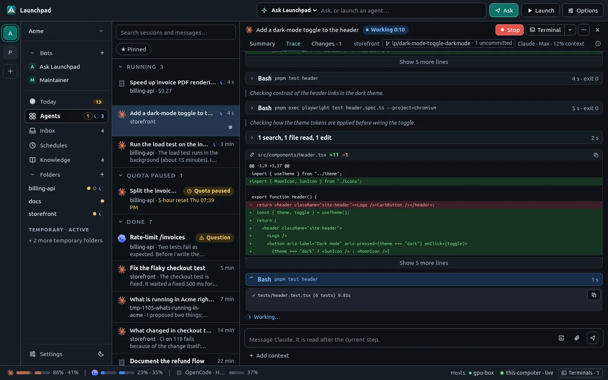
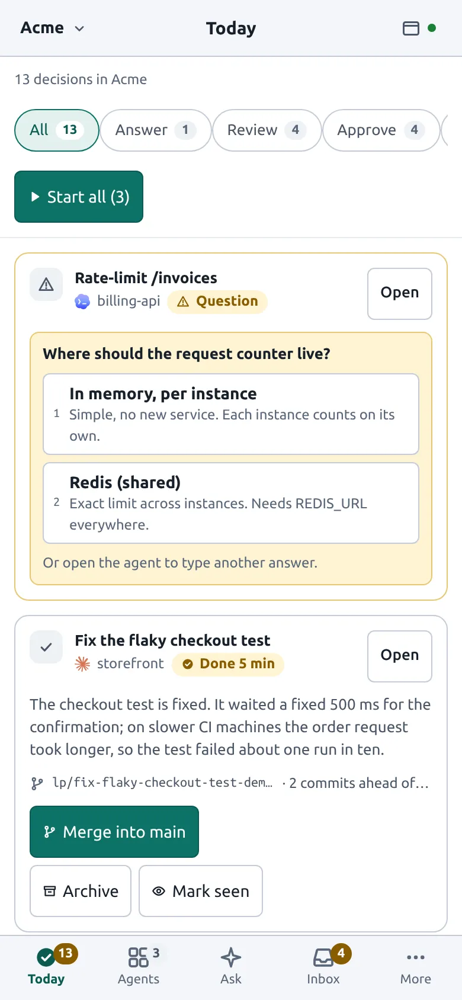

# Launchpad

Launchpad is a web app to launch, follow and review coding agents (Claude Code, Codex and OpenCode), with a fast GitHub client built in. One **Home** keeps your records, credentials and branches. Agents run on **runners**: your Linux machines, a Local VM, or Burst jobs on Hugging Face. Use it from any browser or phone you pair with Home, and install it as an app (PWA).



## Try it yourself

Deploy your own Launchpad Home as a private Hugging Face Space with one command. You need the [hf CLI](https://huggingface.co/docs/huggingface_hub/guides/cli), signed in with `hf auth login`:

```sh
curl -fsSL https://raw.githubusercontent.com/Wauplin/launchpad/main/deploy/hf-home/deploy.sh | bash
```

The script checks your tools and sign-in, creates a private backup bucket and a private Docker Space (`<your user>/launchpad-home`), deploys the latest release, waits for the build and checks that Home answers. Then open the Space URL it prints and follow the setup page. Run the same command again to update to the newest release. Add `bash -s -- --main` to deploy the latest `main` instead (CI's package of the newest built commit), and `--help` for the other options. See [deploy/hf-home/README.md](deploy/hf-home/README.md).

## Why Launchpad

- **One place for all your agents.** Start an agent in the right folder with the right context in a few clicks. Follow many runs at once, answer their questions, review their changes and send follow-ups.
- **One list of decisions.** Today shows what waits for you: questions, finished agents, proposals, drafts to send, GitHub suggestions and review requests. Each row has one button, for example Answer, Merge, Review or Start, and the other actions in ⋯.
- **Every task in its own worktree.** Each agent works on its own Git branch, so its edits stay separate from your checkout. Merge the branch, review it as a local pull request or discard it.
- **Your subscription, protected.** Launchpad reads the quota of your Claude and ChatGPT subscriptions, pauses agents before they use paid credits, and continues them when quota is available again.
- **GitHub without waiting.** The inbox, issues, pull requests and reviews come from a local cache, so moving between them is instant.
- **One review across devices.** Write the summary and line comments in one PR review panel, use an agent’s suggested review, and finish from the laptop or phone.
- **Nothing reaches GitHub without your click.** Comments and reviews written by agents, and pull requests prepared locally, stay on Home until you publish them.
- **One workspace at a time.** Group folders into workspaces such as "Work" and "Personal". A window shows one workspace; the others show only how many items wait in them.
- **Use it from anywhere.** Home keeps everything, so your laptop can sleep: Home moves a session to another runner, or to Burst, when you send it a message. Your browsers and phone are clients of Home.

<table>
  <tr>
    <td width="66%"></td>
    <td></td>
  </tr>
</table>

## Features

| | |
| --- | --- |
| **Today** | Every decision of the workspace in one list, with filters and a 30-day Done history. The sidebar, the workspace rail and the phone count only this list. [Read more](docs/today.md) |
| **Agents** | Claude Code, Codex and OpenCode behind one session model. Live trace, Summary and Changes views, questions and approval cards, model and permission controls. Temporary folders for work that needs no folder, saved on Home and deleted 30 days after Archive unless you keep them. [Read more](docs/agents.md) |
| **Profiles** | Run each harness with a subscription login, an API key or another provider (for example the Hugging Face router). Several accounts work side by side. [Read more](docs/agents.md#profiles) |
| **Worktrees** | Each agent runs in its own worktree and branch. Launchpad tries to update the base from its remote before launch, merges when you ask, and tries to push the merged base. Remote failures stay visible without blocking the task. A slow merge on Home shows as waiting, never as failed, and an outcome Home lost is shown as uncertain, never retried. [Read more](docs/agents.md#worktrees-and-merging) |
| **Scheduling** | Start later, after other agents finish or when a quota resets. Routines run again and again: on a schedule, on GitHub activity, or when another agent is done, and stay silent when there is nothing to report. A loop guard and an hourly limit stop routines that feed each other. One Schedules page lists them all. [Read more](docs/agents.md#scheduling) |
| **Ask Launchpad** | Describe work in plain words in the top-bar field, with the page you look at as context, and the answer opens in a side panel. A bot that every workspace starts with proposes launches, messages, routines, presets and bots as cards, prepares merges, posts and sends as ready clicks, changes folder and shared settings directly, diagnoses Launchpad's own failures (logs of Home and runners, Burst jobs, health) and can be told about them by a routine, and remembers what it learns in its own memory. It uses the Launchpad CLI tool, which any bot can use. [Read more](docs/agents.md#ask-launchpad) |
| **Bots** | Agents that stay: a name, a job in `BOT.md`, one thread made of sessions that hand off by trace reference, shown as one chat of messages, not traces (per turn the answer, one quiet steps line with a receipt per change, and its cards as one line each, with Details for the full card), one message box that also answers its questions, a status line in words, an **About** drawer (a page on the phone) with `BOT.md`, its triggers (routines, hooks, Telegram) and one Pause all, its memory, its access and its versions, quick-chip starters from `bot.toml` and the Telegram and hook messages that wait for its turn, a memory of its own (notes it writes with `launchpad bot memory`, up to 100 lines loaded at start), a `BOT.md` edit that reaches the running thread with the next message, a new session when the model, effort or permission mode changes (the chat says why), messages from other bots and agents that arrive under a header naming their sender and show as such in the chat, **What it sees at start** to read a new session's instructions and first prompt, routines as files (`routines/<name>.toml`, edited on the page or as a file), and files with versions on Home. The bot proposes changes to its `BOT.md` and routines in one card, one diff per file. A folder is optional: a bot without one starts each session in a temporary folder and adds worktrees of the folders it needs. Ask Launchpad is a bot like the others: edit, replace or delete it, and it can propose new bots. So is the Librarian, which tends the knowledge base. [Read more](docs/bots.md) |
| **Channels and Outbox** | A Telegram chat per workspace for notifications and messages to its bots, Slack, Discord and webhook channels whose agent drafts wait in Today for your click, and incoming hooks for scripts and CI. [Read more](docs/channels.md) |
| **GitHub** | Inbox triage, issues, pull requests, diffs, reviews and merges, with local PRs and agent suggestions. Everything agents publish ends with an attribution line naming the harness or bot. [Read more](docs/github.md) |
| **Files and terminals** | A read-only file viewer with syntax colors, for folders, worktrees and branches, also while the runner is away. Shells and the harness's own TUI open from Home's window and run on the agent's runner, relayed through its link. [Read more](docs/agents.md#terminals-and-files) |
| **Phone and remote access** | Pair a phone with a QR code, use it over Tailscale, expand Summary or Trace for more reading space; get notifications on the phone through each workspace's Telegram chat. [Read more](docs/remote-access.md) |
| **Home, runners and the jail** | One Home keeps every record, credential and branch (in a private Space, see [deploy/hf-home](deploy/hf-home/README.md), or self-hosted), with a guided setup and backups with encrypted credentials. Home runs no agents. Linux runners run agents in a bubblewrap jail, with Home's logins and tokens added by a proxy (agents only see placeholders), or in a Local VM for Docker. A network capture below the HTTP libraries sends every connection of every tool through that proxy, so a tool works the same in the jail, a Local VM and Burst (**Check network** verifies a runner). Runners are low-trust workers: Home checks what they and their agents send, and each workspace is a boundary for agents. When no runner is online, Home runs the session on **Burst**, an HF Job that holds no token and stops after each turn (monthly cap). A session continues on its own runner, else on another runner, else on Burst; every turn is saved on Home, and a runner never pushes over a branch you restored there. MCP servers are configured once on Home and reached from every runner through Home's gateway. Ready-made tools: GitHub CLI, Hugging Face CLI and Slack ([slackline](https://github.com/co42/slackline), read-only or write). [Read more](docs/home-and-runners.md) |
| **Knowledge** | One knowledge base per workspace, the memory agents share: notes and media that agents read as files and write through Launchpad, with the author of every change, diffs, Restore for 30 days, a read-only list of each bot's memory, the Librarian (a bot every workspace starts with, which tidies the notes and keeps your preferences about them) and a one-click import of Claude Code and Codex memories from a runner. [Read more](docs/knowledge.md) |
| **Hugging Face** | Run Home in a private Hugging Face Space. Home copies the original conversation of every agent to its bucket, one file per trace, readable in the bucket's trace viewer. [Read more](docs/hugging-face.md) |
| **Chrome extension** | Give an agent the browser tabs you choose. [Read more](extension/README.md) |

## Getting started

The easiest Home is a private Hugging Face Space (see [Try it yourself](#try-it-yourself)). Its setup page leads you from an empty Home to a first agent.

To host Home yourself on a Linux machine, build and install it from source (Rust 1.93+, Node 24 and pnpm through Corepack):

```sh
git clone https://github.com/Wauplin/launchpad.git
cd launchpad
packaging/install.sh
```

This installs Home as a systemd user service (`launchpad daemon`). Home runs no agents: add a runner (a Linux machine), or turn on Burst on a Home in a Space. Open Home in a browser with `launchpad url`, then follow **Finish setup**.

The [getting started guide](docs/getting-started.md) covers runners, prebuilt packages, headless servers, the first run and your first agent.

## Documentation

- [Getting started](docs/getting-started.md): install Home, add a runner, onboarding tour, setup and first agent.
- [Today](docs/today.md): every decision that waits for you, one row each.
- [Agents](docs/agents.md): profiles, launching, sessions, worktrees, scheduling, quotas, Ask Launchpad and files.
- [Home and runners](docs/home-and-runners.md): where agents run, how sessions move and how work is saved on Home.
- [GitHub](docs/github.md): inbox, pull requests, review, local PRs and agent suggestions.
- [Remote access and phones](docs/remote-access.md): pairing, Tailscale, phone layout, notifications and a self-hosted Home.
- [Hugging Face](docs/hugging-face.md): Home in a Space, trace copies and Hugging Face models.
- [Knowledge](docs/knowledge.md): the knowledge base of each workspace, the memory agents share.
- [Bots](docs/bots.md): persistent agents with one thread, instructions and their own memory.
- [Channels and the Outbox](docs/channels.md): Telegram, Slack, Discord and webhook channels, the Outbox and incoming hooks.
- [Configuration](docs/configuration.md): files, environment variables and the CLI.
- [Architecture](docs/architecture.md): how Home, runners, the UI and the agents fit together.
- [Development](docs/development.md): build, run and check the code.

## Project status

Launchpad is a personal tool, built for one user. Home may run anywhere; agents run only on Linux. Every paired device has full access. Releases are dated snapshots (`vYYYY.MM.DD.N`), not stable versions, and there are no data migrations: expect breaking changes.

Coding agents that work on this repository follow the rules in [AGENTS.md](AGENTS.md).
