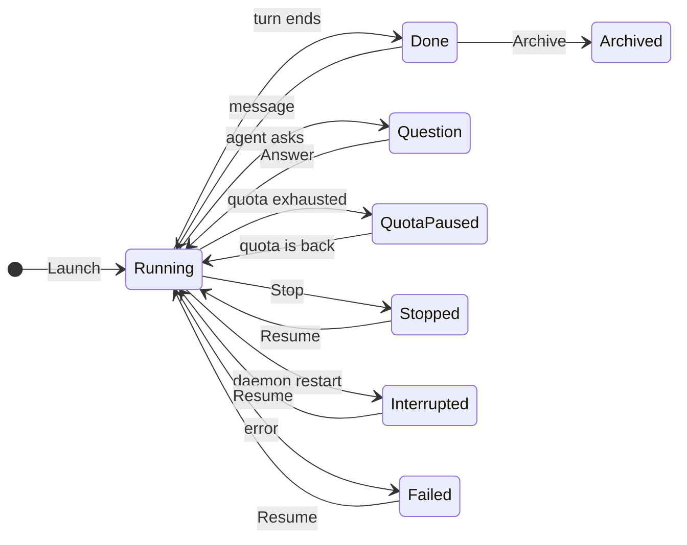
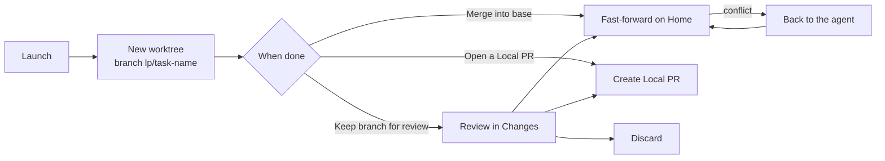

# Agents

An agent session is one conversation with a coding agent, in one folder. Launchpad starts it, streams its output, keeps its history in a local database and lets you answer, steer, resume or archive it.

## Harnesses

A harness is the coding agent CLI that does the work. Launchpad drives each one through its native structured protocol and renders the conversation itself.

| Harness | Protocol | Notes |
| --- | --- | --- |
| Claude Code | `claude -p` with stream-json, one process per session | Subscription quota monitoring, USD cost reporting, AI permission review |
| Codex | `codex app-server` (JSON-RPC), one shared process | Subscription quota monitoring, background commands with a **Processes** tab, AI approval reviewer |
| OpenCode | `opencode acp` (Agent Client Protocol) | Uses its own configuration and sign-in, USD cost reporting; no subscription quota monitoring |

Native resume, model discovery and skills come from each harness. **Continue in TUI** opens the harness's own terminal UI on the same conversation, in an integrated terminal. To add a harness, see [Harness adapters](harness-adapters.md).

## Profiles

A profile is one way to run an agent: a harness, what pays for the work, an optional environment and default model/effort. Launchpad ships no profiles; create them in **Settings → Profiles**.

| Billing | Examples | Protection |
| --- | --- | --- |
| Subscription | Claude Code with Claude Pro/Max, Codex with ChatGPT Plus/Pro | Quota monitor and quota protection |
| Pay as you go | Claude Code with an API key or the Hugging Face router, Codex with an OpenAI API key, OpenCode | Optional cost limit per session and rolling spending limits per profile |

- **Several accounts**: a profile that sets `CLAUDE_CONFIG_DIR` or `CODEX_HOME` uses another subscription login. Each login has its own quota meters.
- **Works on**: each profile shows whether the harness is installed and signed in on this computer, with **Install** and **Sign in** buttons that run the official command in a visible terminal.
- **Environment values** can use `~/`, `${NAME}` (a variable of your login shell) and `${LAUNCHPAD_MODEL}`. Sessions store only the profile ID, never the values.

Profiles live in `config.toml` (see [Configuration](configuration.md#profiles)).

## Launching an agent

The top bar has one field with two buttons:

- **Launch** starts an agent at once with the text, the page as context and the folder's defaults (on a folder page, that folder). If it cannot start within a few seconds, the composer opens instead. With an empty field or a kept draft, it opens the composer. Its **▾** menu has **Launch with options…**, which opens the full composer with the text.
- **Ask** sends the text to a bot of the workspace and opens its chat in the Ask panel (see [Ask Launchpad](#ask-launchpad)).

The page you look at is the context: a folder, a GitHub item, an agent's trace, a Local PR or a settings page. A chip in the field names it; **✕** removes it. The primary button follows the page: Launch on folder, agent and Local PR pages, Ask elsewhere (Launch when the workspace has no bot). **Enter** runs the primary button and **Shift+Enter** adds a line.

Folder pages, inbox rows and every **▶** button open the composer too. The composer opens as a side drawer:

- **Prompt.** Type `@` for files and folders, `/` for skills and `#` for folders, agent traces and GitHub items. Paste or drop images and files (up to eight files, 5 MB each).
- **Attach** and **+ Add context**, under the prompt. **+ Add context** attaches issues, pull requests, file selections, other folders and the trace of another agent; the chips show only when there are some. Traces are referenced by a `launchpad trace` command, not copied into the prompt.
- **Folder.** A folder of the workspace, or **Temporary folder** for a question or a task that needs no folder (see [Temporary folders](#temporary-folders)).
- **Options.** One line sums up the launch: where the agent runs and what happens when it is done (for example "New worktree from main · keep branch"), then the profile and only the values that differ from the defaults, and warnings. Click it to open the options: **Run in** (in a Git folder: **New worktree**, the default, **New Local PR** or an existing worktree or Local PR; see [Local PRs](github.md#local-prs)), **From** (the base branch), **When done** (see [Worktrees and merging](#worktrees-and-merging)), profile, model, effort, permission mode, paid usage, cost limit, presets and start conditions. When the prompt or the context names one pull request of the folder's repository (for example a pasted link to a review comment), **Push to PR #N** is checked under Run in: the worktree starts from the PR head and the agent pushes its commits to the PR branch (see [GitHub](github.md#continue-a-pull-request)).
- **Preview prompt** shows exactly what the agent will receive.

The draft is saved as you type. **Minimize** keeps it as a "draft" badge on the **Launch** button while you collect more context; its **▾** menu starts a new agent instead or discards the draft.

Session titles appear immediately from the prompt. Claude Code and Codex also generate a short AI title, then refresh it after each turn using the prompt and recent conversation. Naming uses Haiku for Claude Code and prefers Luna or Mini for Codex, with the lowest supported effort. Quota or spending limits can skip naming; a failed request keeps the existing title. OpenCode keeps the prompt-based title.

New launches ask the agent to end its first task with a short, self-contained summary. In an agent's message box, the **+** icon next to presets and attachments adds the same context to the next message. Follow-up messages are sent unchanged, except the first message after a Local PR is published, which tells the agent to push to the published branch from now on.

## Temporary folders

**Temporary folder** in the composer's folder menu starts the agent in a new, empty folder in Launchpad's data folder (`<data_dir>/tmp/`), outside your folders root. The agent is told that the folder is temporary, and how to list the workspace's folders and add a worktree of one with `launchpad work add-project`. The Folders page lists them.

Launchpad saves a temporary folder's files on Home at the end of every turn, except files listed in a `.gitignore` and nested Git repositories, so the session keeps its folder when it continues on another runner (for example a new Burst job). When you archive the last agent of a temporary folder, Launchpad removes it from the computer and from the folder lists; Home keeps its files 30 days, and **Resume** brings the folder back with them. After 30 days, Home deletes them and a resumed agent continues in an empty folder (the session says so). To keep the files for good, click **Keep as folder** in the session's Next steps (or on the Folders page) once the agent is done, and choose a name: the folder becomes a folder stored by Home under that name (a plain folder, or a Git folder when the agent created a Git repository in it), so agents run in it on any runner, and its sessions stay resumable. Files listed in a `.gitignore` are saved too from then on. To create a folder before launching, use **Add folder** instead.

## Following agents

**Agents** is a monitor of what runs and what ran. Its list groups sessions by state:

- **Running**: starting, working, or waiting on background commands.
- **Quota paused**: held until subscription quota is available again.
- **Done**, **Stopped**, **Interrupted**, **Failed**, **In terminal** and **Archived** for local sessions. Routines and scheduled launches are on the **Schedules** page.

A session **needs you** when it has an open question, or when it finished, failed or was interrupted and you have not seen it yet. Such sessions wait as cards in [Today](today.md) and stay bold in their group here. A session counts as seen after it was on screen for 1.5 seconds in a window you used recently. The sidebar shows only how many agents run or wait for quota.

Each session has three views:

- **Summary**: what the agent did first: the exact final message and the next steps (review changes, post suggestions, publish a Local PR), then the first prompt and the run facts.
- **Trace**: the full conversation with tool calls, diffs, reasoning and nested subagents.
- **Changes**: the Git diff of the session folder, with viewed markers and line notes that you send back to the agent as one message.

On a laptop, the session header has two rows:

- **First row**: the title, the status and one main action that depends on the state: **Merge into &lt;base&gt;** when the merge is safe (the same check as in [Today](today.md)), otherwise **Stop**, **Answer**, **Review changes**, **Archive**, **Resume** or **Re-attach**. Then **Terminal** and **⋯**.
- **Second row**: the view tabs, chips for run settings, paid usage and cost limit only when they differ from the defaults, and one muted line with the bot, the folder, the worktree, the Local PR, the profile and the context use. **ⓘ** shows the folder path, profile, model, usage and start time.

**⋯** holds the other actions, among them **New agent here** (a new draft in the same folder with this session's trace as context), **Jump to the final message** (in the trace), **Mark as unread**, **Use trace as context** and **Archive**. On a phone, **⋯** also has **Jump to the final message**, and **New agent here** is in the session details.

A state band above the trace shows only an open question or a turn you stopped.

### Questions and permissions

Agent questions appear as cards with one button per option. Permission modes:

- **YOLO** (default): the agent runs every tool without asking.
- **Ask for approval**: native permission rules; requested actions show approval cards.
- **Auto**: the harness's own AI reviewer approves or refuses (Claude auto mode, the Codex approvals reviewer).

Change the mode, model or effort of a running session in **Summary → Run**.

### Automatic retries

Sessions that fail because the model is at capacity or overloaded resume automatically after about five minutes, up to five times. Resume, a new message, Stop or Archive cancels the pending retry.

## Worktrees and merging

In a Git folder, each new agent gets its own worktree and branch, created by Launchpad before the agent starts. The launch returns as soon as the worktree exists locally; in the background, before the agent starts, Launchpad tries to fast-forward the base from its configured upstream (or the same branch on `origin`) and moves the new, untouched task branch to it. Dirty or busy base checkouts stay unchanged. Remote failures leave the local base usable and appear in the worktree card and session trace.

- Every agent in a Git folder works in a fresh worktree cloned from Home Git before it starts; your own checkouts are never used. Its branch (`lp/…`) goes back to Home at the end of every turn, and running worktrees are snapshotted to Home every five minutes.
- **When done** is remembered per folder: **Keep branch for review** (default), **Open a Local PR** or **Merge into &lt;base&gt;**. With **Open a Local PR**, the agent runs `launchpad work finish` when it is done: Launchpad opens a Local PR of its branch on Home, and the agent sets its title and description. You review and publish it.
- **Merge** asks you to confirm (on the laptop and on the phone) and names the branch and the base. It waits while another action of the worktree card runs. Merges wait until the agents are idle and the worktree is clean, push the branch to Home, then Home pushes the branch's commit to the base branch on the folder's remote and fast-forwards the base branch on Home. If the base branch moved, the agent rebases first. Launchpad never stashes, resets or force-pushes. When the remote refuses the push, nothing is merged: the worktree card and the session trace show the reason.
- A per-folder **Worktree setup** command prepares new worktrees (dependencies).
- Worktrees of archived agents are removed after a retention limit (`[worktrees] keep`), once Home has their branch; uncommitted files go to a `lp-scratch/…` branch first. **Resume** clones the folder again.
- Home keeps every previous tip of a Launchpad branch for 30 days: the folder page lists them under **Launchpad branches**, with **Restore**.

## Scheduling

**Launch ▾** offers **Start later…** and **Repeat on a schedule…**. The **Schedules** page (sidebar) lists everything that starts on its own: **Routines** and **Scheduled launches**.

- **Start conditions** (combine several; all must be met): after a delay, at a date and time, after other agents are Done (an agent waiting on a question is not Done), when a quota resets.
- **Edit** on a scheduled launch that has not started opens it in the composer: change the prompt, folder, profile, options and start conditions, then **Save**. It keeps its place, so agents that wait for it keep waiting. **Start now** in the composer saves and starts it; **Repeat on a schedule…** turns it into a routine and cancels the scheduled launch; **Discard changes** leaves it as it was. Scheduled follow-ups cannot be edited: cancel them and schedule again.
- **Routines** run again and again. **Repeat on a schedule…** turns a launch into a routine: each run starts a new agent with the same prompt, on a 5-field cron schedule in the time zone of the browser that saved it, shown next to the schedule (for example `30 8 * * 1-5 (Europe/Paris)`). Routines saved before Launchpad kept a zone run in the server's time; save them again to fix their zone. A [bot's routines](bots.md#routines) send their task to the bot's thread instead, and can also start on GitHub activity or when another agent is done.
- Each run ends with a short report, or with `no_update` when there is nothing to report: a quiet run never notifies you and never waits in Today. Each routine shows its last runs as **Report**, **No update**, **Skipped** (with the reason), **Failed** or **Interrupted**, its last successful run and its next run. A routine whose last run failed waits in Today → Fix.
- Runs are claimed before they start and never repeated after a crash. A run more than one hour late (Launchpad was stopped) or with unmet conditions is skipped, never caught up. **Run now** starts a run at once, whatever the trigger and conditions.
- The **Morning brief** is a routine of Ask Launchpad (or of another bot): weekdays at 8:30 it writes in its thread what needs you and what was handled. Add it from Schedules and edit its time there.
- **Send later…** delivers a message to an existing session at a later time.

## Quota protection and costs

For subscription profiles, **Allow paid usage** is off by default:

- When the 5-hour or weekly quota is reported exhausted, protected sessions move to **Quota paused** and new input waits.
- When fresh readings confirm capacity in both windows, Launchpad continues the same conversation automatically.
- Messages you send to a paused session are queued and delivered, in order, with the continuation. Stop or Archive discards them.
- **Resume with paid usage** lets one session use extra credits, after you confirm. A **Paid usage on** badge stays in its header.

The status bar shows one pair of quota meters per subscription login. Protection is best effort: quota readings can arrive late.

For pay-as-you-go profiles that report costs (Claude Code, OpenCode), set a USD cost limit per session or rolling spending limits per profile. Reaching a limit blocks new input and interrupts the current turn.

## Ask Launchpad

**Ask Launchpad** is a [bot](bots.md#ask-launchpad) that every workspace starts with. It reads your folders, agents, inbox and quotas with the Launchpad CLI tool, and proposes launches, messages, schedules, routines, presets, tools and bots as cards. Nothing starts until you click **Start**, **Send**, **Schedule**, **Create routine**, **Save preset**, **Add tool** or **Create bot**, unless its `bot.toml` sets `proposals = "auto"`. With admin access to the Launchpad CLI, it also changes bots, routines, schedules, workspaces, folder settings and shared settings when you ask; each change shows in its chat as a **Changed** line. Merges, publishing, posts, sends and Inbox Done stay your clicks: it prepares them as ready cards (see [Bots](bots.md#proposals)). It remembers what it learns about you in its notes, like any bot, and you edit, replace or delete it like any bot.

**Ask** in the top bar sends your text, with the page as context, to the workspace's default bot: the oldest bot with admin access (Ask Launchpad unless you changed it), else the oldest bot. The bot's chat opens in the **Ask panel** at the right of the page; its menu picks another bot of the workspace, and on a bot's page Ask talks to that bot. The panel has a link to the bot's page and **Close**; the **New session** checkbox next to its message box sends the next message to a new session.

Any agent granted the Launchpad CLI tool can propose cards too; they wait in Today → Approve and in the session that wrote them; handled cards are in Today → Done. **Add tool** asks you to confirm, then you paste the tool's token. **Edit** moves a proposal into the composer and replaces the card ("Edited in the composer"). **Start all** (in Today and on a bot's Proposals tab) and **Dismiss all** (on a bot's Proposals tab) act on every waiting card after one confirmation.

In **Settings → Presets**, check **Bots**, **Agent composer / steering**, or both for each preset. The Presets button adds selected instructions after your message, in settings order. Bots can also propose a new preset or new values (label, text, agent availability) for an existing one; they cannot delete presets. Agent availability includes launches, steering and Send later. For example, a bots-only preset can say “Please implement the feature using Claude, then launch a review using Codex.”

## Workspaces

Workspaces are yours to define, for example "Work" and "Personal". There is no default workspace: the setup checklist asks you to create at least one before you add or clone a folder, and Home then always keeps at least one. Every folder belongs to exactly one workspace, chosen when you add, clone or create it, and its agents, schedules, crons and inbox threads follow it. A window shows one workspace at a time: every list, count, badge and suggestion follows it, including `#` and `@` in prompts and the folders of **Add context**.

- **Rail**: the column of squares at the left edge, one per workspace. Click a square to show that workspace in this window. Other workspaces show only the count of their Today list. **+** creates a workspace.
- **Workspace menu**: the workspace name at the top of the sidebar. It offers **Rename**, **Open in a new window** (to see two workspaces side by side), **Workspace settings**, **New workspace** and **Delete**. Only an empty workspace can be deleted, and never the last one.
- Move a folder with **Move to …** in its menu or in its settings.
- Desktop and Telegram notifications name the workspace, and opening one shows that workspace.

To use the same repository in two workspaces, clone it again from the other workspace: it becomes a second folder (`<name>-<workspace>`) with its own agents, Local PRs and settings. A temporary folder joins the workspace of the window, so launch it from a workspace.

Folders without a workspace appear in the **Unassigned folders** card on the Folders page until you choose a workspace for each or remove them.

## Terminals and files

- **Terminals**: the dock at the bottom runs shells and harness TUIs owned by the daemon. Open one from any **Terminal** button or with `Ctrl+T` (`Cmd+T`). Several devices can watch the same terminal. Shell snippets in agent messages have **Run in terminal**.
- **Files**: a read-only file browser for folders, worktrees, branches and commits, with syntax colors, Markdown and HTML previews, search and **Download**. Select lines to add them as context for an agent.

## Notifications

Desktop and Telegram notifications report finished turns, failures, unexpected interruptions and automatic quota stops and resumptions. Questions, manual stops and archives are silent. A window that you are actively using suppresses notifications for the session it shows.
