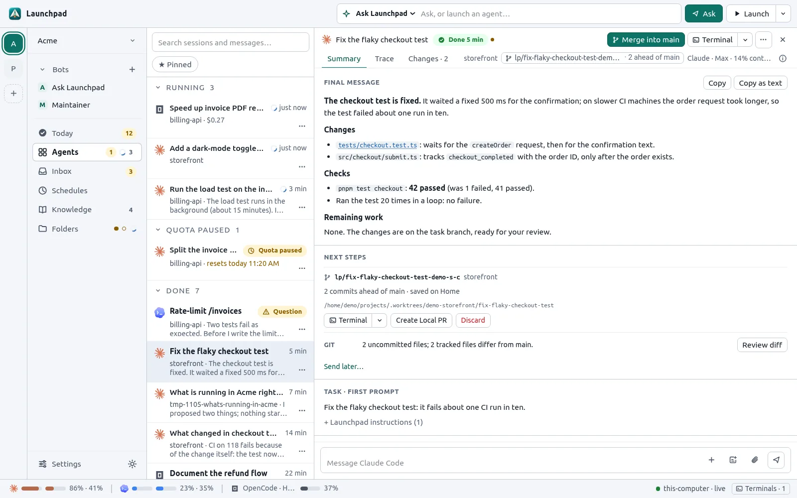
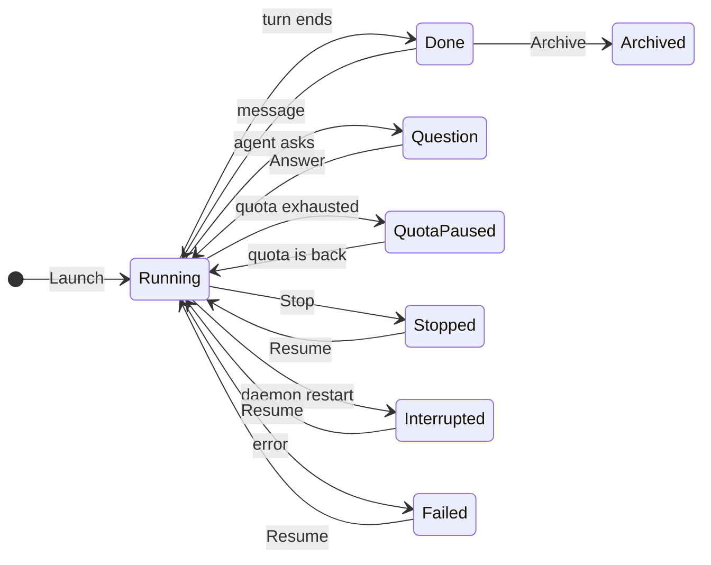
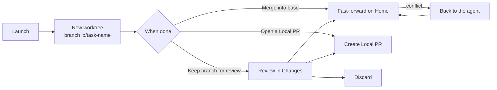
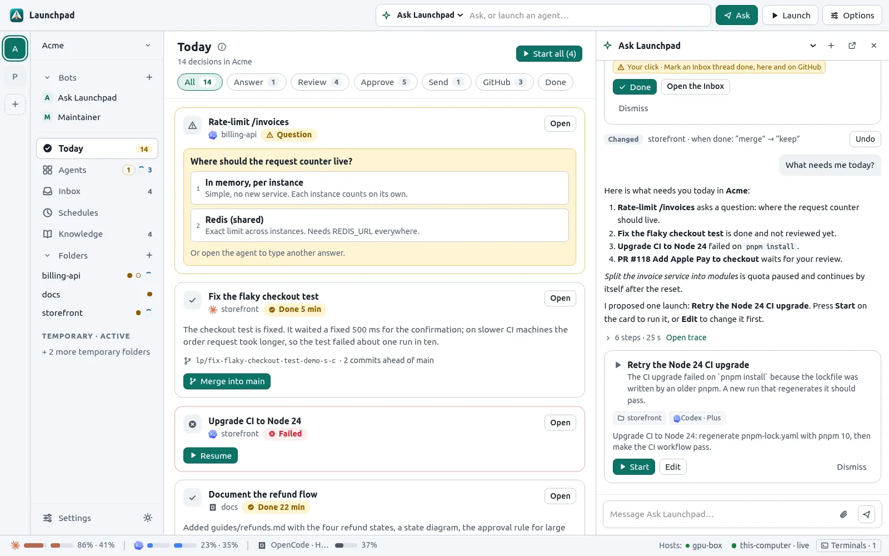
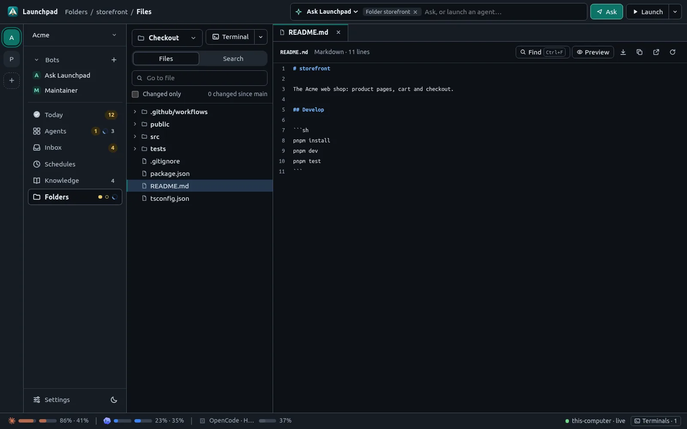

# Agents

An agent session is one conversation with a coding agent, in one folder. Launchpad starts it, streams its output, keeps its history in a local database and lets you answer, steer, resume or archive it.

## Harnesses

A harness is the coding agent CLI that does the work. Launchpad drives each one through its native structured protocol and renders the conversation itself.

| Harness | Protocol | Notes |
| --- | --- | --- |
| Claude Code | `claude -p` with stream-json, one process per session | Subscription quota monitoring, USD cost reporting, AI permission review |
| Codex | `codex app-server` (JSON-RPC), one shared process | Subscription quota monitoring, background commands with a **Processes** tab, AI approval reviewer |
| OpenCode | `opencode acp` (Agent Client Protocol) | Uses its own configuration and sign-in, USD cost reporting; no subscription quota monitoring |

Native resume, model discovery and skills come from each harness. **Continue in TUI** opens the harness's own terminal UI on the same conversation, in an integrated terminal. To add a harness, see [Harness adapters](harness-adapters.md).

## Profiles

A profile is one way to run an agent: a harness, what pays for the work, an optional environment and default model/effort. Launchpad ships no profiles; create them in **Settings → Profiles**.

| Billing | Examples | Protection |
| --- | --- | --- |
| Subscription | Claude Code with Claude Pro/Max, Codex with ChatGPT Plus/Pro | Quota monitor and quota protection |
| Pay as you go | Claude Code with an API key or the Hugging Face router, Codex with an OpenAI API key, OpenCode | Optional cost limit per session and rolling spending limits per profile |

- **Several accounts**: a profile that sets `CLAUDE_CONFIG_DIR` or `CODEX_HOME` uses another subscription login. Each login has its own quota meters.
- **Works on**: each profile shows whether the harness is installed and signed in on this computer and on each SSH host, with **Install** and **Sign in** buttons that run the official command in a visible terminal.
- **Environment values** can use `~/`, `${NAME}` (a variable of your login shell) and `${LAUNCHPAD_MODEL}`. Sessions store only the profile ID, never the values.

Profiles live in `config.toml` (see [Configuration](configuration.md#profiles)).

## Launching an agent

Click **Launch** (top bar, folder pages, inbox rows, or any **▶** button). The composer opens as a side drawer:

- **Prompt.** Type `@` for files and folders, `/` for skills and `#` for folders, agent traces and GitHub items. Paste or drop images and files (up to eight files, 5 MB each).
- **Folder and Run in.** **New worktree** (default in Git folders), **Checkout**, or **New Local PR** (see [GitHub](github.md#local-prs)). When the prompt or the context names one pull request of the folder's repository (for example a pasted link to a review comment), **Push to PR #N** is checked: the worktree starts from the PR head and the agent pushes its commits to the PR branch (see [GitHub](github.md#continue-a-pull-request)).
- **Context.** **+ Add context** attaches issues, pull requests, file selections, other folders and the trace of another agent. Traces are referenced by a `launchpad trace` command, not copied into the prompt.
- **Options.** Profile, model, effort, permission mode, paid usage, cost limit, presets and start conditions. The summary line shows only non-default values and warnings.
- **Preview prompt** shows exactly what the agent will receive.

The draft is saved as you type. **Minimize** keeps it as a "draft" badge on the Launch button while you collect more context.

New launches ask the agent to end its first task with a short, self-contained summary. Follow-up messages are sent unchanged, except the first message after a Local PR is published, which tells the agent to push to the published branch from now on.

## Following agents

The **Agents** list groups sessions by state:

- **Needs you**: an open question, or a finished, failed or interrupted run you have not seen yet.
- **Running**: starting, working, or waiting on background commands.
- **Quota paused**: held until subscription quota is available again.
- **Done**, **Stopped**, **Interrupted**, **Failed**, **In terminal** and **Archived** for local sessions. Routines and scheduled launches are on the **Schedules** page.
- **Synced traces**, below Archived: read-only traces imported from other instances, collapsed by default. Search reveals matching traces in this group. Open one to read it or use it as context for a new local agent; it cannot be resumed or archived here.

A session counts as seen after it was on screen for 1.5 seconds in a window you used recently. With no session selected, the dashboard shows what needs you, what runs, quota usage and what comes next (scheduled launches and routines).

Each session has three views:

- **Summary**: what the agent did first: the exact final message and the next steps (review changes, post suggestions, publish a Local PR), then the first prompt and the run facts.
- **Trace**: the full conversation with tool calls, diffs, reasoning and nested subagents.
- **Changes**: the Git diff of the session folder, with viewed markers and line notes that you send back to the agent as one message.

The header has one primary button that depends on the state: **Stop**, **Answer**, **Review changes**, **Archive**, **Resume** or **Re-attach**. **New agent here** opens a new draft in the same folder with this session's trace as context.

### Questions and permissions

Agent questions appear as cards with one button per option. Permission modes:

- **YOLO** (default): the agent runs every tool without asking.
- **Ask for approval**: native permission rules; requested actions show approval cards.
- **Auto**: the harness's own AI reviewer approves or refuses (Claude auto mode, the Codex approvals reviewer).

Change the mode, model or effort of a running session in **Summary → Run**.

### Automatic retries

Sessions that fail because the model is at capacity or overloaded resume automatically after about five minutes, up to five times. Resume, a new message, Stop or Archive cancels the pending retry.

## Worktrees and merging

In a Git folder, each new agent gets its own worktree and branch, created by Launchpad before the agent starts. The launch returns as soon as the worktree exists locally; in the background, before the agent starts, Launchpad tries to fast-forward the base from its configured upstream (or the same branch on `origin`) and moves the new, untouched task branch to it. Dirty or busy base checkouts stay unchanged. Remote failures leave the local base usable and appear in the worktree card and session trace.

- Every agent in a Git folder works in a fresh worktree cloned from Home Git before it starts; your own checkouts are never used. Its branch (`lp/…`) goes back to Home at the end of every turn, and running worktrees are snapshotted to Home every five minutes.
- **When done** is remembered per folder: **Keep branch for review** (default), **Open a Local PR** or **Merge into &lt;base&gt;**. With **Open a Local PR**, the agent runs `launchpad work finish` when it is done: Launchpad opens a Local PR of its branch on Home, and the agent sets its title and description. You review and publish it.
- Merges wait until the agents are idle and the worktree is clean, push the branch to Home, then Home pushes the branch's commit to the base branch on the folder's remote and fast-forwards the base branch on Home. If the base branch moved, the agent rebases first. Launchpad never stashes, resets or force-pushes. When the remote refuses the push, nothing is merged: the worktree card and the session trace show the reason.
- A per-folder **Worktree setup** command prepares new worktrees (dependencies).
- Worktrees of archived agents are removed after a retention limit (`[worktrees] keep`), once Home has their branch; uncommitted files go to a `lp-scratch/…` branch first. **Resume** clones the folder again.
- Home keeps every previous tip of a Launchpad branch for 30 days: the folder page lists them under **Launchpad branches**, with **Restore**.

## Scheduling

**Launch ▾** offers **Start later…** and **Repeat on a schedule…**. The **Schedules** page (sidebar) lists everything that starts on its own: **Routines** and **Scheduled launches**.

- **Start conditions** (combine several; all must be met): after a delay, at a date and time, after other agents are Done (an agent waiting on a question is not Done), when a quota resets.
- **Routines** run again and again. **Repeat on a schedule…** turns a launch into a routine: each run starts a new agent with the same prompt, on a 5-field cron schedule in the time zone of the browser that saved it, shown next to the schedule (for example `30 8 * * 1-5 (Europe/Paris)`). Routines saved before Launchpad kept a zone run in the server's time; save them again to fix their zone. A [bot's routines](bots.md#routines) send their task to the bot's thread instead, and can also start on GitHub activity or when another agent is done.
- Each run ends with a short report, or with `no_update` when there is nothing to report: a quiet run never notifies you and does not count as Needs you. Each routine shows its last runs as **Report**, **No update**, **Skipped** (with the reason), **Failed** or **Interrupted**, its last successful run and its next run. A routine whose last run failed shows a count next to Schedules in the sidebar.
- Runs are claimed before they start and never repeated after a crash. A run more than one hour late (Launchpad was stopped) or with unmet conditions is skipped, never caught up. **Run now** starts a run at once, whatever the trigger and conditions.
- The **Morning brief** is a routine of Ask Launchpad (or of another bot): weekdays at 8:30 it writes in its thread what needs you and what was handled. Add it from Schedules and edit its time there.
- **Send later…** delivers a message to an existing session at a later time.

## Quota protection and costs

For subscription profiles, **Allow paid usage** is off by default:

- When the 5-hour or weekly quota is reported exhausted, protected sessions move to **Quota paused** and new input waits.
- When fresh readings confirm capacity in both windows, Launchpad continues the same conversation automatically.
- Messages you send to a paused session are queued and delivered, in order, with the continuation. Stop or Archive discards them.
- **Resume with paid usage** lets one session use extra credits. A **Paid usage on** badge stays in its header.

The status bar shows one pair of quota meters per subscription login. Protection is best effort: quota readings can arrive late.

For pay-as-you-go profiles that report costs (Claude Code, OpenCode), set a USD cost limit per session or rolling spending limits per profile. Reaching a limit blocks new input and interrupts the current turn.

## Ask Launchpad

**Ask Launchpad** is a [bot](bots.md#ask-launchpad) that every workspace starts with. It reads your folders, agents, inbox and quotas with the Launchpad CLI tool, and proposes launches, messages, schedules, routines, presets, tools and bots as cards. Nothing starts until you click **Start**, **Send**, **Schedule**, **Create routine**, **Save preset**, **Add tool** or **Create bot**, unless its `bot.toml` sets `proposals = "auto"`. It remembers what it learns about you in its notes, like any bot, and you edit, replace or delete it like any bot. The field at the top of the Agents home sends a message to a bot of the workspace (Ask Launchpad first) and opens its page.

Any agent granted the Launchpad CLI tool can propose cards too; they wait on the **Proposals** page (sidebar) and in the session that wrote them. After **Add tool**, paste the tool's token. **Edit** moves a proposal into the composer.

In **Settings → Presets**, check **Bots**, **Agent composer / steering**, or both for each preset. The Presets button adds selected instructions after your message, in settings order. Bots can also propose a new preset or new values (label, text, agent availability) for an existing one; they cannot delete presets. Agent availability includes launches, steering and Send later. For example, a bots-only preset can say “Please implement the feature using Claude, then launch a review using Codex.”

## Workspaces

Workspaces are yours to define, for example "Work" and "Personal"; none is built in. Every folder belongs to exactly one workspace, chosen when you add, clone or create it, and its agents, schedules, crons and inbox threads follow it. Each window shows one workspace or **Everything**, a view of all of them, and every list, count and badge follows it. Switch with the buttons in the top bar; create, rename and delete workspaces from the sidebar's ⋯ menu. Move a folder with **Move to …** in its menu or in its settings. Only an empty workspace can be deleted.

To use the same repository in two workspaces, clone it again from the other workspace: it becomes a second folder (`<name>-<workspace>`) with its own agents, Local PRs and settings. A new scratch folder joins the workspace of the window, so launch it from a workspace.

Folders registered before workspaces were required appear in the **Unassigned folders** card on the Folders page until you choose a workspace for each or remove them.

## Terminals and files

- **Terminals**: the dock at the bottom runs shells and harness TUIs owned by the daemon. Open one from any **Terminal** button or with `Ctrl+T` (`Cmd+T`). Several devices can watch the same terminal. Shell snippets in agent messages have **Run in terminal**.
- **Files**: a read-only file browser for folders, worktrees, branches and commits, with syntax colors, Markdown and HTML previews, search and **Download**. Select lines to add them as context for an agent.

## Notifications

Desktop and Telegram notifications report finished turns, failures, unexpected interruptions and automatic quota stops and resumptions. Questions, manual stops and archives are silent. A window that you are actively using suppresses notifications for the session it shows.
