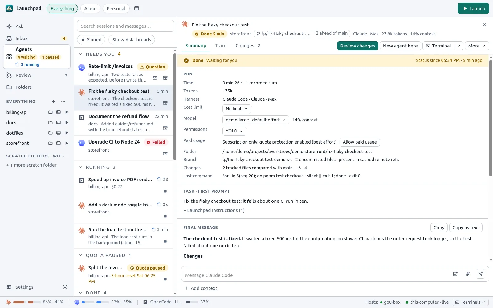
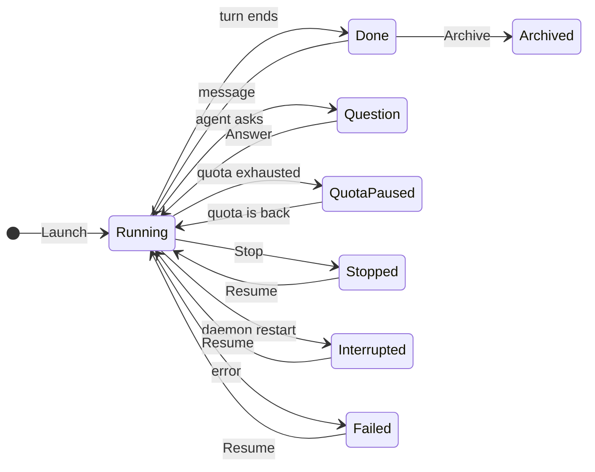
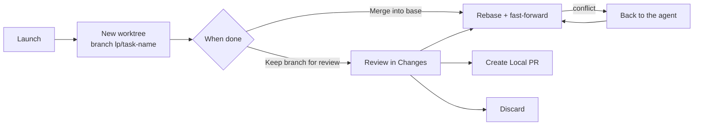
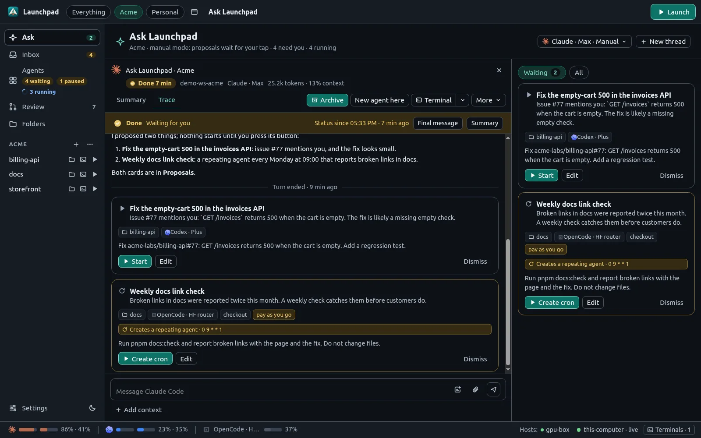
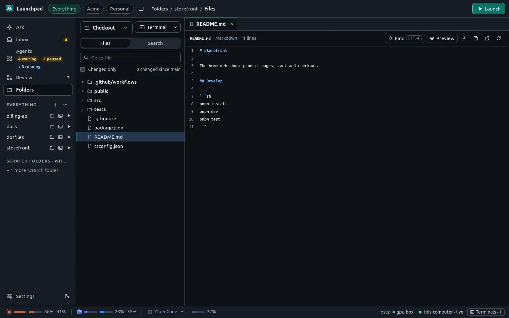

# Agents

An agent session is one conversation with a coding agent, in one folder. Launchpad starts it, streams its output, keeps its history in a local database and lets you answer, steer, resume or archive it.

## Harnesses

A harness is the coding agent CLI that does the work. Launchpad drives each one through its native structured protocol and renders the conversation itself.

| Harness | Protocol | Notes |
| --- | --- | --- |
| Claude Code | `claude -p` with stream-json, one process per session | Subscription quota monitoring, USD cost reporting, AI permission review |
| Codex | `codex app-server` (JSON-RPC), one shared process | Subscription quota monitoring, background commands with a **Processes** tab, AI approval reviewer |
| OpenCode | `opencode acp` (Agent Client Protocol) | Uses its own configuration and sign-in, USD cost reporting; no subscription quota monitoring |

Native resume, model discovery and skills come from each harness. **Continue in TUI** opens the harness's own terminal UI on the same conversation, in an integrated terminal. To add a harness, see [Harness adapters](harness-adapters.md).

## Profiles

A profile is one way to run an agent: a harness, what pays for the work, an optional environment and default model/effort. Launchpad ships no profiles; create them in **Settings → Profiles**.

| Billing | Examples | Protection |
| --- | --- | --- |
| Subscription | Claude Code with Claude Pro/Max, Codex with ChatGPT Plus/Pro | Quota monitor and quota protection |
| Pay as you go | Claude Code with an API key or the Hugging Face router, Codex with an OpenAI API key, OpenCode | Optional cost limit per session and rolling spending limits per profile |

- **Several accounts**: a profile that sets `CLAUDE_CONFIG_DIR` or `CODEX_HOME` uses another subscription login. Each login has its own quota meters.
- **Works on**: each profile shows whether the harness is installed and signed in on this computer and on each SSH host, with **Install** and **Sign in** buttons that run the official command in a visible terminal.
- **Environment values** can use `~/`, `${NAME}` (a variable of your login shell) and `${LAUNCHPAD_MODEL}`. Sessions store only the profile ID, never the values.

Profiles live in `config.toml` (see [Configuration](configuration.md#profiles)).

## Launching an agent

Click **Launch** (top bar, folder pages, inbox rows, or any **▶** button). The composer opens as a side drawer:

- **Prompt.** Type `@` for files and folders, `/` for skills and `#` for folders, agent traces and GitHub items. Paste or drop images and files (up to eight files, 5 MB each).
- **Folder and Run in.** **New worktree** (default in Git folders), **Checkout**, or **New Local PR** (see [GitHub](github.md#local-prs)).
- **Context.** **+ Add context** attaches issues, pull requests, file selections, other folders and the trace of another agent. Traces are referenced by a `launchpad trace` command, not copied into the prompt.
- **Options.** Profile, model, effort, permission mode, paid usage, cost limit, presets and start conditions. The summary line shows only non-default values and warnings.
- **Preview prompt** shows exactly what the agent will receive.

The draft is saved as you type. **Minimize** keeps it as a "draft" badge on the Launch button while you collect more context.

New launches ask the agent to end its first task with a short, self-contained summary. Follow-up messages are sent unchanged.

## Following agents

The **Agents** list groups sessions by state:

- **Needs you**: an open question, or a finished, failed or interrupted run you have not seen yet.
- **Running**: starting, working, or waiting on background commands.
- **Quota paused**: held until subscription quota is available again.
- **Done**, **Stopped**, **Interrupted**, **Failed**, **In terminal**, **Cron**, **Scheduled** and **Archived**.

A session counts as seen after it was on screen for 1.5 seconds in a window you used recently. With no session selected, the dashboard shows what needs you, what runs, quota usage and scheduled launches.

Each session has three views:

- **Summary**: run facts, the first prompt, the exact final message and the next steps (review changes, post suggestions, publish a Local PR).
- **Trace**: the full conversation with tool calls, diffs, reasoning and nested subagents.
- **Changes**: the Git diff of the session folder, with viewed markers and line notes that you send back to the agent as one message.

The header has one primary button that depends on the state: **Stop**, **Answer**, **Review changes**, **Archive**, **Resume** or **Re-attach**. **New agent here** opens a new draft in the same folder with this session's trace as context.

### Questions and permissions

Agent questions appear as cards with one button per option. Permission modes:

- **YOLO** (default): the agent runs every tool without asking.
- **Ask for approval**: native permission rules; requested actions show approval cards.
- **Auto**: the harness's own AI reviewer approves or refuses (Claude auto mode, the Codex approvals reviewer).

Change the mode, model or effort of a running session in **Summary → Run**.

### Automatic retries

Sessions that fail because the model is at capacity or overloaded resume automatically after about five minutes, up to five times. Resume, a new message, Stop or Archive cancels the pending retry.

## Worktrees and merging

In a Git folder, each new agent gets its own worktree and branch, created by Launchpad before the agent starts. Your checkout stays untouched.

- **When done** is remembered per folder: **Keep branch for review** (default) or **Merge into &lt;base&gt;**.
- Merges wait until the agents are idle and the worktree is clean, then rebase and fast-forward. Launchpad never stashes, resets or force-pushes. Conflicts go back to the agent.
- A per-folder **Worktree setup** command and `.worktreeinclude` files prepare new worktrees (dependencies, `.env` files).
- Clean worktrees of archived agents are removed after a retention limit (`[worktrees] keep`). The branch stays, and **Resume** restores the folder.

## Scheduling

**Launch ▾** offers **Start later…** and **Repeat on a schedule…**.

- **Start conditions** (combine several; all must be met): after a delay, at a date and time, after other agents are Done, when a quota resets.
- **Cron agents** run a 5-field cron schedule in the server's time zone. Each run is a normal session. Missed runs are skipped, never caught up.
- **Send later…** delivers a message to an existing session at a later time.

## Quota protection and costs

For subscription profiles, **Allow paid usage** is off by default:

- When the 5-hour or weekly quota is reported exhausted, protected sessions move to **Quota paused** and new input waits.
- When fresh readings confirm capacity in both windows, Launchpad continues the same conversation automatically.
- Messages you send to a paused session are queued and delivered, in order, with the continuation. Stop or Archive discards them.
- **Resume with paid usage** lets one session use extra credits. A **Paid usage on** badge stays in its header.

The status bar shows one pair of quota meters per subscription login. Protection is best effort: quota readings can arrive late.

For pay-as-you-go profiles that report costs (Claude Code, OpenCode), set a USD cost limit per session or rolling spending limits per profile. Reaching a limit blocks new input and interrupts the current turn.

## Ask Launchpad

**Ask** is an assistant for the current workspace. It reads your folders, agents, inbox and quotas, and proposes launches, messages, schedules and crons as cards. Nothing starts until you click **Start**, **Send**, **Schedule** or **Create cron**. **Edit** moves a proposal into the composer.

In **Settings → Presets**, check **Ask Launchpad**, **Agent composer / steering**, or both for each preset. The Presets button adds selected instructions after your message, in settings order, including the first Ask request and later messages. Agent availability includes launches, steering and Send later. Existing presets remain available to agents until you change their availability. For example, an Ask-only preset can say “Please implement the feature using Claude, then launch a review using Codex.”

The assistant runs with a restricted token: it can read state and write proposals, nothing else. It never reaches GitHub.

## Workspaces

A workspace is a named set of folders, for example "Work" and "Personal". Each window shows one workspace (or **Everything**), and every list, count and badge follows it. Switch with the buttons in the top bar; create, rename and delete workspaces from the sidebar's ⋯ menu.

## Terminals and files

- **Terminals**: the dock at the bottom runs shells and harness TUIs owned by the daemon. Open one from any **Terminal** button or with `Ctrl+T` (`Cmd+T`). Several devices can watch the same terminal. Shell snippets in agent messages have **Run in terminal**.
- **Files**: a read-only file browser for folders, worktrees, branches and commits, with syntax colors, Markdown and HTML previews, search and **Download**. Select lines to add them as context for an agent.

## Notifications

Desktop and Web Push notifications report finished turns, failures, unexpected interruptions and automatic quota stops and resumptions. Questions, manual stops and archives are silent. A window that you are actively using suppresses notifications for the session it shows.
