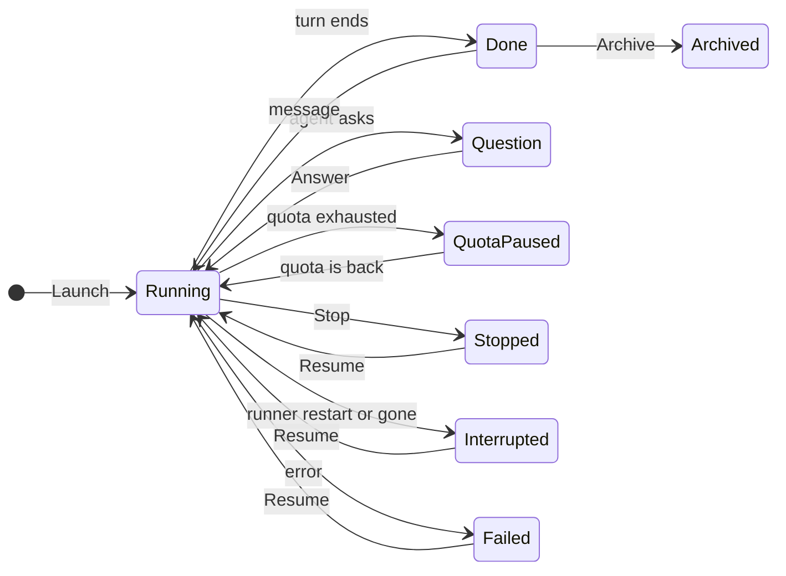
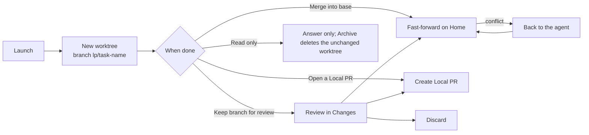

# Agents

An agent session is one conversation with a coding agent, in one folder. Launchpad starts it on a runner, streams its output, keeps its history on Home and lets you answer, steer, resume or archive it.

## Harnesses

A harness is the coding agent CLI that does the work. Launchpad drives each one through its native structured protocol and renders the conversation itself.

| Harness | Protocol | Notes |
| --- | --- | --- |
| Claude Code | `claude -p` with stream-json, one process per session | Subscription quota monitoring, USD cost reporting, AI permission review |
| Codex | `codex app-server` (JSON-RPC), one process per session | Subscription quota monitoring, background commands with a **Processes** tab, AI approval reviewer |
| OpenCode | `opencode acp` (Agent Client Protocol) | Uses its own configuration and sign-in, USD cost reporting; no subscription quota monitoring |

Native resume, model discovery and skills come from each harness. A Codex session that stays idle for 10 minutes between turns (Done or Stopped, with nothing running or asked) frees its app-server. The next message resumes the same conversation, and the trace shows “Resumed”. Processes the agent started outside Codex's own background commands end then. To add a harness, see [Harness adapters](harness-adapters.md).

## Profiles

A profile is one way to run an agent: a harness, what pays for the work, an optional environment and default model/effort. Launchpad ships no profiles; create them in **Settings → Profiles**.

| Billing | Examples | Protection |
| --- | --- | --- |
| Subscription | Claude Code with Claude Pro/Max, Codex with ChatGPT Plus/Pro | Quota monitor and quota protection |
| Pay as you go | Claude Code with an API key or the Hugging Face router, Codex with an OpenAI API key, OpenCode | Optional cost limit per session and rolling spending limits per profile |

- **Logins**: subscription logins live in Home's vault (**Settings → Credentials and tools**). A profile names its login. Without one, it uses the harness's default login: the first by name (then by ID). Leases, quota readings and runners all use this same login. Add several logins to use several accounts; each login has its own quota meters. Agents never use a machine's own sign-in.
- **Login and runners**: each profile shows its login on Home (Home reads quotas with it and lends it to agents) and the runners that have the harness's CLI, with its version. A runner without the CLI takes none of the profile's sessions. Runners update their CLIs on their own within a major version; a new major version waits for your approval in Today (see [Agent CLI updates](home-and-runners.md#agent-cli-updates)).
- **Environment values** can use `~/`, `${NAME}` (a variable of your login shell) and `${LAUNCHPAD_MODEL}`. Sessions store only the profile ID, never the values.

Profiles live in `config.toml` (see [Configuration](configuration.md#profiles)).

## Launching an agent

The top bar has one field with two buttons:

- **Launch** starts an agent at once with the text, the page as context and the folder's defaults (on a folder page, that folder). While it waits for the folder's defaults it reads **Launching…**; when something blocks the launch (no profile, no folder, a busy worktree), the composer opens at once and says what is missing. With an empty field or a kept draft, it opens the composer. Its **▾** menu has **Launch with options…**, which opens the full composer with the text.
- **Ask** sends the text to a bot of the workspace and opens its chat in the Ask panel (see [Ask Launchpad](#ask-launchpad)).

The page as context is the folder, GitHub item, Local PR or settings page you are on, or the agent open in **Agents** (Ask names its session, Launch adds its trace). It shows as a chip in the field; **×** leaves it out.

The page you look at is the context: a folder, a GitHub item, an agent's trace, a Local PR or a settings page. A chip in the field names it; **✕** removes it. **Ask** is the primary button on every page, and **Enter** sends to Ask. In a workspace without a bot, Launch is the primary button and **Enter** launches. **Shift+Enter** adds a line.

Folder pages, inbox rows and every **▶** button open the composer too. The composer opens as a side drawer:

- **Prompt.** Type `@` for files and folders, `/` for skills and `#` for folders, agent traces and GitHub items. Paste or drop images and files (up to eight files, 5 MB each).
- **Attach** and **+ Add context**, under the prompt. **+ Add context** attaches issues, pull requests, file selections, other folders, the trace of another agent and presets; the chips show only when there are some. Traces are referenced by a `launchpad trace` command, not copied into the prompt.
- **Folder.** A folder of the workspace, or **Temporary folder** for a question or a task that needs no folder (see [Temporary folders](#temporary-folders)).
- **Options.** One line sums up the launch: where the agent runs and what happens when it is done (for example "New worktree from main · keep branch"), then the profile and only the values that differ from the defaults, and warnings. Click it to open the options: **Run in** (in a Git folder, one menu: a new worktree from a branch, by default the default branch, or an existing worktree or Local PR to continue there; see [Local PRs](github.md#local-prs)), **When done** (for a new worktree, including **Open a Local PR**; see [Worktrees and merging](#worktrees-and-merging)), profile, model, effort, permission mode, paid usage, cost limit and start conditions. When the prompt or the context names one pull request of the folder's repository (for example a pasted link to a review comment), **Push to PR #N** is checked under Run in: the worktree starts from the PR head and the agent pushes its commits to the PR branch (see [GitHub](github.md#continue-a-pull-request)).
- **Preview prompt** shows exactly what the agent will receive.
- **What it sees at start**, next to Preview prompt, shows the agent's instructions file (the knowledge base, the Launchpad CLI reference, the attribution rule) and its first prompt, in labelled parts with their line counts. Launchpad builds them like a real start, without starting anything.

The draft is saved as you type. **Minimize** keeps it as a "draft" badge on the **Launch** button while you collect more context; its **▾** menu starts a new agent instead or discards the draft. **Discard** in the composer keeps the draft 10 seconds behind **Undo**.

On a laptop, the composer, the Ask panel and the terminal dock are closed when a window opens: a kept draft waits as the "draft" badge, and each panel opens only when you open it. They stay open while you move between pages.

Session titles appear immediately from the prompt. Claude Code and Codex also generate a short AI title, then rename it once, when the first turn ends (done, failed, interrupted or stopped), from what the agent actually did: the prompt, the agent's final message and the recent conversation, without Launchpad's own instructions. So an agent started from a bare link (a Slack thread, an issue) gets a title that names the real subject once it has worked on it. Follow-up turns keep that title, so an agent is renamed at most twice. Naming uses Haiku for Claude Code and prefers Luna or Mini for Codex, with the lowest supported effort. Quota or spending limits can skip naming. When the first naming fails, Launchpad tries again after 1, 4 and 16 minutes, then keeps the title from the prompt; a failed rename at the first turn end keeps the existing title. Naming costs count toward the session's cost limit and the profile's spending limits, also when a request fails. OpenCode keeps the prompt-based title.

New launches ask the agent to end its first task with a short, self-contained summary. In an agent's message box, and in a bot's message box (presets checked for **Bots** there), the **+** icon next to attachments adds the same context and presets to the next message; a message can carry context without text. On a phone, **+** opens a bottom sheet. Follow-up messages are sent unchanged, except the first message after a Local PR is published, which tells the agent to push to the published branch from now on.

## Temporary folders

**Temporary folder** in the composer's folder menu starts the agent in a new, empty folder in the runner's data folder (`<data_dir>/tmp/`). The agent is told that the folder is temporary, and how to list the workspace's folders and add a worktree of one with `launchpad work add-project`. It adds only Git folders of the session's workspace. The Folders page lists them under **Temporary folders**, one row each with its open agents, **Launch**, and **⋯** with **Keep as folder** (name it there) and **Delete files**; **ⓘ** next to the title explains them.

Launchpad saves a temporary folder's files on Home at the end of every turn, except files listed in a `.gitignore` and nested Git repositories, so the session keeps its folder when it continues on another runner (for example a new Burst job). When you archive the last agent of a temporary folder, Launchpad removes it from the runner and from the folder lists; Home keeps its files 30 days, and **Resume** brings the folder back with them. After 30 days, Home deletes them and a resumed agent continues in an empty folder (the session says so). To keep the files for good, click **Keep as folder** in the session's Next steps (or on the Folders page) once the agent is done, and choose a name: the folder becomes a folder stored by Home under that name (a plain folder, or a Git folder when the agent created a Git repository in it; that repository's `origin` must then be a network address, such as GitHub, never a local path), so agents run in it on any runner, and its sessions stay resumable. Files listed in a `.gitignore` are saved too from then on. A temporary folder that holds a Git repository is not saved on Home: it stays on its runner (the session cannot move, and Archive keeps the folder). Keep it as a folder while its runner is connected. To create a folder before launching, use **Add folder** instead.

## Following agents

**Agents** is a monitor of what runs and what ran. Its list groups sessions by state:

- **Needs you** (first, with an amber count): an open question, or a finished, failed or interrupted session you have not seen yet.
- **Running**: starting, working, or waiting on background commands.
- **Quota paused**: held until subscription quota is available again.
- **Done** (seen), **Stopped**, **Interrupted**, **Failed**, **In terminal** and **Archived** for local sessions. Routines and scheduled launches are on the **Schedules** page.

Click a row to open its session, on its default view (a link that opened one session on Changes does not change the next ones); clicking the open session's row keeps it as it is. **Archive N seen, older than 3 d** under Done asks for a confirmation, then says how many it archived. The row's **⋯** holds **Stop** (while it runs) or **Archive**, **Mark unread** and **Pin** (pinned sessions show first). The filter field over the list matches the title, the prompt and the folder name, and also the messages sent to each agent and its answers. It does not search tool calls or reasoning. A quota-paused row shows when its quota resets; hover it for every window.

A tag at the start of a row's second line says where the agent's work went, so you can tell what is safe to archive without opening it: **Merged** (merged into its base branch, from its worktree or its Local PR), **On main** (every commit of its branch is already in the base branch, named after it), **Local PR** (not published yet), **PR #N** (a published Local PR or a pull request the agent continues) or **Read-only** (launched with When done = Read-only). A row without a tag may hold work that is not merged or handed off yet. Hover the tag for details.

A session **needs you** when it has an open question, or when it finished, failed or was interrupted and you have not seen it yet. Such sessions wait as cards in [Today](today.md) and in the **Needs you** group here; an unseen one has a small amber dot after its status. A session counts as seen after it was on screen for 1.5 seconds in a window you used recently. The sidebar shows only how many agents run or wait for quota.

Each session has three views:

- **Summary**: in order, **Run** (the run facts, then **Credentials**: the workspace's tools and MCP servers, green for those this agent holds, and the requests that received a token), **Task** (the first prompt), **Final message** (the exact last message) and **Next steps** (review uncommitted changes, post suggestions, review and publish a Local PR, **Launch here**, **Use trace as context** and **Archive**). When the agent prepared a Local PR, **Review & publish** shows its diff, so **Review diff** appears only for uncommitted files. **Runs on** names the machine that runs the session now; when its turns ran on more than one machine, **Turns ran on** lists them in order with their turn numbers (for example `laptop · turns 1–3 → Burst · turn 4`).
- **Trace**: the full conversation with tool calls, diffs, reasoning and nested subagents. A background command shows the last lines of its output. The runner reads that output only from the session's own `/tmp` or `/var/tmp`, and only when it is a regular file.
- **Changes**: the Git diff of the session folder, with viewed markers and line notes that you send back to the agent as one message.

On a laptop, the session header has two rows:

- **First row**: the title, the status and one main action that depends on the state: **Merge into &lt;base&gt;** when the merge is safe (the same check as in [Today](today.md)), otherwise **Stop**, **Answer**, **Fix merge**, **Review changes**, **Archive**, **Resume** or **Re-attach**. When a merge stopped (a conflict or a failure), an amber band under the header says **Not merged into &lt;base&gt;** with the reason, and **Fix merge** is the main action: it sends the problem to the agent, which rebases, resolves and asks to merge again. Once the branch is merged, in a Local PR or in a GitHub pull request, and nothing is uncommitted, **Archive** replaces **Review changes** (the changes stay in the Changes tab). Then **⋯**. When the header shows **Merge into &lt;base&gt;**, the next steps in Summary do not repeat it.
- **Second row**: the view tabs, chips for run settings, paid usage and cost limit only when they differ from the defaults, and one muted line with the bot, the folder, the worktree, the Local PR, the profile and the context use. **ⓘ** shows the folder path, profile, model, usage and start time.

Next to the status, **Saving** means the runner is saving the turn's work on Home; **Not on Home** (amber) means the save failed and the runner retries (see [Saved on Home](home-and-runners.md#saved-on-home)).

**⋯** holds the other actions, among them **Launch here** (a new draft in the same folder with this session's trace as context), **Jump to the final message** (in the trace), **Mark as unread**, **Use trace as context** and **Archive**. On a phone, **⋯** also has **Rename** and **Jump to the final message**, and **Launch here** is in the session details.

On a phone, a bar at the bottom holds **Reply** and the main action. **Reply** opens the message box in place of that bar, so only **Send** sits above the keyboard; **Hide** closes it and keeps your draft. A session with a draft opens with its message box.

After **Archive**, a message offers **Undo** for 8 seconds. The agent comes back Done (or Stopped, when it was not Done), without starting its process; your next message resumes it as usual. Agents with admin access can do the same with `launchpad session unarchive <id>`.

A state band above the trace shows only an open question or a turn you stopped. To answer a question in the message box, type the answer; when the agent asked several questions, type one answer per line, in order (or pick the options in the question card).

### Questions and permissions

Agent questions appear as cards with one button per option. Permission modes:

- **YOLO** (default): the agent runs every tool without asking.
- **Ask for approval**: native permission rules; requested actions show approval cards.
- **Auto**: the harness's own AI reviewer approves or refuses (Claude auto mode, the Codex approvals reviewer).

Change the mode, model or effort of a running session in **Summary → Run**. For a profile with its own model list (`models_url`, for example the Hugging Face router), the model menu shows only that list, with a search field, and no effort choices. You can also type a model ID that is not in the list. Home refuses the harness's own models (such as `opus`) for such a profile, except the profile's default model.

Only you grant permissions. No agent can answer an approval card, even one with admin access to the Launchpad CLI. An agent may change a session's permission mode only to a stricter one: from YOLO to Auto or Ask for approval, or from Auto to Ask for approval. The same holds when an agent edits a scheduled launch (`schedule update`): it cannot loosen the mode the launch has.

### Automatic retries

Sessions that fail because the model is at capacity or overloaded resume automatically after about five minutes, up to five times. Resume, a new message, Stop or Archive cancels the pending retry.

## Attribution

What an agent publishes through Launchpad ends with one line in italics, so readers (and bots reading a thread later) know who wrote it:

- a one-time agent: `_Done with Claude Code using [Launchpad](https://github.com/Wauplin/launchpad)_` (the harness's name: Claude Code, Codex, OpenCode);
- a bot's session: `_Done by HFJS Bot using [Launchpad](https://github.com/Wauplin/launchpad)_` (the bot's name).

Launchpad adds it itself, so no bot or prompt has to:

- **Suggestions** (comments and reviews) and **Outbox** messages get it when you click Post or Send; the draft you edit stays without it. Slack messages use Slack's link syntax.
- **Local PRs** get it in the pull request's description when you publish them.
- **Direct GitHub posts** of a contained agent (`gh` or the GitHub API with a token Home lends, as bots with GitHub access do) get it from the runner proxy: pull request and issue bodies, comments, and reviews with text. Inline review comments and approvals without text stay as written.
- **Claude Code** writes it instead of its own "Generated with Claude Code" line in pull request descriptions (its `attribution.pr` setting). Commit trailers keep Claude Code's default.

Comments and reviews get a `---` rule before the line; descriptions and chat messages only a blank line. A body that already ends with an attribution line (italic or not, or Claude Code's own line) gets it replaced, never doubled. Agents are told the line too, and end what they publish elsewhere with it.

## Worktrees and merging

In a Git folder, each new agent gets its own worktree and branch on its runner, created before the agent starts. The launch returns at once; in the background, before the agent starts, Home refreshes its mirror from the folder's remote and the runner clones the worktree from Home Git. Remote failures leave the base usable and appear in the worktree card and session trace.

- Every agent in a Git folder works in a fresh worktree cloned from Home Git before it starts; your own checkouts are never used. Its branch (`lp/…`) goes back to Home at the end of every turn, and every file of the worktree, committed or not, is snapshotted to Home at each turn end and every five minutes. So Changes, Files, Merge and Create Local PR work from Home while the runner sleeps.
- **When done** is remembered per folder: **Keep branch for review** (default), **Open a Local PR** or **Merge into &lt;base&gt;**. Only with **Merge into &lt;base&gt;** does `launchpad work finish` ask Home to merge. With **Keep branch for review** it changes nothing: you merge, publish or discard the branch from Launchpad. With **Open a Local PR**, the agent runs `launchpad work finish` when it is done: Launchpad opens a Local PR of its branch on Home, and the agent sets its title and description. You review and publish it.
- **Read only (questions, audits)** is for an agent that only reads the code: asking a question, an audit, a review. It is chosen per launch and never remembered for the folder. The agent still gets its own worktree (it may build and run the code) but is told not to change, commit or push files and to give its answer in its final message; `launchpad work finish` refuses. When you archive the agent, Launchpad deletes the worktree and its branch if nothing changed (no commit, no changed or new file); otherwise they are kept like any other worktree, so nothing is lost. It is an instruction, not a sandbox: the files stay writable.
- **Merge** asks you to confirm (on the laptop and on the phone) and names the branch and the base. It waits while another action of the worktree card runs. Merges wait until the agents are idle and the worktree is clean, push the branch to Home, then Home checks that the branch is still at the commit you reviewed and pushes the branch's commit to the base branch on the folder's remote and fast-forwards the base branch on Home. If the base branch moved, the agent rebases first. Launchpad never stashes, resets or force-pushes. When the remote refuses the push, nothing is merged: the worktree card and the session trace show the reason. A merge that takes Home more than about 40 seconds (a slow fetch or push) shows **Waiting: Home is still merging**, and the runner asks Home again until it has the outcome. It is never reported as failed while Home still works on it, and it also waits while the runner has no link to Home. When Home restarted during a merge and lost its outcome, the merge shows as uncertain: check the base branch on the remote, then merge again. Launchpad never retries it on its own, and never sends it to the agent. **Cancel** during the wait stops waiting, but Home may still complete the merge; the branch then shows as merged. A merge the agent asked for (`launchpad work finish`) that fails goes back to the agent once on its own (an automatic **Fix merge**, usually enough for a race on the base branch); a second failure waits for you. This message is automatic work: it goes only to an idle agent with confirmed quota. Otherwise a notice in the session says it was not sent, and **Fix merge** sends it. When your own **Merge** stops on a conflict, **Fix merge** asks the agent to rebase and end its turn; then **Merge** is the main action again, and you click it.
- A per-folder **Worktree setup** command prepares new worktrees (dependencies). It runs in the session's jail, with its lease and network capture.
- Worktrees of archived agents are removed after a retention limit (`[worktrees] keep`, in **Settings → Disk cleanup**; Home sends it to every runner, which applies it to its own worktrees), once Home has their branch; uncommitted files go to a `lp-scratch/…` branch first. **Resume** clones the folder again.
- Home keeps every previous tip of a Launchpad branch for 30 days: the folder page lists them under **Launchpad branches**, with **Restore**.

## Scheduling

**Launch ▾** offers **Start later…** and **Repeat on a schedule…**. The **Schedules** page (sidebar) lists everything that starts on its own: **Routines** and **Scheduled launches**. Its **New routine** and **Schedule a launch** buttons open the composer with that choice made. Once created, a routine or a scheduled launch opens on Schedules, with when it starts.

- **Start conditions** (combine several; all must be met): after a delay, at a date and time, after other agents are Done (an agent waiting on a question is not Done), when a quota resets.
- **Edit** on a scheduled launch that has not started opens it in the composer: change the prompt, folder, profile, options and start conditions, then **Save**. It keeps its place, so agents that wait for it keep waiting. **Start now** in the composer saves and starts it; **Repeat on a schedule…** turns it into a routine and cancels the scheduled launch; **Discard changes** leaves it as it was. Scheduled follow-ups cannot be edited: cancel them and schedule again.
- **Routines** run again and again. **Repeat on a schedule…** turns a launch into a routine: each run starts a new agent with the same prompt, on a 5-field cron schedule in the time zone of the browser that saved it, shown next to the schedule (for example “Weekdays at 08:30 (Europe/Paris)”; hover it to see the cron). Routines saved before Launchpad kept a zone run in the server's time; save them again to fix their zone. A [bot's routines](bots.md#routines) send their task to the bot's thread instead, and can also start on GitHub activity or when another agent is done. A routine started by events runs at most 6 times an hour, and a [loop guard](bots.md#loop-guard) stops chains of more than 3 automatic messages.
- Each run ends with a short report, or with `no_update` when there is nothing to report: a quiet run never notifies you and never waits in Today. Each routine shows its last runs as **Report**, **No update**, **Skipped** (with the reason), **Failed** or **Interrupted**, its last successful run and its next run. A routine whose last run failed waits in Today → Fix.
- Runs are claimed before they start and never repeated after a crash. A run more than one hour late or with unmet conditions is skipped, never caught up. The reason says why: Home was not running at the scheduled time, or the run waited an hour for a confirmed quota reading (it names the login and the last error). A due run that waits says why on the routine, and a run skipped for want of a quota reading counts as a failure (Today → Fix, `launchpad failures`, **When Launchpad fails** routines). **Run now** starts a run at once, whatever the trigger and conditions.
- The **Morning brief** is a routine of Ask Launchpad (or of another bot): weekdays at 8:30 it writes in its thread what needs you and what was handled. Add it from Schedules and edit its time there.
- **Send later…** delivers a message to an existing session at a later time. A follow-up that an agent scheduled arrives under a header that names that agent, like its other messages (see [Messages from other bots and agents](bots.md#messages-from-other-bots-and-agents)).

## Quota protection and costs

For subscription profiles, **Allow paid usage** is off by default:

- When the 5-hour or weekly quota is reported exhausted, protected sessions move to **Quota paused** and new input waits.
- A session in a turn first gets an interrupt request. It stays **Running**, with "Interrupt requested; waiting for the turn and commands to finish.", until the turn really stops. Then it shows **Quota paused**, and its work is saved on Home like at any turn end.
- When fresh readings confirm capacity in both windows, Launchpad continues the same conversation automatically.
- Messages you send to a paused session are queued and delivered, in order, with the continuation. Stop or Archive discards them.
- **Resume with paid usage** lets one session use extra credits, after you confirm. A **Paid usage on** badge stays in its header.

The status bar shows one pair of quota meters per subscription login. Protection is best effort: quota readings can arrive late.

Automatic work starts only with a quota reading less than 90 seconds old that confirms capacity. Your own messages and clicks may start on best-effort protection, and so may the direct launches and messages of a bot with admin access. Automatic work is:

- Routine runs of every trigger. Schedule, GitHub and failure triggers wait up to an hour for a reading, then skip the run. A run for **When an agent is done** is skipped at once, as missed.
- Scheduled launches and scheduled follow-ups.
- Messages from incoming hooks to a bot: they wait in the bot's queue until the quota is confirmed. Your Telegram messages go ahead of them.
- Messages from agents to a bot (`launchpad bot message`): Home refuses them while the quota is not confirmed.
- Cards that a bot in auto mode starts. A launch waits for the quota before it starts. A message card without confirmed quota is not sent: it waits for your **Start**, and its note says why.
- The message that sends a failed merge back to the agent that asked for it. When the agent is busy or its quota is not confirmed, it is not sent: a notice in the session says so, and **Fix merge** sends it.

Home reads each vault login's quota itself, and running sessions report theirs. A Claude Code token from `claude setup-token` only allows model requests: Anthropic's usage endpoint refuses it (403), so Home asks that endpoint only once an hour. While automatic work waits for a reading, Home reads the quota from the rate-limit headers of a one-token request with the login, like Claude Code's own quota check, at most every 10 minutes. It never sends that request while the last reading shows a used-up window that has not reset, so it cannot use paid extra usage. After 15 minutes of waiting, `launchpad health` and the failure list name the login and the last error.

For pay-as-you-go profiles that report costs (Claude Code, OpenCode), set a USD cost limit per session or rolling spending limits per profile. Reaching a limit blocks new input and interrupts the current turn. Spending limits count the costs of every runner and Burst job together, and Home starts no Burst job past a limit.

## Ask Launchpad

**Ask Launchpad** is a [bot](bots.md#ask-launchpad) that every workspace starts with. It reads your folders, agents, inbox and quotas with the Launchpad CLI tool, and proposes launches, messages, schedules, routines, presets, tools and bots as cards. Nothing starts until you click **Start**, **Send**, **Schedule**, **Create routine**, **Apply** (changes to a bot's `BOT.md` and routines), **Save preset**, **Add tool** or **Create bot**, unless its `bot.toml` sets `proposals = "auto"`. With admin access to the Launchpad CLI, it also changes bots, routines, schedules, workspaces, folder settings and shared settings when you ask; each change shows in its chat as a receipt on the turn's steps line. When it messages another bot or agent, the message arrives under a header that names Ask Launchpad as the sender, never as yours. It can also diagnose Launchpad's own failures (logs of Home and runners, runners, Burst jobs, health) and be told about them by a **When Launchpad fails** routine. Merges, publishing, posts, sends and Inbox Done stay your clicks: it prepares them as ready cards (see [Bots](bots.md#proposals)). It remembers what it learns about you in its notes, like any bot, and you edit, replace or delete it like any bot.

**Ask** in the top bar sends your text, with the page as context, to the workspace's default bot: the oldest bot with admin access (Ask Launchpad unless you changed it), else the oldest bot. The bot's chat opens in the **Ask panel** at the right of the page; its menu picks another bot of the workspace, and on a bot's page Ask talks to that bot. The panel has a link to the bot's page and **Close**. Each change the bot makes shows in the chat as a line that links to what changed; the chat has no Undo, so open the record to change it back, or ask the bot. It shows the same chat as the bot's page; as the panel has no status line, its last row shows the current step next to **Stop** while the bot works. To start a new session of the bot's thread, use **⋯ → Start a new session…** on the bot's page. A message sent with **Ask** is sent once, like any bot message: a double tap or a lost response never sends it twice (see [The bot's page](bots.md#the-bots-page)). After a lost response, the top-bar field only shows an error: open the bot's chat to check, or send the same text again to get the first result.

Any agent granted the Launchpad CLI tool can propose cards too; they wait in Today → Approve and in the session that wrote them; handled cards are in Today → Done. **Add tool** asks you to confirm, then you paste the tool's token. **Edit** (in the card's **⋯**) moves a proposal into the composer and replaces the card (“Edited in the composer”). **Start all** (in Today) starts every waiting card that starts something, after one confirmation. A bot's cards also show in its chat, at the turn that wrote them, as one line each with **⋯ → Details** for the full card.

In **Settings → Presets**, check **Bots**, **Agent composer / steering**, or both for each preset. **+ Add context** → **Presets…** (in the composer, an agent's message box and a bot's message box) adds the selected instructions after your text, in settings order. Bots can also propose a new preset or new values (label, text, agent availability) for an existing one; they cannot delete presets. Agent availability includes launches, steering and Send later. For example, a bots-only preset can say “Please implement the feature using Claude, then launch a review using Codex.”

## Workspaces

Workspaces are yours to define, for example "Work" and "Personal". There is no default workspace: **Finish setup** asks you to create at least one before you add or clone a folder, and Home then always keeps at least one. Every folder belongs to exactly one workspace, chosen when you add, clone or create it, and its agents, schedules, crons and inbox threads follow it. A window shows one workspace at a time: every list, count, badge and suggestion follows it, including `#` and `@` in prompts and the folders of **Add context**.

- **Workspace menu**: the workspace name at the top of the sidebar. It lists your workspaces first: click one to show it in this window. Other workspaces show only the count of their Today list, and the menu's button shows their total. It then offers **Rename**, **Open in a new tab** (to see two workspaces side by side), **Workspace settings**, **New workspace** and **Delete**. Only an empty workspace can be deleted, and never the last one. Its bots (Ask Launchpad, the Librarian and your own) are deleted with it, with their routines, and so is its Telegram setup; their sessions stay. Delete is refused while one of its bots works.
- Move a folder with **Move to …** in its menu or in its settings.
- Each workspace has its own Telegram bot and chat (Settings → Workspace → Telegram). Its notifications name the workspace, and opening one shows that workspace.

To use the same repository in two workspaces, clone it again from the other workspace: it becomes a second folder (`<name>-<workspace>`) with its own agents, Local PRs and settings. A temporary folder joins the workspace of the window, so launch it from a workspace.

Folders without a workspace appear in the **Unassigned folders** card on the Folders page until you choose a workspace for each or remove them.

## Terminals and files

- **Files**: a read-only file browser for folders, worktrees, branches and commits, with syntax colors, Markdown and HTML previews, search and **Download**. Select lines to add them as context for an agent. On the phone, the tree and search open from the folder button in the title bar. When a session's runner is away, Files shows its worktree from Home (see [Files on Home](home-and-runners.md#files-on-home)).
- **Terminals**: open a shell or **Continue in &lt;harness&gt; TUI** from Home's window: the terminal runs on the session's runner, next to the agent, and Home relays it through the runner's link. Its output stays on the runner. The dock lists the terminals of every connected runner.
  - A shell of an agent, its worktree or its temporary folder opens on that agent's runner. A Git folder without an agent opens on a runner picked like for a launch, in that runner's copy of the repository.
  - A plain folder gets a shell only from one of its agents: its files change through agents and sync, so a shell in a runner's copy would lose edits.
  - When the runner is away, or needs an update to open terminals from Home, the **Terminal** buttons, **Continue in TUI**, **Run in terminal** and `Ctrl+T` are disabled and say why. A terminal never moves a session to another runner and never starts Burst.

## Notifications

Notifications come only through Telegram, to the chat of the session's workspace (see [Channels](channels.md#telegram)). A workspace without a Telegram bot gets none. They tell you when a turn ends, fails or is cut off, and when quota stops or resumes an agent. Questions, manual stops and archives are silent. A window that you are actively using suppresses notifications for the session it shows.
