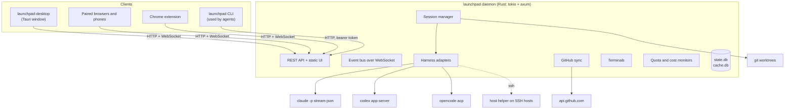

# Architecture

Launchpad is a Rust daemon that owns everything stateful, a React UI served by that daemon, and a thin desktop shell that shows the UI in a native window.



## Design principles

1. **Never wait on the network to show something.** Every screen renders from the local database first and refreshes in the background.
2. **Launching an agent is the main action.** A minimal launch is a prompt and a click.
3. **The core does not depend on a harness.** Claude Code, Codex and OpenCode are adapters behind one session model.
4. **Local first, publish later.** Anything that would create noise on GitHub stays local until you publish it.
5. **Click only.** Every action is a visible button. The only keyboard shortcuts are `Ctrl+F` in Files, `Ctrl+T` for a terminal and normal text and terminal keys.
6. **One user, move fast.** No multi-user model, no versioning, no data migrations. Few tests.

## Processes

- **Daemon** (`launchpad daemon`): a systemd user service on Linux, launchd agents on macOS, a detached process on Windows. It owns SQLite, the agent processes, terminals, GitHub polling, quota monitoring and notifications. It listens on `127.0.0.1` by default. At startup, it reads the environment of your login shell, so agents see the same tools as in a terminal.
- **Desktop shell** (`launchpad-desktop`): a small Tauri v2 app. It starts the daemon if needed and loads the UI from it. Closing the window hides it, so the next click shows it at once. Links to other sites open in the system browser.
- **Agent processes**: children of the daemon. **Restarting the daemon interrupts running turns**; sessions become Interrupted and resume with one click through the harness's native resume.

Closing the window never affects running agents.

## Sessions and harnesses

Every harness maps to the same model:

- A **launch spec** describes what to run: the prompt, target folder, context, profile, model, options and start conditions. The composer, schedules, crons and Ask proposals all produce launch specs.
- A **session** is the durable record: status, usage, title, folder, native conversation ID.
- **Events** are the normalized conversation (messages, tool calls, questions, approvals, subagents), stored in order with a sequence number and pushed to every client over the event bus. Clients reconnect with the last sequence number they received and get what they missed.

Adapters (`crates/core/src/harness/`) translate each native protocol into these events and own everything native: startup, resume, model discovery, quota readings, terminal commands. See [Harness adapters](harness-adapters.md).

## Storage

| Store | Content | Lifetime |
| --- | --- | --- |
| `config.toml` | Settings, profiles, presets | Edited in Settings or by hand |
| `state.db` (SQLite, WAL) | Sessions, events, drafts, Local PRs, suggestions, schedules, devices | Your data; back it up |
| `cache.db` (SQLite) | GitHub payloads as JSON | Disposable, rebuilt on demand |
| Harness folders | Native conversations (`~/.claude`, `~/.codex`, OpenCode data) | Owned by each harness |

Rust types shared with the UI derive `ts_rs::TS`, so the API is typed end to end without an OpenAPI spec.

## Security model

- Launchpad has one user. Every paired browser has full access.
- The daemon listens on loopback. Remote access goes through a private network (Tailscale) or a proxy you control, with an exact allowed origin.
- Browsers authenticate with an HttpOnly device cookie after pairing. The CLI uses a bearer token from the data folder.
- The Ask Launchpad assistant gets a restricted token: read state and write proposals only.
- GitHub publication, merges and setup commands always require an owner click.
- Agents run as your user with your credentials. Launchpad is not a sandbox for hostile code.

## Repository layout

```text
crates/
├── core/        domain and services: sessions, harness adapters, GitHub, worktrees, quota, terminals, hosts
├── server/      axum routes, WebSocket, authentication, embedded UI
└── cli/         the launchpad binary: daemon and agent-facing subcommands
web/             React app (Vite, TanStack Query/Router/Virtual, Tailwind)
├── src/features/   one folder per feature
├── src/demo/       demo mode: an in-browser fake daemon for the tour
└── src/gen/        TypeScript types generated from Rust
desktop/         Tauri v2 shell
extension/       Chrome extension
deploy/hf-space/ Hugging Face Space connector
packaging/       installers, systemd unit, icons
skills/launchpad/ the agent skill for the launchpad CLI
```
