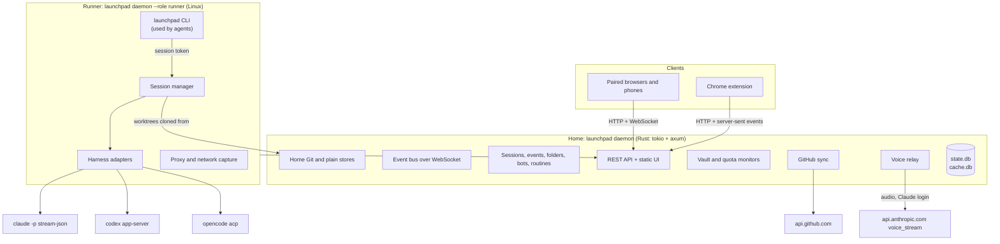
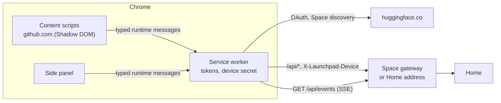
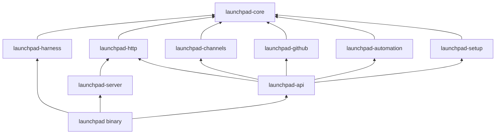

# Architecture

Launchpad is one Rust binary that runs as **Home** or as a **runner**, and a React UI that Home serves to browsers and phones (installable as a PWA). Home owns every record; runners run the agents and send everything back to Home.



## Design principles

1. **Never wait on the network to show something.** Every screen renders from the local database first and refreshes in the background.
2. **Launching an agent is the main action.** A minimal launch is a prompt and a click.
3. **The core does not depend on a harness.** Claude Code, Codex and OpenCode are adapters behind one session model.
4. **Local first, then follow GitHub.** New work stays local until you publish it. Once work is on GitHub (a published Local PR, or a pull request launched with **Push to PR**), agents keep pushing to that same branch, never with force. Comments, reviews and PR state changes always need your click.
5. **Click only.** Every action is a visible button. The only keyboard shortcuts are `Ctrl+F` in Files, `Ctrl+T` for a terminal, `Ctrl+Space` and `Esc` for dictation in a message box, and normal text and terminal keys. The only gestures are pull to refresh on phone lists and a long press on a message box's mic to hold to talk.
6. **One user, move fast.** No multi-user model, no versioning, no data migrations. Few tests.

## Processes

- **Home** (`launchpad daemon`, the default role; `--role home` is a no-op): a systemd user service on a Linux server, or the daemon of a Hugging Face Space (`deploy/hf-home`). It owns `state.db`, Home Git, the vault, GitHub polling, quota monitoring, routines, Telegram and the voice relay. It runs no agents and no terminals: a request that would start an agent there is refused, and terminal calls are relayed to a runner. Home may run on another system than Linux.
- **Runner** (`launchpad daemon --role runner`, Linux only, `role::ensure_agent_os`): runs agents in its own folders and keeps only copies and work in progress. It starts only the sessions Home places on it. At startup, it reads the environment of your login shell, so agents see the same tools as in a terminal.
- **Agent processes**: children of a runner, each in its jail. **Restarting a runner interrupts its running turns**; sessions become Interrupted and resume with one click through the harness's native resume, on that runner or another one. At its next start the runner handles each cut turn as a turn end (`Sessions::load`: heads, `unsaved` mark), and notifies only once that turn is saved (`turn_sync::notify_when_saved`). Restarting Home interrupts nothing.

There is no single-process mode (`--role all` is refused) and no native shell: browsers and the installed PWA are the only windows, and the daemon never opens windows or links. Notifications go only through Telegram.

## Roles

The [Home and runners plan](https://wauplin-launchpad-bots-research.static.hf.space/index.html) splits the daemon into two roles of the same binary. Home never reads a runner's disk: every lease, MCP, Git, plain-folder and knowledge base call of a runner goes to Home over its link. Every folder is stored by Home (Home Git or a plain store) and runs on any runner. Folders are added only by Clone from GitHub (`project_clone::clone_to_home`), New plain folder (`projects::create_plain`) and Keep as folder; there is no Add folder by path, folder discovery or folders root, and Home never reads or writes its own disk for folders. Temporary folders are the only records a runner registers itself. A runner's own window shows only its status (`web/src/features/runner`): the server refuses every other call from a signed-in browser on a runner (`auth::runner_window_path`), while bearer clients (Home's tunnel, the CLI, agent tokens) are unaffected. A runner refuses launches that Home did not relay (`X-Launchpad-From-Home`). Its **Takes new sessions** switch (`runner.takes-sessions`, the `paused` guard in the runner's folder) is reported to Home, which then places nothing new there.

A runner pairs with `launchpad connect` (a code approved on Home; Home stores the SHA-256 of the runner's secret) and keeps one outbound WebSocket to `/api/runners/tunnel`, authenticated with `X-Launchpad-Runner`. Each side writes the socket from one task with two lanes (`wire::lanes`): control messages (pings, requests and answers, acknowledgements, replication, terminal frames) always go first, and the body parts of exchanges wait in a bounded bulk lane. Each exchange body has a 4 MiB window: the sender waits for room, the reader acknowledges what it read (`HttpAck`), and a reader that drops a body early sends `HttpCancel`, which stops the other side. A peer without the `flow` capability gets no window. Home sends API requests over it (`runners::Hub::request`), which the runner answers by calling its own router as its local owner. The other direction is not trusted: a runner is a low-trust worker (`runner_trust.rs`). Its credential reaches Home Git, plain folders, handoffs, leases, quota readings, replication and uploads for the sessions Home placed on it, and a closed list of API requests its own work needs (folder and Local PR records, merges and branch deletes of its sessions' branches, its sessions' records and the context traces Home sent it, presets, connection names and notifications of its sessions), each checked against Home's records. It reads plain stores (knowledge bases, bot files, plain, asset and temporary folders) and Local PRs only of the workspaces of the sessions Home placed on it (`scope::of_runner`). An agent's CLI call that the runner forwards (`FromRunner::Req` with `session`) runs on Home with a session credential Home signs for that session (placed on that runner), so Home checks it with `agent_auth` and the session's access from its own records (`vault::session_access`). Home lets a runner act on the owner's click it relayed (Merge at the reviewed head, Keep as folder) through short-lived grants (`runners::Hub::grant`). Nothing a runner sends runs as the owner, so a compromised runner reaches only its own sessions: never the vault, MCP settings, connections, the Outbox, Suggestions, Local PR publication, Home updates or another runner's sessions. Pairing, approval and the tunnel refuse a runner that reports another system than Linux (`role::os_refusal`, shown as refused in Settings). A runner and Home compare `role::PROTOCOL` and the build commit: another protocol cannot connect; another build of the same protocol keeps its running sessions but takes no new ones. Such a runner updates itself on an owner click (`self_update.rs`, capability `self_update`): Home relays `POST /api/runner/update`; the runner waits until none of its sessions is running, downloads Home's running executable (`GET /api/runners/build`, runner credential, through an `HttpOpen` exchange, with SHA-256, commit, OS and architecture headers), renames it over its own executable, stops its server and `exec`s the new build with the same arguments.

A Home on a Hugging Face Space updates itself (`crates/setup/src/home_update.rs`): it reads its Space's Dockerfile (written by `deploy/hf-home/deploy.sh`) to know its channel and version (a release tag, or CI's package of a `main` commit), checks GitHub every hour (and on **Check for updates**) for a newer one of the same channel, and lists it in Today. **Update Home** (the owner's click, an admin agent's `launchpad home update`, or a ready card; the newest of the deployed channel, or of the channel asked for) saves a `home_update` record in `state.db`, takes a forced backup (a failed backup clears the record and refuses the update, since the restarted Space would restore an older backup), then commits the rewritten `Dockerfile.release` of the target and the Space card to the Space (Hub commit API, Home's own HF login, on top of the revision it checked); the Space rebuilds and restarts. When the owner asked for it, the new Home restores the record and asks each connected runner with another build to update itself (`self_update`), once per runner, for 24 hours. A source-built Space or an edited Dockerfile is never replaced.

Agent CLI updates (`crates/setup/src/cli_update.rs`): Home reads each harness's npm package (`Harness::cli_package`) every six hours, asks each connected runner with the `cli_update` capability for its versions (`GET /api/runner/clis`) and decides with `cli_update::plan` (same major version, or same minor for 0.x: automatic; else an Approve card). Home keeps one `cli_update` record per harness and version in `state.db`, with one entry per runner, and saves an entry as requested before it relays `POST /api/runner/clis/update`, so a runner is asked once per version (Retry is the owner's). The runner daemon finds the installer from the resolved executable (npm prefix, or the CLI's own installer), waits like a self-update until none of its sessions is running, holds `harness::CLI_INSTALL` for writing while it installs (harness starts take it for reading) and reads the version again; Home follows the job every minute. Burst and Home's Space keep the pins of `deploy/hf-home/release.json`.

Replication (`replica.rs`): on a runner, `Sessions::store` and `Sink::emit` also queue the record or event in `home_outbox`, in the same transaction. The tunnel sends the outbox in order, one batch in flight (`replica::batch`: at most 200 items and 4 MiB; a larger item goes alone, and one over 48 MiB loses its inline data URLs or becomes a marker that Home skips). Home applies each item and records its number in `runner_ack` in one transaction (`Sessions::apply_replica`), then acknowledges the last item it stored (`Ack`). The runner deletes acknowledged items and sends the next batch from that acknowledgement (`replica::after_ack`), so an item that failed is sent again; an unanswered batch is resent after two minutes, and Home ignores items it already holds. Home skips an item only after it kept failing for 10 minutes (`replica::give_up`), with an error in its log. Cost increases replicate the same way (`replica::Item::Spend`, counted once by ID): Home holds the spending ledger of every machine (`spend.rs`) and sends it to every runner (`ToRunner::Spend`), which checks the rolling spending limits against it. On Home, sessions with a `runner_id` are replicas: startup never interrupts them, and items of an older `generation` are ignored. A replica never changes the fields Home placed (harness, profile, workspace, bot, tools), and Home's `last_seq` is its last stored event, so a trace through it always exists. Temporary folders replicate the same way (`project.runner_id` on Home: where the folder is now); every other folder is Home's record, and Home ignores other folder items. Home owns workspaces, Git folders, Home Git, Local PRs, review drafts, scheduled launches and follow-ups: it sends `Workspaces` snapshots to runners, and runners forward changes to Home (`home_client::home_owned`). Runners also forward the Launchpad CLI's context reads (`/api/context/*`) and every trace read: only Home sees the sessions, schedules and Inbox of every runner and holds every generation of a trace, so an agent sees the same Launchpad on any runner. A launch or message on a runner resolves its context the same way, never only from the runner's own records: context traces (and `browser_trace`) come from Home unless the runner's record already covers the requested events (`sessions::resolve_traces`), a folder missing from the runner's copy of Home's list comes from Home (`projects::resolve`), read-only plain context folders come down when the runner has no copy (`plain::reference`) and Git ones are cloned, presets come from Home, and attachments come as `upload:` references whose bytes the runner fetches from Home. A trace read waits for the items the runner queued before it, and the runner answers itself only when Home is out of reach.

On Home, `runners::relay` sends every session or folder request to its runner, except the record, events, images and trace, which Home serves. Relayed requests carry only `Idempotency-Key` and are marked `X-Launchpad-From-Home`. Home also sends `ToRunner::Settings` (`[worktrees] keep`) and its profiles on connect and after each config change; the runner writes the value through `ConfigHandle::update` only when it differs.

Terminals (`crates/server/src/terminals.rs`): a runner's daemon owns every PTY; Home runs none. `runners::relay` passes every `/api/terminals*` call to `terminals::home`, which picks the runner: the terminal's runner (`ROUTES`, filled from runners' answers and pruned by fresh lists), else `?runner=`, `?session=`, a temporary folder's runner, a path a runner reported, or the agent whose folder holds the path. A Git folder without an agent goes to a runner picked like for a launch (`runners::pick`, else any connected runner that serves terminals), with the body rewritten to `project=<id>`, so the runner opens its repository cache (`repo_cache::sync`). Plain folders get no shell without an agent. The list merges every connected runner's list (10 s per runner) and tags each entry with `runner_id`; close-all goes to every runner. Continue in TUI (`/api/sessions/{id}/terminal`) is relayed by session. A runner needs `Capabilities.terminals`; an away runner, a stopped Burst job or an older build answers 503 with the reason, and the UI disables its entry points. A terminal never moves a session or starts Burst. Each viewer WebSocket goes through the tunnel as a stream: `ToRunner::WsOpen { id, path }` (only `/api/terminals/{id}/ws[?offset=]`), `WsFrame { id, text | data }` in both directions (binary as base64) and `WsClose { id }` (`FromRunner::WsClose` may carry an error). The runner serves it like a local viewer (`Access::through_home`), so output stays in its 1 MB buffer and the per-viewer credit and `ack` pass through unchanged; Home checks the window's own access. A dropped window sends `WsClose`; a dropped tunnel closes its relays (`runner_gone`) and windows reconnect with `?offset=`. Runners report terminal changes (`FromRunner::Terminals`) and Home publishes `terminals/changed`; output never goes on the bus.

Placement (`runners::place`) is the only way Home picks where a session continues: its runner when connected; else, between turns, a move to another runner that takes launches (`runners::pick`: the previous runner, else the least busy); else Burst; else a clear error. It serves the owner's messages, Resume and answers, bot, proposal and report-reply messages, Local PR review requests (`runners::send_anywhere`) and scheduled follow-ups (`schedules::run`; a busy session answers 409 and the follow-up stays queued). Launches use the same order (`launch_anywhere`, Home only), never fall back from a runner chosen in the composer, and first move the sessions of a runner that does not take launches (away, paused, outdated) when they continue in a session's folder (Launch here, Run in) or a temporary folder: to another runner, else to the Burst job, which takes them before it starts the launch (`runners::move_pinned_to`). While a Burst job starts for a session, placement sends its other requests (messages, Resume, answers) to that job: they wait in its run record (`BurstRun.queued`; a retry with the same idempotency key is kept once) and follow the first one in order; a failed start fails them with it. Every launch records the session on Home before the runner starts it (`runners::record_placement`: Home's launches before relaying, Burst's placeholder), so a lease is only ever given for a session Home placed.

A session still Running, asking or paused for quota on a runner that left becomes Interrupted on Home after `runners::AWAY_GRACE_MS` (10 minutes), with a note as its last message; a runner that comes back with the same generation replaces the record. A runner releases the sessions Home moved away from it (`handoff::release`): every move queues the release in `runner_delivery` (`state.db`), with pending Archives, and `runners::deliver_pending` sends them when the runner is connected, again every 10 minutes, and drops each one only after the runner answered it. The runner stops them, pushes their commits and uncommitted files to `lp-scratch/<branch>-gen<n>` with the daemon's Git token, removes their folders once Home confirmed the push, and forgets them. Session records, events and tunnel messages carry attachments as `upload:` references only, never bytes. Home stores the data URLs of a launch or message as uploads before it sends it to a runner or Burst (`attachments::to_refs`). The runner fetches the bytes it lacks from Home (`attachments::fetch_missing`, runner call `upload`); Home serves them only for a session it placed on that runner, and only references it sent to that session or that its record names (`attachments::read_for_runner`). Harnesses get images as data URLs only at delivery (`attachments::for_harness`), and runners replicate records without inline bytes (`Session::without_bytes`). Upload cleanup keeps the uploads that chat messages name, so their images stay viewable. Tunnel messages may reach 64 MiB, and the Space gateway allows the same. A session's attachments (`<data_dir>/attachments/<id>/`) travel in its handoffs and are restored on the adopting runner; files Home already has for the session go by hash only.

Home Git (`home_git.rs`): Home keeps a bare mirror per Git folder in `<data_dir>/git/<id>.git`. Its fetch refspecs follow every branch and tag of the folder's remote except `lp/*` and `lp-scratch/*`; a `pre-receive` hook accepts pushes only to those and `refs/lp-snapshots/*`. A session's Git token writes only its own refs (`home_git::session_ref_patterns`, from Home's records): its branches, their `lp-scratch/` leftovers and the snapshots of its worktrees, and only in folders of its workspace or folders its launch named; the runner daemon's token keeps every Launchpad ref. Runners speak Git's smart HTTP protocol to `/api/git/<id>.git` (served by `git http-backend`, authenticated by the runner credential, session named by `X-Launchpad-Session`); after each `receive-pack`, Home compares the Launchpad refs, keeps every replaced tip as `refs/kept/<ms>/<branch>` (pruned after 30 days) and records the push time of `lp-scratch/` branches (`scratch_push`). The prune deletes an `lp-scratch/` branch 30 days after the later of its last push and its commit date (`scratch_expired`), after copying its tip to `refs/kept/`, and only if it did not move meanwhile; snapshots age from their commit date. Mirrors keep `gc.auto = 0`; the six-hour prune runs `git gc --prune=1.day.ago` on each mirror with at least 2,000 loose objects or 20 packs (`home_git::needs_gc`), one mirror at a time and without the mirror's lock (Git's one-day grace covers pushes that run meanwhile; every object Home needs is held by a ref, and reflogs are off). It first deletes the browse copy under its lock, since that copy borrows the mirror's objects; the next read rebuilds it. Home pushes followed branches (`git_follow`: published Local PRs, Push to PR sessions) to GitHub, only after a push by a session that works on that branch. `/api/home-git/<id>/…` serves refresh, branches, Restore, delete, merge and pull request branches (Home reads the pull request itself). Whenever a worktree's folder is gone from its runner (retention, or a move) or the runner is away, `away.rs` answers its Changes, worktree list, Merge and Create Local PR on Home from the mirror (`WorktreeInfo.on_home`), whatever the runner's state. Runners send every worktree record to Home on its own (`replica::Item::Worktree`, Home's `runner_worktree`, dropped once all its sessions are archived), so away views work before the first handoff and flag `unpushed` when Home's branch differs from the runner's head. Home checks each merge a runner asks for against its own records (`worktrees::check_merge_request`): a worktree branch of the named session with that base; for an agent's merge also When done = Merge and the folder in the session's workspace. A runner's merge counts as the owner's only for the folder, branch and head of an owner's Merge that Home relayed to it (a grant kept in memory for a day, so an owner merge that waits across a Home restart must be clicked again). A runner's merge request (`/api/home-git/<id>/merge`) runs in its own task on Home (`worktrees::merge_for_runner`, one per folder, branch, head and base). The call waits at most 40 s, less than the runner's 60 s, then answers `Pending`; the runner keeps the merge Waiting and asks again with `again`. A call that got no answer or was never sent (`home_link::NoAnswer`, `NotSent`) waits the same way. Home replays only a merge that happened; a failed one runs again on a new request. When `again` finds no task (Home restarted) or a task ended without an outcome, Home reads `branch_merge`: a recorded merge is done, anything else is `Uncertain`, which fails the merge with a notice and is never retried or sent to the agent. `home_git::merge` skips its fetch when the mirror fetched in the last 30 s: the push to the remote is never forced, so a base that moved since is refused there. Every worktree merge goes through `worktrees::merge_on_home`, which records it in `branch_merge` (dropped when the branch leaves Home Git): Home is the source of truth for a branch's `merged` and `predraft_id` (`away::from_home`) and completes every runner's worktree list with them (`away::complete`). Changes always compare with the merge-base of the branch and its base branch. Home's own worktree handlers refuse: what reaches Home without `?session=` is refused, never run on Home's disk.

Runner side (`repo_cache.rs`, `worktrees.rs`): `<data_dir>/repos/<id>` is a clone whose `origin` is the runner-local endpoint `/git/<id>.git` and whose `upstream` is the folder's remote (fetched first for objects). The endpoint accepts only HMAC tokens derived from the daemon token (`daemon`, or `session:<id>` in each worktree's `config.worktree`) and forwards to Home with the runner credential; Home refuses a session that now runs elsewhere. `worktrees::plan` records a worktree at launch; `prepare` (background start task) syncs and adds it; removal pushes first and saves uncommitted files to `lp-scratch/…`.

Saving a turn (`turn_sync.rs`): a turn end stores each worktree's local head in its record, then the new status with an `unsaved` mark (`Session::unsaved`), so Home never shows a turn as saved before it is. `turn_sync::save` then pushes each branch with `--force-with-lease` on the tip Home last confirmed (`TaskWorktree.pushed`, empty for a new branch), never the clone's remote-tracking ref. When the push is refused, the runner reads Home's tip: a tip that is already the local head counts as pushed, a fast-forward from `pushed` goes through, and anything else (a Restore, another runner's commits) sends the session one notice and holds pushes (`held_at`) until the local tip takes Home's tip in and, after a Restore to an older tip, drops the held commits (`worktrees::hold_lifted`), or until Home's branch changes again. So a Restore is never overwritten, even by commits made on top without a fetch. The save then syncs plain and temporary folders, uploads the handoff and clears the mark. A failure keeps the mark with its reason; the runner retries every three minutes and when its tunnel reconnects, one save per session at a time (a move waits for it, `turn_sync::hold`). A final handoff, an adoption and Archive clear the mark. Done routine triggers wait for the mark to clear (`crons::turn_saved`). Every worktree Merge sends the head the window showed (`worktree.merge` input `head`) and is refused when the branch moved past it.

Session status (`Sink::set_status_when`): status changes of one session run one at a time under a per-session lock, from the read through the turn end's heads and `unsaved` mark to the write. The pure `sessions::transition` decides each change (quota pause guard, quota stops, same status), and the write applies only when the stored record still gives the same decision (compare and set), so a turn end never overwrites a newer status. Side effects run only for an applied change. A quota pause first sets the `Pausing` phase and leaves the session Working; the harness's real turn end becomes QuotaPaused with the turn end's save and notification. When the guard moves to `Paused` and the status is still not QuotaPaused, that is the turn end. A turn the harness starts on its own while QuotaPaused is saved at its end, without a notification (`paused_turns`). A message that reaches a turn which ended on its way sets Working again, so its next turn end is recorded.

Snapshots (`worktrees::snapshot`): at each turn end, at removal and every five minutes during turns (`turn_sync::periodic`, with plain and temporary folders), the runner commits every file of each worktree on top of `HEAD` with a temporary index (`repo_cache::capture`) and pushes it to `refs/lp-snapshots/<worktree id>` on Home; the worktree's index, `HEAD` and files are never touched. Away Changes and Files show the last snapshot when it is newer than Home's branch, as of when it was taken. A folder cloned again from Home (`worktrees::restore`, after a move or retention) gets its commits and uncommitted files back from it; a snapshot it cannot apply (diverged, or applying failed) goes to `lp-scratch/<branch>-snapshot` first. Discard and the 30-day prune delete snapshots.

Local PRs (`predrafts.rs`) are Home records for `(folder, lp branch)`; detail, Merge (`home_git::merge`) and Publish (`home_git::push` of the reviewed commit) read the mirror. Runners forward `/api/predrafts` to Home, except `create`/`resolve` by worktree. `change_set` is the creating session; `publish_set` checks every member's reviewed commit first, publishes nothing when a branch moved, then publishes the open members and links the pull requests. Followed branches (`git_follow`) push one at a time per branch, never forced, always the branch's current commit; the record keeps the last commit GitHub accepted and the last error, each mirror refresh retries in the background, and the UI shows "Not on GitHub yet". A worktree merge (`worktrees::merge_on_home`, also used for a runner's request and an away session) marks the open Local PRs of its branch merged; Home also marks merged an open Local PR whose branch moved past `initial_base` and has no commit beyond its base (when its page opens, at start and every six hours), and refuses a new Local PR of a merged branch with nothing new. Home backups add one bundle per mirror. After a restore, `git_restore.json` lists the pending bundles of each folder. `home_git::ensure` applies them once the mirror has fetched its remote, and `home_backup::run` retries them every minute. A bundle is fetched into `refs/lp-restore/`, and only refs the mirror lacks are created (`update-ref` with `create`), so newer refs are never overwritten. A pending bundle stays in every backup (`git/<id>.pending.bundle`) until it is applied.

Temporary folders (`projects::create_temp`, `Target::Temp`): a folder `<data_dir>/tmp/tmp-<MMDD>-<slug>` on the session's machine, registered with `is_temp` in the launch's workspace so Files and routing work as for any folder; it is the only record a runner registers itself. The launch prompt gets `sessions::temp_instruction` (folders list and `work add-project`). Its files are a store on Home, `tmp-<folder id>` (`plain::temp_store`), synced like a plain folder (down in `plain::prepare`, up at every turn end) without `.gitignore`d files, nested Git repositories, lock or baseline repository. The folder keeps its ID on every runner: a move recreates it with the same ID and name (`handoff::relocate`, `projects::ensure_temp`) after Home moved the record (`projects::move_temp`), and the old runner removes its copy at the final handoff. `sessions::archive` (the Archive endpoint and Home's local close) runs `projects::after_archive`, which removes the folder and its record (hidden from every list) once every session in it is archived and Home holds every file (`plain::in_sync`); Resume recreates it (`ensure_temp` in `reattach`). Home drops the store 30 days after the last session was archived (`plain::clean_temp`). A temporary folder that holds a Git repository (`plain::git_inside`, at its top or nested) never leaves its runner: a move is refused, and Archive and a release keep the folder and say why. Each handoff records whether it saw one (`Handoff.temp_git`). **Keep as folder** (`projects::keep_as_folder`, on the runner that has it; `projects::keep_away` on Home when that runner is away, refused when the last handoff saw Git data) makes it a folder stored by Home: a temporary folder with a Git repository becomes a new Git folder of Home (`add_to_home`; only with a network remote, `projects::register_remote`, so Home never mirrors a path of its own disk) and stays for its agents; other files go up to Home, then Home turns the record into a plain folder with the same ID and moves the store's files and history from `tmp-<id>` to the folder's store, its one open agent holding the lock (`projects::keep_temp`, `POST /api/plain/<id>/keep`); the runner moves its copy to `plain::copy_dir`, with what it synced (`plain::moved_copy`), native harness history (`project_moved`) and the sessions' `cwd`. From then on `.gitignore`d files sync too, as in every plain folder.

Plain and asset folders (`plain.rs`): Home keeps each store's tree in `plain_file`, contents by SHA-256 in `<data_dir>/blobs/sha256/`, and every change in `plain_history` (30 days; Restore re-commits the old content). `plain_lock` gives one session a store. Runners call `/api/plain/<id>/{tree,blob,commit,lock,unlock}` over HTTP with the runner credential; `sync_down` writes Home's version into the copy (`<data_dir>/plain/<id>`, or an asset path of a worktree) and commits a local Git baseline for Changes; `sync_up` hashes the copy and sends what changed since the last sync, leaving symbolic links out (one log line per sync); an asset folder that is or goes through a link is never synced (`session_stores`). Home has no copy: Files reads a plain folder from `plain::browse_copy` (`<data_dir>/browse/<id>`, written from the store when its version changed), like a Git folder from its browse copy; `code::open` maps the folder's own path to it (temporary folders use the `tmp-` store). Home relays `/api/code/*` to the connected runner that holds the root (`code::runner_for`: a session's folder or a runner's temporary folder; images and downloads come back in a base64 envelope, `x-launchpad-envelope`); for a session whose runner is away, `code::open` reads its worktree from `origin/<branch>` of the browse copy, and its plain or temporary folder from the store copy. Backups list live blobs as `plain/<sha>` objects; a restored Home reads missing blobs from the backup store. `plain::prune` deletes only unlisted blobs written at least an hour ago (`prunable`), since blobs are uploaded before the records that name them; writing a blob that exists refreshes its time.

## Credentials and the jail

Home keeps a vault in `state.db` (`vault.rs`): harness logins (a Claude setup token, a Codex `auth.json`), and tokens, all write-only, plus the tool registry (`tool` table: install recipe, variables that get a placeholder, settings that are not secret, host rules, granted workspaces). A lease keeps one token per host (`vault::host_conflict`: the first tool by name). A tool's settings never enter the session's environment: the runner puts wrapper scripts on PATH that set them and run the tool's programs (`tool_install::wrappers`, in `<data_dir>/sessions/<id>/tools/<tool>/`, read-only in the jail). Settings → Credentials and tools edits them; runners forward those requests to Home.

Before a harness starts, `contain::apply` asks Home for the session's lease (`FromRunner::Call` "lease" through the tunnel). Home gives one only for a session it placed on that runner, in its current generation (`vault::check_owner`), builds its contents (workspace, folder, bot, login, tools) from its own session record (`vault::own_request`, `contain::request`), never from the runner's request, and records `vault_lease`. The lease holds the login's token, the granted tools and their tokens, and the Git identity. The runner keeps it in `proxy::Proxy` memory, renews it every ten minutes and drops it after an hour without Home, or on Stop/Archive (`release`). Each lease row records its tools and MCP servers for the session's Summary.

The runner proxy (`proxy.rs`) listens on `127.0.0.1`, with a second port for captured connections (see Network capture below). Jailed processes get `HTTPS_PROXY` with a per-lease key and the runner CA in their CA variables; host rules match only lowercase DNS names (`vault::dns_name`, exact or `*.` subdomains; tools are saved lowercase) and a token is added only when the built URL still goes to exactly that host, on the default port and without user info (`vault::url_is_host`); on a host with a credential the proxy terminates TLS with a leaf certificate from the runner's CA (`<data_dir>/proxy/`), sets the token (Bearer, Basic, header or query) and streams the request upstream; every other host is a plain `CONNECT` tunnel. Harness logins use base URLs on the proxy (`/lp/<key>/<host>/…`): Claude Code gets `ANTHROPIC_BASE_URL` and a placeholder `CLAUDE_CODE_OAUTH_TOKEN`; Codex gets an `auth.json` with placeholders and an unsigned ID token, and `config.toml` pointing at the proxy (adapters own this in `Harness::contained_login`). GitHub API requests that write a pull request or issue body, a comment or a review (REST, and the GraphQL mutations `gh` uses) are read and signed with the session's attribution line (`attribution.rs`; on Burst, `token_relay` signs them on Home); the same module signs Suggestions, published Local PRs and Outbox messages at the owner's click, and `Harness::contained_attribution` sets a harness's own pull request attribution (Claude Code's `attribution.pr`). Requests that received a token go to Home's `access_log` (through `replica::Item::Access` on a runner); known actions become session notices. Home refreshes Codex logins itself (when the quota app-server on Home's copy refreshed a login, the vault keeps that newer login, `vault::login_home`); the owner's Refresh (`vault.refresh-login`, `vault::refresh_login`) forces a refresh, asks runners to renew the leases that hold the login (`ToRunner::RenewLeases`) and reads the quota now (`Harness::read_quota_now`); a refused login sets `QuotaStatus.refused`, and Home's sign-in on a Space replaces it in place (`/_home/login` with `replace`) and runs one quota monitor per vault login (`vault:<id>`, plus `vault:default:<harness>`), sent to runners as `ToRunner::Quotas`. A profile without its own login uses the harness's default login (`vault::default_login`: the first by name, then ID) for its lease and its quota reading; only Home resolves `vault:default:<harness>`, and runners keep Home's copy of that reading. Automatic work (routines, hook and agent messages to a bot, auto-mode cards, merge follow-ups) starts only on a confirmed reading (`quota::hold_reason`, `bots::quota_hold`, `crons::quota_hold`); runners send the readings of their running sessions back with the `quota` runner call (`quota::session_reading`). Automatic work that waits for a reading (`quota::hold_reason`) asks the login's monitor for one (`quota::want_reading`); the Claude monitor then reads the rate-limit headers of a one-token request (`setup-token` tokens cannot read the usage endpoint), at most every 10 minutes and never against a used-up window that has not reset.

The jail (`jail.rs`) is bubblewrap with system folders, PATH folders and toolchain folders read-only (never a folder that is or holds the home folder, the data folder or a credential folder: `jail::protected` and `jail::mountable`; such PATH folders are left out, and a harness program falls back from its release folder to its `bin` folder or the file alone), and the session's folders read-write: its working folders, `<data_dir>/worktrees`, `<data_dir>/repos`, its harness home (`<data_dir>/sessions/<id>/home`: `HOME`, `CLAUDE_CONFIG_DIR`, `CODEX_HOME`), its `/tmp` and its workspace's cache (`<data_dir>/caches/<workspace>`: `XDG_CACHE_HOME`, `CARGO_HOME`, and `sccache` through `RUSTC_WRAPPER` when installed, with a per-session server socket in its `/tmp`). Only a short list of machine variables passes. Jailed CLIs receive an HMAC credential in a separate signing domain, bound to session ID and generation; the server limits it to context and inert preparation, checking session ownership for worktree mutations. `UserEnv::jailed` makes `exec::Cmd` wrap the program in `bwrap`; adapters start every native process with `StartSpec::process_env`, and title requests, harness TUIs and folder setup commands (`worktrees::run_setup`, through `contain::auxiliary`) use the same lease, jail and network capture. Tools install once per recipe into `<data_dir>/tools/` (downloads by the runner, package managers in a jail). With `[runner] boundary = "vm"` (a Local VM, `packaging/local-vm.sh`) the VM is the boundary: no jail, Docker allowed, same lease and proxy. There and on Burst, `contain::apply` builds the same `Jail` with `bwrap: false`: the process runs without bubblewrap but with only the kept variables and under the capture, and the runner CA goes into the machine's system bundle (`netcap::system_ca`; the Burst image makes it writable, `local-vm.sh` installs it with `launchpad proxy-ca`). Burst and Local VM daemons mark themselves non-dumpable, and `UserEnv` drops `LAUNCHPAD_BURST_CREDENTIAL`. Because jails write the repository caches and worktrees, the runner daemon's own Git never reads their config, hooks or attributes files (`git_safe.rs`): `GIT_DIR` comes from the folder and `GIT_COMMON_DIR` is a shadow directory of the daemon with its own config (`origin` = Home's URL) and links to the repository's objects and refs; credentials are keyed to Home's exact URL. A folder without a repository gets a `GIT_DIR` that does not exist, so daemon Git fails closed (only `init` and `clone` run there). Because Git still follows links and `objects/info/alternates` that an agent plants, daemon Git on a runner whose jail is bubblewrap also runs in a minimal bubblewrap sandbox: system programs and libraries and a few `/etc` files read-only, the shadow directories, and only the caches and worktrees, or the one plain or temporary folder it works in, with a private `/tmp` and the shared network (pushes go to the daemon's loopback Git endpoint). The home folder and the rest of Launchpad's data do not exist there, so nothing outside those folders reaches Home through a push or snapshot. A runner without bubblewrap fails its daemon Git; Local VM and Burst runners (no owner files) skip the sandbox. The sandbox has no `~/.ssh`, so a runner's direct fetch of an SSH remote fails and Home sends the commits. The owner's terminals in a worktree are not covered: tools run there read the agent's Git config.

Outside Git, the runner never follows a link an agent planted (`safe_fs.rs`). Every file it reads or writes outside the jail in a folder an agent can write goes through `safe_fs`: plain, temporary and asset folders with their `.launchpad/assets.toml`, a clone's `info/exclude`, native traces (`trace::read`, `trace::write`, the OpenCode export), attachments and their handoff copies, and the harness setup files in the harness home (`Harness::contained_*`, `.gitconfig`). `safe_fs::anchor` takes the data folder's first-level folder (`<data_dir>/sessions`, `worktrees`, `plain`…) as a trusted base, also under its resolved path, and creates it when missing. These folders are the daemon's, and jails mount them or folders below them, so they may be links the owner made. Below the base, every component opens with `openat(O_NOFOLLOW|O_DIRECTORY)` from the previous descriptor, so nothing can change between a check and the use. Reads open the last component with `O_NOFOLLOW|O_NONBLOCK` and accept only regular files. Writes go to a new `.lp-write-<uuid>` file (`O_EXCL|O_NOFOLLOW`), get their mode with `fchmod` and replace the name with `renameat`, so a planted link or hard link is replaced, never written through. Downloaded plain files get 0755 when executable and the umask's default otherwise. The output of a background task (`/api/sessions/{id}/task-output`) is read only on the session's runner (`contain::tmp_file`): a `/tmp/…` or `/var/tmp/…` path maps to the session's own `tmp` folder (the machine's `/tmp` on a Local VM or Burst), read with `safe_fs::tail`. Home relays the route to the session's runner and answers `null` for a session without one.

Network capture (`netcap.rs`, the supervisor in `crates/cli/src/netcap.rs`): `Jail::command` runs every contained process as `launchpad netcap --port <capture port> --key <proxy key> -- <program>`, inside bubblewrap when there is one. The supervisor forks the program under a seccomp filter with a user notification listener (`no_new_privs`, so no process of the session removes it), stays its parent and the subreaper of processes that detach (Yama allows ancestors to read the agent's memory) and exits with its status. Non-dumpable processes (Chrome's helpers, ssh-agent) need `CAP_SYS_PTRACE` in their user namespace: where the kernel allows it, the program starts in a new user namespace mapping only its own user and group, which the supervisor owns and so holds every capability over, while the program drops all of its own (`Reach::Namespace`). Where user namespaces are refused or lose their capabilities (HF Jobs, Ubuntu 24.04's AppArmor restriction), the filter makes `prctl(PR_SET_DUMPABLE, 0)` succeed without effect (`Reach::KeepDumpable`). A process the supervisor still cannot read gets EFAULT for checked calls, never an unchecked one. It creates every internet socket itself and injects it (`SECCOMP_IOCTL_NOTIF_ADDFD`; HF Jobs refuse `pidfd_getfd`), keeping a copy of TCP sockets until they connect. A TCP connect to a non-loopback address connects that copy to the proxy's capture port with `LPCAP1 <key> <ip> <port>`; the proxy connects to the destination first and answers `OK` or `ERR <errno>`, so `connect` returns the real result. On port 443 of a lease with tokens the proxy reads the ClientHello's server name and, on a lease host, terminates TLS as for `CONNECT`. `getpeername` returns the original address. The filter refuses io_uring, x32 and foreign-architecture calls, TCP Fast Open, raw and packet sockets, and socket families other than Unix, internet and route netlink; UDP may only reach port 53 (`netcap::udp_allowed`). Link-local and cloud metadata addresses (169.254.0.0/16, fe80::/10, fd00:ec2::254) are refused except on port 53 (`netcap::refused`), by the supervisor and again by the runner proxy on the resolved address. The jail shares the machine's network namespace, so the supervisor also runs `connect` and `bind` of Unix sockets itself, on a copy of the descriptor (`pidfd_getfd`) with the address it checked: paths work, the abstract namespace (X11, D-Bus of the machine) is refused; addresses given to `sendto` and `sendmsg` are checked in place. `netcap::check` runs `launchpad netcap --self-test` once; a machine where it fails runs no agents. `netcap::network_check` runs `launchpad netcap-probe` in a sandbox built like a session's, for **Check network** (`POST /api/runners/{id}/network-check` on Home, forwarded to the runner's `/api/runner/network-check`; Home keeps the last result in `RunnerStatus.network_check`).

Bots (`bots.rs`) are Home records (`bot` table: workspace, slug) whose files live in a plain store `bot-<id>` with history: `BOT.md` (instructions), `bot.toml` (`BotSettings`: name, profile, model, optional Git folder, permission mode, `max_threads`), the only source of their settings, `routines/<name>.toml` (the definitions of its routines) and `memory/`, the bot's notes. Every write of the store (`bots::write`: owner saves, `bots::write_files`, Restore, accepted cards) calls `ext::Extensions::bot_files_changed`, which runs `crons::sync_bot_files`. Bot-files cards (`ProposalBody::BotFiles`) hold the new text of `BOT.md` and routine files (null deletes one) with the sha256 each started from; accepting checks every hash, then writes all files in one change. Memory writes go through `bot_memory::apply`, which uses the knowledge base's writer (`kb::apply_to`: one write at a time, base check, author in `plain_history.meta`) and refuses paths outside `memory/`. `launchpad bot memory` posts writes to the runner (`/api/bot-memory`), which sends them to Home (`FromRunner::Call`, op `bot-memory`); Home takes the bot and the author from its own session record. Runners mirror the store of each bot with an open session to `<data_dir>/bot-files/<bot id>/` (`bot_memory::sync`: before a session starts, after each write and every minute; dropped an hour after the bot's last open session), and the jail mounts only that bot's copy read-only as `$LAUNCHPAD_BOT`. At start, Home moves each older bot's `bots/<slug>/` notes from the knowledge base into `memory/` once (`bot_memory::move_from_kb`, claimed in `seeded`; a new bot claims it at creation). A bot without a folder launches each session with `Target::Temp`, and so does a bot whose `bot.toml` still names a plain folder (`bots::effective_folder`; `Bot.folder_unused` says why), since bots never run in plain folders. A bot has several threads (`bot_threads.rs`, table `bot_thread`: bot, id, routing key, title, created and archived times; `main` always exists). A thread is the sessions whose `LaunchSpec.bot` names the bot and its `BotLaunch.thread` (empty = `main`). `bot_threads::route` (pure) picks the thread from the message's source: the owner's chosen thread (`bot.message` `thread`, `new_thread`, or `item_thread` for one GitHub item, key `github:<repo>#<n>`), `channel:<id>`, `hook:<id>`, `agent:<sender session>`, or a new thread per routine run (`routine:<file>`); `bot_threads::resolve` takes the open thread with that key or creates one, under a per-bot lock. `bots::message_with` sends to the thread's newest open session (`runners::send_anywhere`) or, on the thread's first message, a change of profile, folder, model, effort or permission mode in `bot.toml` (`bots::rotation`, compared with `BotLaunch.permission_mode`, the mode `bot.toml` gave at start, so a mode set on the session in Agents keeps the thread), an archived session or the owner's New session checkbox, closes it and launches a new one (`runners::launch_anywhere`) with a `BotLaunch` (name, slug, `BOT.md`, its `version`, the `reason` shown on the chat divider, the thread's previous session). At most `max_threads` threads (default 16) work at once (`bot_threads::at_cap`): the owner's messages bypass it, automatic ones from hooks, channels and agents wait in `queued_message` under `bot:<id>:<thread>`, and routine runs at the cap are skipped. `POST /api/bots/{id}/message` is retry-protected like session input: the retry middleware (`crates/server/src/operations.rs`) claims its `Idempotency-Key` in `browser_operation`, and `bots::message_with` passes the key on as the input's key, or as the new session's ID. Calls without a key (agents' `launchpad bot message`, Telegram, hooks, routines, report replies) skip the claim. A per-bot lock (`bots::MESSAGES`) covers every caller from the choice of session through the close of the old session and `launch_anywhere`, so two messages never start two sessions of one thread and the cap check stays with the launch; it is released before a message to the open session is relayed. The runner's `resolve` appends the bot instruction and the previous session's trace reference; traces come from Home, so a thread continues on any runner. A `BOT.md` edit reaches the current session through `runners::deliver`, the one place where Home sends a message to a runner: when the session's `BotLaunch.version` differs from the bot's, it appends `bots::changed_block` (the new `BOT.md`) after the typed text and records the new version on Home's record only once the runner accepted it (a Burst-queued message gets the block when the job delivers it). A replica never overwrites `launch_spec.bot`. At start, `contain::apply` loads the bot's memory into the instructions (`bot_memory::compose`: `memory/INDEX.md` first, then by path, up to 100 lines, then a closing line that says where it was cut and how to read the rest); `Bot.memory_loaded` reports the counts. `start.rs` holds the labelled parts of a start (`instruction_parts`, `join`, prompt `slices` from the marks of `Sessions::resolve`); the real start and What it sees at start (`launchpad_api::bots::start_preview`: `GET /api/bots/{id}/start-preview`, `POST /api/launch/start-preview`, action `launch.start-preview`, Home-owned) use the same functions. Bot sessions are normal sessions in every list; the sidebar shows a state dot summed over the bot's threads, and Today titles a bot's card with the bot and the thread. Home's backups also write readable copies of knowledge bases and bot files under `<workspace>/` in the bucket (`home_backup::readable`).

Routines (`launchpad-automation`: `crons.rs`, table `cron_agent`, one JSON record each) live on Home. A bot's routine is defined by its file (`CronAgent.file`): `sync_bot_files` (one at a time) creates, updates or deletes records from the files, keeps the last good definition and sets `file_error` when a file has an error, and recomputes the next run from now when the schedule, zone, trigger or pause changed (a new trigger also starts its watermarks from now). UI saves of a bot routine write the file (under one lock), and the sync updates the record. The record keeps runs, the next run, watermarks and claims. `crons::files_from_records` wrote older bot routines as files once (claimed in `seeded`). Other routines stay records only. A `Trigger` starts a run: the record's 5-field schedule (`crons::spawn` checks every 5 s), new Inbox threads after an Inbox sync (`crons::inbox_synced`, watermark `github_seen`), or a turn ending Done (`crons::turn_ended`, which the core reaches through `ext::Extensions::turn_ended` from `Sessions::apply_replica` on Home; a turn with the `unsaved` mark triggers when the mark clears, `crons::turn_saved`). Each run is claimed as a `RoutineRun` history entry before it starts; `turn_ended` settles it (Report, No update, Failed, Interrupted, Stopped). A routine with `bot_id` (or an Assistant target) sends `crons::bot_message` to a new thread of the bot for each run, and a quiet run (`no_update`) archives that thread while it holds only the run's session; others launch their spec with `LaunchSpec.routine`, whose prompt gets `routines::instruction`. A paused bot sets `bot_paused` on its routines. Before the claim, `crons::limit_reason` skips a run past the loop guard, or the 7th run in an hour of a routine started by events (schedule triggers are exempt). `session_done` triggers skip turns of bot threads unless `include_bots` is set. `channel_trigger.rs` runs bot routines with a `Trigger::Channel` (channel ID, `mentions_only`) in Home's 30-second failure tick: it reads the `channel`, `channel_member` and `channel_message` tables of state.db directly (no dependency on `launchpad-channels`), claims by advancing the `channel_seen` watermark (a message ID, set to the newest message when the trigger is created or changed), skips the bot's own messages and the messages a `channel_delivery` row already delivered to it (it reads only messages at least 5 seconds old, since a post writes its delivery rows after the message), and gives the run the highest message hop plus one. `check_file` refuses a channel that is not of the bot's workspace, archived or without the bot as a member; the bot routine API and `routine` cards resolve `#name` or `@<bot slug>` to the ID. A schedule runs in the record's IANA `time_zone` (chrono-tz; the saving browser's zone, else `[home] time_zone`, else the host's).

Every start goes through `runners::launch_anywhere` on Home (browser launches, accepted proposals, routines, scheduled launches, bot messages, and agents' launches forwarded by runners), sent once and never retried. When no runner takes it, or the composer chose Burst, `burst::launch` stores a Starting placeholder record and starts a job; the runner then creates the session with the same ID and its record replaces the placeholder.

The tunnel (`server::wire`) is the same protocol whichever side dialed. Burst runners (`burst.rs`) are HF Jobs from Home's own image, with a runner record Home creates and a secret derived from its daemon token; Home dials `/api/runner/reverse` through the HF Jobs proxy (`server::burst`). They hold no credential: a lease for a Burst runner has no secrets (`relayed`), the runner proxy sends those requests as `HttpOpen` exchanges with a `Lease` target, and `token_relay` adds the token on Home, sends the request and records it. Every other connection of the proxy (captured connections, `CONNECT` tunnels, plain HTTP) is an exchange with a `Tcp` target: Home connects to a public address only (`netcap::public`, checked on the resolved address), answers 200 or an error with `errno <n>`, and streams both directions (`token_relay::tcp`). Home Git and plain-folder requests of a Burst runner go to a local relay (`127.0.0.1:<port>`, `home_link::load`) and then through the tunnel to Home's router (`exchange::home`, runner-authenticated paths only). The job runs agents without a jail, and its daemon keeps its owner token in memory only (`Paths::keep_token_in_memory`, as on a Local VM). `burst::tick` stops a job after the session's final handoff and a newer complete Home backup, or 15 minutes after the handoff without one (`burst::after_handoff`: the run then fails with the reason and a notice in its sessions), and records its cost (`burst_run`); Home starts no job for a launch or message past a profile's spending limit; a message to that session starts a new job and moves the session there. An hour before HF Jobs' 24-hour limit, Home stops the job's open turns once (claimed in `limit_stop_at` before the requests) with a notice in each session, so they hand off. A moved session in a temporary folder finds it with its files on the new runner.

Moves (`handoff.rs`): runners post a handoff (native conversation files from `Harness::native_trace`, worktree records) to `/api/handoff/<id>` at each turn end, through their tunnel (an `HttpOpen` exchange with the runner credential, `exchange::home`), never by HTTPS to Home's address, where a Space's gateway refuses requests without a browser Origin, when it changed, and a final one before a planned move (branches pushed, leftovers saved, folders removed, process stopped). A worktree whose merge stopped moves with its record; only a waiting merge holds the folder. Home keeps the latest handoff per session in `session_handoff`, with the native files in the content-addressed blob store (`plain::write_blob`, kept by `plain::live_blobs` and the Home backups), never in `state.db`. A turn-end handoff is short when it can: the runner remembers what Home confirmed for each native file (length and SHA-256, `handoff::send`), sends an unchanged file by hash only and a file that only grew as its new tail with its `base` hash and the hash of the whole file (`handoff::part`). A file that shrank or changed earlier bytes goes in full. A short handoff goes to `/api/handoff/<id>/parts`, which an older Home refuses, so it never stores a tail as a whole file. Home (`handoff::store`) accepts a `base` or a by-hash file only when it equals the hash of the same file in the session's latest handoff, appends the tail to that blob, checks the whole SHA-256 and stores a complete blob, so the latest handoff, adoption, trace copies and backups see whole files. When Home refuses a short handoff, the runner sends the full one to `/api/handoff/<id>` at once; any failure clears what it remembers. Adoption and `handoff::restore` seed that memory from the handoff Home served, and a release forgets it. `handoff::move_to` holds `runners::place_lock`, so a session moves once at a time. When the old runner is connected, its final handoff runs first, as a job Home polls with one key (`handoff::final_job`), waited for up to 30 minutes. Then Home increases the session's generation and names the new runner (`Sessions::reassign`), and asks it to adopt: it fetches the record and handoff, rewrites folder paths for its own data folder, records the worktrees as Removed (cloned again from their branches and snapshots on the next message), restores the attachments and calls `Harness::restore_native`. A failed adoption does not undo the move: the new runner adopts the session when Home relays its next request about it (`handoff::adopt_moved`); adoption is idempotent. The adopting runner numbers its events after a gap (`sessions::MOVE_SEQ_GAP`), so late events of the previous generation are stored below them, never dropped or overwritten. Every hour a runner removes the folder of archived sessions (`<data_dir>/sessions/<id>`) after Home confirmed the same native files (`handoff::clean_archived`); a later start restores them from Home's handoff (`handoff::restore`, from `contain::apply`).

MCP (`mcp.rs`): servers live in `mcp_server` with their token as a `mcp-<id>` vault entry. A lease names granted servers; `Harness::contained_mcp` points the harness at `/lp/<key>/mcp/<id>` on the runner proxy, which sends each request as an exchange with an `Mcp` target. The gateway checks the lease and grant, refuses a POST body that is not a JSON-RPC object or a non-empty batch (400, error -32700) and forwards the value it checked, refuses `tools/call` and filters `tools/list` for tools that are off, adds the token, streams the answer back and logs each call.

Default tools (`tool_defaults.rs`): workspace and folder layers in `tool_defaults` (Home), the bot layer in `bot.toml` `[tools]`. Home resolves them with the launch's `tools_off`/`tools_on` in `LeaseRequest::off` when it builds a lease (and in the MCP gateway); runners compute nothing.

The knowledge base (`kb.rs`) is the memory agents share; a bot's own notes live in its store (see Bots above). Runners mirror each workspace's knowledge base to `<data_dir>/knowledge/<workspace name>/` (every minute, before a session starts and after each write); the jail mounts it read-only as `$LAUNCHPAD_KB`, and `Harness::contained_memory` turns the harness's own memory off and writes its user instructions (the knowledge base and `INDEX.md`). `launchpad kb` posts writes to the runner (`/api/kb`), which uploads contents as blobs and sends the writes to Home (`FromRunner::Call`, op `kb`); Home checks the session's runner, takes the author from its own session record and applies writes one at a time. A write whose base changed is kept as a `.concurrent-<id>` sibling. A removal names the content it removes (`Op::Remove.base`: the mirror's synced version for agents, the shown version for the owner) and leaves a note that changed since in place, with a line that says so. Edits and deletions in a runner's mirror are not sent (Home's version replaces them, and a missing mirror is downloaded again): Home accepts a runner's writes only for its sessions, and the owner edits notes in Home's window.

## Sessions and harnesses

Every harness maps to the same model:

- A **launch spec** describes what to run: the prompt, target folder, context, profile, model, options and start conditions. The composer, schedules, crons and proposals all produce launch specs.
- A **session** is the durable record: status, usage, title, folder, native conversation ID.
- **Events** are the normalized conversation (messages, tool calls, questions, approvals, subagents), stored in order with a sequence number and pushed to every client over the event bus. Clients reconnect with the last sequence number they received and get what they missed.

Adapters (`crates/harness/`, contract in `crates/core/src/harness/mod.rs`) translate each native protocol into these events and own everything native: startup, resume, model discovery, quota readings, terminal commands. See [Harness adapters](harness-adapters.md).

Voice (`crates/server/src/voice.rs`, Home only; see [Voice](voice.md)): `GET /api/voice` returns the `[voice]` settings and every profile as a source with its state (ready, used up with its reset time, refused, no login, pay as you go, unsupported) and why voice is unavailable. `GET /api/voice/ws` is the dictation socket. It accepts only a signed-in browser device of Home with one of Home's window origins: runners, bearer clients (the CLI), agents' session tokens and the Chrome extension's origin are refused. The window sends `warm`, `start {id, keyterms, profile?}`, binary frames of 16 kHz mono 16-bit PCM (100 ms each), `stop` and `cancel`; Home answers `source {name, note?}`, `delta` (the phrase so far), `done` (a settled phrase), `error {reason}` and `closed`, each with the `id` of its start, so the window drops late messages of an earlier dictation. Home opens the provider through the harness contract: `HarnessCapabilities.voice` (shown by `GET /api/harnesses`) and `Harness::open_voice(app, env, VoiceOpts {language, keyterms})`, which returns a `VoiceCall` with an input channel (`Audio`, `Finish`) and events (`Interim`, `Final`, `Error {refused}`, `Closed`); a refused login is a `VoiceRefused` error. The env is Home's own copy of the profile's vault login (`vault::login_home`, read only, never refreshed), and two profiles with one login count once. Only Claude Code sets `voice` today (`crates/harness/src/claude/voice.rs`: a WebSocket to `wss://api.anthropic.com/api/ws/speech_to_text/voice_stream` with `Authorization: Bearer`, `x-app: cli` and `x-config-keyterms`, `KeepAlive` every 8 s and `CloseStream` to finish). Home keeps the audio since the last settled phrase in memory; on a refusal, an error, a call the provider closed, or no connection within 3 s, it opens the next source and replays that audio, with a failover note. A warm-up opens the first source for 30 s, and a start with the same keyterms takes it over. One dictation per socket, 5 minutes at most. Logs hold sizes, timings and HTTP statuses, never text, audio or tokens. The provider connection ignores `HTTPS_PROXY`. In the browser, `web/src/lib/voice/` captures the microphone with an AudioWorklet, keeps one dictation per window, detects silence and inserts settled phrases at the caret; the demo plays a scripted voice through the same code (`demo/routes/voice.ts`).

A launch only does local work in the request: it records the session (Starting) and its planned worktrees, then returns. A background task has Home refresh its mirror, clones or fetches the runner's repository cache, adds the worktrees, runs worktree setup and starts the harness; Stop cancels it between steps. A worktree that cannot be prepared fails the session visibly. Merges and publications run on Home and never touch a checkout of the owner.

## Topics

Home owns workspace topics in `crates/core/src/topics.rs`: `topic` stores each name and workspace, and `topic_session` stores its session memberships in `state.db`. Membership is separate from runner session records, so replication cannot overwrite it. Edits never send session input or change status; archiving keeps membership. Bulk edits check every session's workspace before one transaction. Deleting a topic removes its memberships and keeps the sessions; deleting a workspace removes its topics.

The owner routes `/api/topics…` are Home-owned and forwarded by runners. Topic writes use the action list and publish `topics` / `changed`. The shared React feature (`web/src/features/topics/`) provides list and detail pages, chips and a searchable picker: a laptop popover or phone sheet. Agents combines a topic filter with text search and supports bulk assignment.

`TopicContext` in launch and message context starts as a live topic selection. Home resolves it at dispatch into a saved name, source session IDs, event cutoffs and history warnings. It checks every source’s workspace, including members whose folder moved. Overlapping sources keep one reference with the highest selected cutoff; resolution never follows a source’s own context. The prompt contains trace read commands and warnings, not trace bodies. Saved snapshots survive topic rename or deletion; missing source traces fail visibly. Start previews resolve a cloned spec through the same resolver without changing membership.

Home saves launch snapshots and inherited topic IDs before runner or Burst placement, and adds membership after recording the receiving session. Follow-up messages add membership after an accepted runner response; quota-held messages retain their rendered trace references. Direct trace selections inherit the source’s current topics; whole-topic selections inherit the selected topics. Later membership edits do not change earlier recipients. Membership changes never remove attached context, and rejected launch cleanup removes the receiving session’s memberships.

Scoped agent reads use Home’s `/api/context/topics` through `launchpad topics list|show`. They expose source indexes and cutoff trace commands only in the caller’s workspace; owner topic routes remain closed to agents. The shared UI offers expandable source previews, topic Launch and a Summarize prompt that asks an agent to read the traces and cite its sources.

## Storage

| Store | Content | Lifetime |
| --- | --- | --- |
| `config.toml` | Settings, profiles, presets | Edited in Settings or by hand |
| `state.db` (SQLite, WAL) | Sessions, events, drafts, Local PRs, suggestions, Outbox messages, connections (table `connection`) and hooks, bot channels (`channel`, `channel_member`, `channel_message`, `channel_delivery`, Home only), bot threads (`bot_thread`, Home only), schedules, devices | Your data; back it up. A daily pass (`crates/server/src/retention.rs`, Home and runners, also at start) deletes completed `browser_operation` claims after 7 days (`operations::prune`; claims without a result stay), `session_raw` rows after 14 days and proxy access entries after 30 days. `session_raw` is capped per session (20,000 lines, 16 MiB, each line cut to 64 KiB), written without awaiting and deleted at Archive |
| `cache.db` (SQLite) | GitHub payloads as JSON | Disposable, rebuilt on demand |
| Home backup (`home_backup.rs`) | `state.db` copies (`VACUUM INTO`, at most every 10 minutes on the timer, `DB_EVERY_MS`; backups of new Home Git refs or uploads in between list the last copy with the plain blobs and uploads it needs), `config.toml`, uploads, plain blobs and Home Git bundles by content hash, one manifest per backup, written last; a live blob already in the destination is listed without a download, one missing on Home and in the destination is left out and reported (`missing_blobs`) | Home only; retention keeps the two newest, the newest at least 1 h old and the newest at least 1–10 days old (`retained`), after checking the newest is complete, then deletes unlisted objects older than an hour; a listing or download error, a listing without the new backup or an unreadable recent manifest stops pruning; restored on an empty boot only from a complete manifest (retries, then fails the boot when objects exist without a readable manifest), bundles and blobs fetched when first needed, bundles kept pending until applied |
| Trace copies (`trace_copies.rs`) | After each backup, the native files of each session's latest handoff, unchanged, and `launchpad.json` under `<workspace>/traces/<folder>/<YYYYMMDD_HHMM>_<id>/` (one file per trace) | Home only; changed files only, never read back. What they hold (`trace-copies.json`, `readable-copies.json`) is saved on Home and under `home/copies/` in the destination (`home_backup::save_copy_state`), uploaded when it changed; a Home with no local file reads it from there, so a restore does not copy everything again |
| Harness folders | Native conversations, per session in the runner's `<data_dir>/sessions/<id>/home` (removed once archived and copied to Home). Adapters never read the machine's `~/.claude` or `~/.codex` | Owned by each harness |
| Knowledge base (`kb.rs`) | One per workspace, stored by Home like a plain folder (store `kb-<workspace>`, history with author and line counts in `plain_history.meta`); a read-only mirror on each runner | Home; changes restorable 30 days |
| Bots (`bots.rs`, `bot_memory.rs`) | `bot` rows on Home; `BOT.md`, `bot.toml` and `memory/` stored like a plain folder (store `bot-<id>`), with history; a read-only mirror on runners for open bot sessions; readable copies in the bucket | Home; changes restorable 30 days |
| Ask Launchpad (`ask_bot.rs`) | a normal bot, created once per workspace; the Launchpad CLI tool, added once to the tool registry (`seeded` rows record both) | Home |
| Librarian (`librarian.rs`) | a normal bot, created once per workspace (existing and new) with its paused `routines/weekly-tidy.toml`; a `seeded` row records it | Home |
| Vault (`vault.rs`) | Credentials (write-only), tools, leases, access log, in `state.db` | Home only |

Pending PR reviews live in Home’s `review_state` under `pending-review:<repo>#<number>`. Summary, event, follow-up, line comments, source suggestion and an uncertain submission travel together. Posting claims a source suggestion before the GitHub write and records success before any merge or CI follow-up; follow-ups never retry. Local PR line notes store path, line and side separately from their text.

Each database runs its calls on one thread (`Db::call`). `state.db` also has a second, read-only connection on its own thread (`Db::read`) for long reads: session search runs there, so it never holds up event inserts, replication or Today (WAL readers do not block the writer). Search matches only `user_message` and `assistant_message` events, through the partial index `session_event_message`.

Inbox polls (`crates/github/src/inbox.rs`) mirror `/notifications?all=true` in `cache.db`. An incremental poll starts with a conditional first page (a 304 ends it) and stops at the first page whose threads the mirror already holds with the same `updated_at` and read state (`inbox::all_known`); it only adds or updates threads. A full pass every 3 hours (`FULL_EVERY_MS`) and at each start reads the whole history and replaces the mirror, so threads that left GitHub's history and read changes on older pages show within 3 hours. Inbox membership stays in `state.db`.

Rust types shared with the UI derive `ts_rs::TS`, so the API is typed end to end without an OpenAPI spec.

## Security model

The Home-only Space POC (`deploy/hf-home/`) runs the daemon behind the private Hub gate, with backups on a separate private bucket volume. Its gateway runs the first-start setup (`onboarding.py` and `setup.html`): HF device login and the `LP_HOME_KEY` credential key (a passphrase the owner generates or types; the gateway derives the AES key with scrypt and passes it to the daemon as `LAUNCHPAD_HOME_KEY`), required before admitting app or runner requests; GitHub device login; the Git identity; a first profile through a Claude `setup-token` or Codex device login stored in the vault; a workspace and a cloned folder. Optional steps pair a runner and launch a first agent through the normal API. The gateway also serves `/_home/runner/install.sh` and Home's own binary, so runners install the exact build Home runs. With `LAUNCHPAD_HOME_KEY`, Home seals only vault secrets (AES-256-GCM) inside backup copies of `state.db`; other backup data stays plain for browsing and deduplication. The gateway keeps Home's HF and GitHub logins encrypted in the bucket, and rejects disabling or redirecting Home backups. Its image includes the pinned harness, GitHub and Hugging Face CLIs for discovery and quota checks; agent turns still run on runners. See its README for isolation and recovery limits.

- Launchpad has one user. Every paired browser has full access.
- The daemon listens on loopback. Remote access goes through a private network (Tailscale) or a proxy you control, with an exact allowed origin.
- Browsers authenticate with an HttpOnly device cookie after pairing. The Chrome extension sends its device secret in the `X-Launchpad-Device` header instead (see [Chrome extension](#chrome-extension)). The CLI uses a bearer token from the data folder. Burst and Local VM runners, where agents run as the daemon's user, keep that token in memory only: no runner window sign-in or owner CLI there.
- Agents use Launchpad through their session CLI token at their access level for the Launchpad CLI tool: read, propose or admin (from the bot's `bot.toml`), which Home reads from its own records (`vault::session_access`). Workspaces are a boundary for agents (`scope.rs`, checked on Home by `agent_auth::authorize`): lists, traces, Local PRs, proposals, admin actions, `work add-project`, Home Git and plain stores cover only the session's workspace. Presets, shared settings, MCP switches, Home updates and diagnostics stay Launchpad-wide. Proposals are inert: the owner starts them, except one-time starts of a bot in auto mode. Admin reaches only Launchpad's own records and a closed list of shared settings (presets, GitHub poll interval, worktrees kept), never GitHub, the Outbox, credentials, the rest of `config.toml` or the machine. No agent grants a permission (`agent_auth::permission_guard`): it never answers a permission request, and it may only make a session's permission mode stricter. An agent's `bot.update`, Restore of `bot.toml` and `schedule.update` never raise a bot's Launchpad access, turn `inbox_done` on or loosen a bot's or a scheduled launch's permission mode (`bots::agent_refusal`), and a bot an agent creates gets at most propose. Accepting a card runs its action, so admin accepts only cards whose action it may run directly. Ready cards prepare an owner action and run only from their own button.
- Diagnostics (`crates/api/src/diagnostics.rs`, admin access only, `agent_auth::diagnostic`): `GET /api/logs` reads the recent log (`launchpad_http::logs`: every tracing line, redacted when written, in `<data_dir>/logs/launchpad.jsonl`); on Home, `source=all` merges Home's lines with each connected runner's (`source=local` there), and a runner forwards every other source to Home. `/api/context/{health,failures,runners,burst,burst/<runner>/job,home,tools,connections}` return state without secrets. The failure feed (`launchpad_automation::failures`) is Home's 30-second check of failed sessions, Burst runs, routine start failures and runs skipped after waiting an hour for a quota reading (`RoutineRun::missed`), scheduled launches, runners that went offline with running sessions, quota holds (`quota::holds`: automatic work waited 15 minutes for a login's reading) and restarts (`daemon_start`, written at each start and clean stop); routines with a `failure` trigger read it after their watermark (`failure_seen`). On a runner, every agent read and admin action, an agent's request about a session the runner does not run, and an agent's launch go to Home with the agent's session (`home_client::forward_writes`); Home checks them with that agent's access and relays them like the owner's buttons.
- Messages that are not the owner's (`senders.rs`): Home stamps the sender (`MessageFrom`: bot, session or routine, its card, whether the owner accepted it, and the hop count) from its own records, never from a request body. A runner passes the calling session with each agent request it forwards, and Home trusts it only when it placed that session on that runner; Home's relay replaces any `context.from` in a body, and a runner drops one that Home did not relay. `runners::deliver` puts the text of a bot or agent message under a fixed header naming the sender, fenced, and the `user_message` event records `from`. Launches, schedules and follow-ups carry the sender too (`LaunchSpec.from`); launches get no header. The hop count of a session is that of its last `user_message`; a message past 3 hops is refused (“loop guard”), and an owner message resets it.
- GitHub publication and merges always require an owner click. Owner and repository names in API paths are checked (`github::valid_name`: GitHub's characters, never `.` or `..`), and `GitHub::request` refuses dot segments, also encoded, in every path. Folder setup commands run only in the session's jail; agents cannot change them.
- Connections (outgoing webhooks, incoming hooks and Telegram; `/api/connections…`) live on Home. Messages to other people (outgoing webhooks, GitHub suggestions) wait in the Outbox for a click and are never retried; messages to the owner's own bound Telegram chat go out directly. Telegram is per workspace (`telegram.rs`): each workspace has its own bot token in the vault (`channel-telegram-<workspace id>`) and a `telegram_chat` row (bound chat, single-use code, switches, update offset), written by one writer (`telegram::modify`). Home long-polls each token in its own loop, so it needs no inbound endpoint; a bot already used by another workspace is refused, so a token never has two readers. Plain text goes to the workspace's Ask target and `/<bot>` to its bots only; notifications and `launchpad send telegram` (the session of the agent's CLI token) reach only the chat of the session's workspace (`kb::workspace_of_session`), and a session without one gets no Telegram. The owner's routes are `/api/connections/telegram/{workspace}` (the `telegram.*` actions, never admin). Deleting a workspace removes its token and row; a one-time start step (`seeded` key `telegram-per-workspace`) deleted the former single token and binding. Incoming hooks (`/hooks/<id>`) skip the browser sign-in and authenticate with their own secret (behind a private Space, also an HF token). Each hook messages its own thread of the bot (`hook:<id>`), Telegram the main thread. Hook and Telegram messages to a busy thread wait in `queued_message` (`hooks::deliver`, key `bot:<id>:<thread>`) until its turn ends, automatic ones also for confirmed quota and a free thread slot (the queue is checked every 3 s); each is claimed (deleted) before its single send.
- Bot channels and DMs (`crates/channels`: `channel.rs` records, posting and mentions; `delivery.rs` delivery and loop guard; `/api/channels…`) live on Home in four `state.db` tables: `channel` (a named channel or a `dm` of two bots, with its pause, block, archive, limits, allowance and reset time), `channel_member` (a bot and its mode), `channel_message` (author, text, mentions, hop count) and `channel_delivery` (one row per bot a message goes to, with state and reason). A channel belongs to one workspace (`scope::of_channel`). Home stamps the author from its own records: the owner, or the bot of the calling session when it is a member. Delivery writes every row first (the claim), then sends through the bot path (`hooks::deliver_channel`, to the bot's thread of that channel, `channel:<id>`: `queued_message` while that thread works or the bot is at its thread cap, quota holds for bots' messages); a later message joins the bot's waiting entry under the queue's lock. A claimed delivery is never retried; a row neither queued nor sent when Home stopped becomes skipped as uncertain at the next start (`delivery::after_restart`). The channel's loop guard (`delivery::guard`: hop limit, hourly limit, allowance; the owner's messages skip it and reset it) replaces `senders::guard` for these messages, and the delivered text is framed and fenced like other senders' messages, with the channel's history referenced, never inlined. Agents use their own routes (`crates/channels/src/agent.rs`): `GET /api/channels/agent` (list), `GET /api/channels/agent/read` and `POST /api/channels/agent/post`. Home takes the caller from its record of the CLI token's session (`AgentSession`: bot, workspace, access), never from the body, and resolves channel names, `@bot` DMs and bot names only in that workspace. `agent_auth` allows list and read at every level and post at propose (an own write: the body's `session_id` must be the token's session); the workspace check (`agent_auth::within_workspace`) leaves exactly these three paths to the handler and refuses any other `/api/channels/agent/…`. The owner routes stay the owner's, except `channel.create` and member changes (`channel.add-member`, `channel.set-mode` on its own route so the activity list records the right action, `channel.remove-member`) at admin; an agent on another owner route gets a hint that names the CLI command (`agent_auth::channel_refusal`). A runner holds no channel state: `/api/channels…` is in `home_client::home_owned`, so it forwards every channel call to Home with the agent's session, and a runner credential alone reaches none of them (not in `runner_trust::may`). A bot's `channel read` moves only its own `channel_member.last_read`. Channel cards (`ProposalBody::Channel` from `launchpad propose channel`, `ProposalBody::ChannelJoin` from `launchpad channel join`) are proposals of `launchpad-automation`, which reaches the channels crate only through `ext::Extensions::channel_card` (installed by `crates/cli/src/extensions.rs`, served by `launchpad_channels::cards`): it checks a card when filed (names resolved to IDs in the author's workspace; a join card's bot is always the author's, from Home's session record) and again when accepted, then creates the channel or adds the member. A new join card replaces the same bot's waiting card for that channel. A channel name stays taken while its channel is archived (one unique index, shared with DM keys). Asks reach Today through `ext::Extensions::today` (`launchpad_channels::today`: one `ChannelAsk` item per channel with unread asks or mentions of the owner, main action `channel.post` with `reply_to`). Daily digests (`digest.rs`, Home only) run at 08:00 in `[home] time_zone`, else the host's zone: the day is claimed in `channel_digest_run`, each digest row (`channel_delivery.kind = 'digest'`, with its first message and count) is written before its single send through `hooks::deliver_channel` as automatic work, a run over an hour late is skipped, and a skipped digest does not move the member's place. The owner's `channel.digest` sends them at once.
- Agents run contained: a bubblewrap jail on Linux runners (or a Local VM). They see their session's folders, their own harness home and the machine's toolchains, never your home folder, keys, logins or Launchpad's data. The runner never follows a link an agent plants in those folders (`safe_fs`). Their network goes through the runner proxy, captured below the HTTP libraries (`netcap`), which adds Home's tokens on known hosts; agents only hold placeholders. Token scopes decide what a request may do; a steered agent can still leak what it reads or misuse a token within its scopes.

## Chrome extension

The extension (`extension/`) is a GitHub layer inside github.com plus a side-panel chat about any page. It never acts in pages, never posts or submits on GitHub and never calls a model API: agents run on runners like every other session. See [extension/README.md](../extension/README.md) for what it shows.



- **Service worker** (`src/background/`): the only part that talks to Home and Hugging Face and the only part that holds credentials. The Hugging Face refresh token and the device secret live in `chrome.storage.local`, the access token in `chrome.storage.session`; both areas are closed to content scripts. Pages and the panel reach Home only through the typed messages of `src/shared/messages.ts`: one dedicated request per Home route, each checking its input, and no generic Home call. Sign-in, connection and settings requests come only from extension pages.
- **Connection**: on a Space Home, Sign in with Hugging Face (OAuth public client with PKCE, scopes `openid profile read-repos`) finds the Space by its `launchpad-home` tag (or the title “Launchpad Home”), and the gateway's `POST /_home/extension/connect` creates a device after the Hub's private-Space check (the gateway calls `POST /api/devices/extension`, owner bearer only). The Hugging Face token goes only to the Hub and to `https://<name>.hf.space`; discovery asks `GET /_home/status` only of running Spaces of the signed-in account, and an organization's Space only after the owner picks it. On a dev or self-hosted Home, reverse pairing gives the secret (`/auth/reverse/poll` answers `device` to the extension origin and sets no cookie). The daemon accepts `X-Launchpad-Device` only with the extension's origin or with no origin (Chrome sends none on an extension's GETs), never falls back to a cookie, and answers CORS only for `chrome-extension://bbefehapjjlbeodihifmpgidgjhmcklj`. `POST /api/extension/disconnect` deletes the extension's own device; revoking it in Settings → Devices ends its streams.
- **Live updates**: `GET /api/events` is the event bus of `/ws` as server-sent events (the same `hello`, replay by `Last-Event-ID: <boot>:<bus>` or `?boot=&since=`, `resync`, a keepalive comment every 15 s), since a browser WebSocket cannot carry the device header. The worker resumes from its last position, recounts the toolbar badge (Today of the extension's workspace) and drops cached page contexts on relevant events.
- **Page context API** (`crates/github/src/ext.rs`, routes in `crates/api/src/ext.rs`, types `Ext*`): `GET /api/ext/context?url=&workspace=` (the page kind, the folder of the repository with its relation, agents, suggestions with their line comments, Local PRs, branches GitHub lacks or ready to push, CI-relevant files, Today items, the Inbox thread, the default bot), `GET /api/ext/rows` (row states of a list page) and `GET /api/ext/notifications` (Today's counts and the threads a bot handled). They answer from Home's records and cache only, never with a GitHub call, narrowed to the folder's workspace, else the one asked for. They are Home's (runners forward them) and closed to agents. The worker caches each context 30 s per page and workspace.
- **Content scripts** (`src/content/github/`): the page kind comes from the URL. Every insertion point is a named anchor in `anchors.ts` with two or three strategies; the panel's Settings shows their health. Widgets are closed Shadow DOM hosts built from text only, re-rendered after GitHub's soft navigations. IDs and numbers come from the URL and Home, never page text.
- **Writes**: Insert fills GitHub's own fields and only observes GitHub's submit, to record the ledger (`suggestion.shown`, `suggestion.inserted`, `suggestion.posted-by-hand`, `suggestion.dismiss-comment`; `crates/github/src/ledger.rs`, table `suggestion_ledger`). GitHub's own Done, mark as read and Unsubscribe are observed and recorded with `inbox.observed`, a local change only. The three GitHub writes it can start (`localpr.publish`, `inbox.done-handled`, `branch.push-to-pr`) run only from the confirm button of their own dialog, on a trusted click, and Home checks each again.
- **Private notes**: `launchpad note` (`POST /api/notes`, an agent's own write checked like a suggestion; runners forward it to Home) stores a Markdown note in `item_note` on Home (`crates/github/src/notes.rs`), one per bot (else session), item and workspace, replaced by the author's next note and deleted only by the owner (`note.delete`). `ExtContext.notes` carries the notes of the context's workspace; a `notes` bus event drops cached contexts. Notes never leave Launchpad.
- **Prefill and the agent view**: the GitHub layer fills the empty comment box with the newest suggested comment without a click (Settings → GitHub; it claims the suggestion only at GitHub's submit), and shows an agent's turns in a read-only drawer built from `session.events` with the panel's `chatRows`.
- **Selections**: Ask about these lines sends a `DiffSelection` reference; Home reads the lines from the pull request's diff when it sends the message to a runner (`ext::Extensions::selection_lines`) and fences them as untrusted text.

## Action list

Every action that a button, a proposal card, the Launchpad CLI or the admin rules name is defined once in `crates/core/src/actions.rs`: its name (`<group>.<verb>`), method and route, label and icon, input fields, confirmation text, effect (checks, record, starts, outside, machine), access (owner or admin), the card kind whose acceptance runs it, and its undo action. The handlers stay in their crates. Four places read the list:

- `agent_auth::admin_allows` allows a non-GET request from an admin session only when its route matches an admin action exactly and its body holds only the action's input fields. Accepting a card runs the action of its kind (`actions::for_card`), so admin accepts only cards of admin actions. Actions marked `ready` (merge, publish, post, send, run CI, Inbox done, Update Home) can be prepared as ready cards (`ProposalBody::Ready`): the card's button runs the action's call and confirmation, then marks the card `ran`.
- `launchpad_cli::cli_reference` writes one usage line per admin action into the session's instructions.
- `launchpad do <group>.<verb>` and the short verb `launchpad <group> <verb>` build the request from route ids and `--<field>` options, and refuse owner actions.
- The UI reads the generated `web/src/gen/actions.ts`: `ActionButton` asks for the confirmation, and `runAction` sends the request.

Actions that reach GitHub or other people, money, credentials or the machine are owner actions. They have a confirmation or an undo.

The front door records every successful direct admin action of a session (`crates/server/src/activity.rs`) in Home's activity list (`crates/automation/src/activity.rs`): the action, its body, the values before (read through the action's GET route) and the undo call (the undo action with the old values, or a delete of the created record). The bot chat shows each entry as a Changed line whose record name links to its page. Shared settings (`GET/PATCH /api/settings/shared`) are the part of `config.toml` that `settings.set` may change; every `config.toml` write goes through `ConfigHandle::update`, which reads, changes and saves under one lock.

## Decision list

Home computes, once for every window, phone and count, what waits for the owner: the Today list (`crates/core/src/today.rs`). `today::compute` collects the core's items (sessions with `Session::needs_you()`, unpublished Local PRs, outdated runners) and the items of the feature crates through `ext::Extensions::today` (proposals and failed routines, Outbox drafts, GitHub suggestions and open review requests, Home updates, agent CLI updates). Each item names its filter (Answer, Review, Approve, Send, GitHub, Fix), its record (plus `owner/repo#number` for GitHub items, so a row never depends on the Inbox cache) and the main action of its row from the action list. The page shows one compact row per item (`web/src/features/today/TodayRows.tsx`); the bot chat shows the same items as cards (`TodayCards.tsx`). Handled items of the last 30 days form the Done list.

- **Workspaces**: Home resolves each item's place (folder, session, launch, repository) to workspaces with the same rules as the UI's `useScope()`. An item with no workspace is not listed, except what is shared: outdated runners, Home updates, tool or preset proposals without a workspace, Outbox messages without a session.
- **API and event**: `GET /api/today` (`crates/api/src/today.rs`, optional `?workspace=`) is Home-owned; runners forward it. A background task recomputes the list after relevant bus events, at most every 1.5 s, and publishes `today`/`changed` when the waiting items changed. Session updates recompute only when the set of sessions that need you changed. - **Counts**: the sidebar, the workspace menu, the phone, the window title and the app badge read only this list.

## Code layout

```text
crates/
├── core/        launchpad-core: App, model, database, sessions, worktrees, Home Git, runners, vault, jail, proxy, quota, terminals, hosts, harness contract
├── harness/     launchpad-harness: the Claude Code, Codex and OpenCode adapters, and the ACP client
├── channels/    launchpad-channels: connections, the Outbox, Telegram, incoming hooks, bot channels and DMs
├── github/      launchpad-github: issue and pull request views, the Inbox, Suggestions
├── automation/  launchpad-automation: routines (crons), scheduled launches, proposals
├── setup/       launchpad-setup: setup checklist, clone from GitHub, onboarding progress
├── http/        launchpad-http: API error type, route state (Ctx), session CLI token checks
├── api/         launchpad-api: the JSON routes that need only the App
├── server/      launchpad-server: authentication, runner tunnel and relay, Git and plain-folder HTTP, terminals and event WebSockets, the voice relay, Tailscale, embedded UI
└── cli/         launchpad: the binary (daemon and agent-facing subcommands) and build.rs
web/             React app (Vite, TanStack Query/Router/Virtual, Tailwind)
├── src/features/   one folder per feature
├── src/demo/       demo mode: an in-browser fake daemon for the tour
└── src/gen/        TypeScript types generated from Rust
extension/       Chrome extension
deploy/hf-home/  Home in a Hugging Face Space: Dockerfiles, gateway, setup page, runner installer
packaging/       Home installer (install.sh), systemd unit, Local VM runner (local-vm.sh), icons
skills/launchpad/ the agent skill for the launchpad CLI
```

### Crate dependencies



- `launchpad-core` depends on no other Launchpad crate. Every other crate depends on it.
- The feature crates (`harness`, `channels`, `github`, `automation`, `setup`) depend only on the core. They do not depend on each other, so they compile in parallel.
- `launchpad-server` does not depend on `launchpad-api` or on the feature crates. `launchpad_server::serve(app, api)` receives the API router from the binary and serves it behind its authentication, relay and forwarding layers.
- The binary (`crates/cli`) depends on every crate and connects them.

### How the core reaches the crates above it

The core never names a crate above it. The binary installs two things at startup, before `App::start`:

- **Harness adapters**: `launchpad_harness::install()` hands `REGISTRATIONS` to `harness::install`. The core reads adapters only through `harness::registrations()`. See [Harness adapters](harness-adapters.md).
- **Extensions**: `ext::install` takes the binary's implementation of the `ext::Extensions` trait (`crates/cli/src/extensions.rs`). The trait lists the few calls the core makes upward: Telegram notifications, turn ended (routine runs and triggers), the suggestion and connection instructions of a new session, bot paused or deleted (its routines follow), Inbox synced, the Inbox threads, and the items of the decision list (`today`). Until one is installed, and in unit tests, every call does nothing.

Per-daemon state of a crate above the core lives in `App::extras`, one value per type, created on first use (for example the Inbox: `app.extras.get::<Inbox>()`).

After `App::start`, `extensions::start` starts the services of the feature crates (`launchpad_automation::start`, `launchpad_github::spawn`, `launchpad_channels::spawn`). `launchpad gen-types` calls the `gen_types` function of the core and of each feature crate that shares types with the UI.

### Where new code goes

- A new harness: a module in `crates/harness/`.
- A feature the core does not call: the matching feature crate, or a new crate that depends only on the core. Add the crate to the workspace `members` and `default-members`, and to the binary.
- A call from the core into a feature crate: a method on `ext::Extensions` with a default that does nothing, implemented in `crates/cli/src/extensions.rs`. Keep the trait small; move a small helper down into the core when sessions or bots need it (for example `routines`, `launchpad_cli`, `diff`, `locks`).
- A JSON route that needs only the `App`: `crates/api/`. A route that needs authentication internals, the runner tunnel, relays or WebSockets: `crates/server/`.
- Code that sessions, worktrees, runners or the vault call: the core.

### Build impact

A change rebuilds its crate and every crate that depends on it, then relinks the binary. A change in a feature crate, `api` or `server` rebuilds one or two crates. A change in the core rebuilds every crate. Keep code out of the core when nothing in the core needs it.

GitHub item links live on Home in `github_ref_use`. Recording an item also adds its session to the workspace topic `repo#number`, creating that topic by its unique workspace/name key. Launches record links after session placement so workspace checks can resolve the session. Agents can write links only for their own session through `POST /api/link`; topic rename, delete and general membership routes remain owner-only. Suggested comments and reviews record the same link. Local PR issue associations live in their stored Markdown body as closing references to the folder repository (`Fixes #N`, `Closes #N`, `Resolves #N`); saving links the session, and extension context reads these references to match issue pages.
