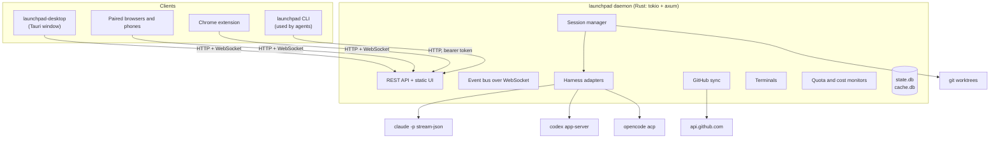
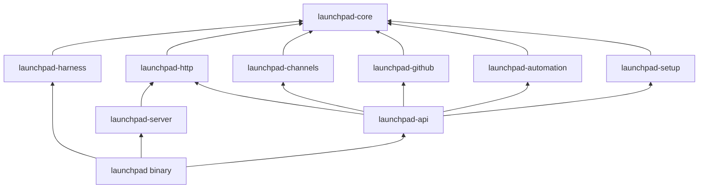

# Architecture

Launchpad is a Rust daemon that owns everything stateful, a React UI served by that daemon, and a thin desktop shell that shows the UI in a native window.



## Design principles

1. **Never wait on the network to show something.** Every screen renders from the local database first and refreshes in the background.
2. **Launching an agent is the main action.** A minimal launch is a prompt and a click.
3. **The core does not depend on a harness.** Claude Code, Codex and OpenCode are adapters behind one session model.
4. **Local first, then follow GitHub.** New work stays local until you publish it. Once work is on GitHub (a published Local PR, or a pull request launched with **Push to PR**), agents keep pushing to that same branch, never with force. Comments, reviews and PR state changes always need your click.
5. **Click only.** Every action is a visible button. The only keyboard shortcuts are `Ctrl+F` in Files, `Ctrl+T` for a terminal and normal text and terminal keys.
6. **One user, move fast.** No multi-user model, no versioning, no data migrations. Few tests.

## Processes

- **Daemon** (`launchpad daemon`): a systemd user service on Linux, launchd agents on macOS, a detached process on Windows. It owns SQLite, the agent processes, terminals, GitHub polling, quota monitoring and notifications. It listens on `127.0.0.1` by default. At startup, it reads the environment of your login shell, so agents see the same tools as in a terminal.
- **Desktop shell** (`launchpad-desktop`): a small Tauri v2 app. It starts the daemon if needed and loads the UI from it. Closing the window hides it, so the next click shows it at once. Links to other sites open in the system browser.
- **Agent processes**: children of the daemon. **Restarting the daemon interrupts running turns**; sessions become Interrupted and resume with one click through the harness's native resume.

Closing the window never affects running agents.

## Roles

The [Home and runners plan](https://wauplin-launchpad-bots-research.static.hf.space/index.html) splits the daemon into two roles of the same binary, selected with `launchpad daemon --role`:

- **Home** holds every record and runs no agents or terminals: starting one there fails with "connect a runner".
- **Runner** runs agents and terminals in its own folders and keeps only caches. Harness discovery uses an empty home in the runner data folder, separate from the laptop's existing sign-ins. The daemon's Codex updater runs only in the combined `all` role.
- **All** (default) runs both roles in one process.

A runner pairs with `launchpad connect` (a code approved on Home; Home stores the SHA-256 of the runner's secret) and keeps one outbound WebSocket to `/api/runners/tunnel`, authenticated with `X-Launchpad-Runner`. Home sends API requests over it (`runners::Hub::request`), which the runner answers by calling its own router as its local owner. A runner and Home compare `role::PROTOCOL` and the build commit: another protocol cannot connect; another build of the same protocol keeps its running sessions but takes no new ones. Such a runner updates itself on an owner click (`self_update.rs`, capability `self_update`): Home relays `POST /api/runner/update`; the runner waits until none of its sessions is running, downloads Home's running executable (`GET /api/runners/build`, runner credential, through an `HttpOpen` exchange, with SHA-256, commit, OS and architecture headers), renames it over its own executable, stops its server and `exec`s the new build with the same arguments. The runner guard (accept launches, pause) lives in the runner's folder and is reported to Home.

Replication (`replica.rs`): on a runner, `Sessions::store` and `Sink::emit` also queue the record or event in `home_outbox`, in the same transaction. The tunnel sends the outbox in order; Home applies each item and records its number in `runner_ack` in one transaction (`Sessions::apply_replica`), then sends `Ack`; the runner deletes acknowledged items and resends the rest after a reconnection. On Home, sessions with a `runner_id` are replicas: startup never interrupts them, and items of an older `generation` are ignored. Temporary folders replicate the same way (`project.runner_id` on Home: where the folder is now); every other folder is Home's record, and Home ignores other folder items. Home owns workspaces: it sends `Workspaces` snapshots to runners, and runner windows forward workspace changes to Home (`home_client::forward_writes`). Runners also forward the Launchpad CLI's context reads (`/api/context/*`): only Home sees the sessions, schedules and Inbox of every runner, so an agent sees the same Launchpad on any runner.

On Home, `runners::relay` sends launches to the runner of the folder (or the first available runner) and every session or folder request to its runner, except the record, events, images and trace, which Home serves. Relayed requests carry only `Idempotency-Key` and are marked `X-Launchpad-From-Home`, which the runner logs for launches. Uploads (`upload:` references) stay on the machine that received them, so Home replaces them by data URLs in launches and messages it sends to a runner or Burst (`attachments::inline_files`); tunnel messages may reach 64 MiB.

Home Git (`home_git.rs`): Home (and an `all` daemon) keeps a bare mirror per Git folder in `<data_dir>/git/<id>.git`. Its fetch refspecs follow every branch and tag of the folder's remote except `lp/*` and `lp-scratch/*`; a `pre-receive` hook accepts pushes only to those and `refs/lp-snapshots/*`. Runners speak Git's smart HTTP protocol to `/api/git/<id>.git` (served by `git http-backend`, authenticated by the runner credential, session named by `X-Launchpad-Session`); after each `receive-pack`, Home compares the Launchpad refs, keeps every replaced tip as `refs/kept/<ms>/<branch>` (pruned after 30 days) and pushes followed branches (`git_follow`: published Local PRs, Push to PR sessions) to GitHub. `/api/home-git/<id>/…` serves refresh, branches, Restore, delete, merge and pull request branches (Home reads the pull request itself). When a session's runner is offline or its Burst job stopped, `away.rs` answers its Changes, worktree list, Merge and Create Local PR on Home from the mirror and the last handoff's worktree records.

Runner side (`repo_cache.rs`, `worktrees.rs`): `<data_dir>/repos/<id>` is a clone whose `origin` is the runner-local endpoint `/git/<id>.git` and whose `upstream` is the folder's remote (fetched first for objects). The endpoint accepts only HMAC tokens derived from the daemon token (`daemon`, or `session:<id>` in each worktree's `config.worktree`) and forwards to Home with the runner credential; an `all` daemon serves its mirrors directly. `worktrees::plan` records a worktree at launch; `prepare` (background start task) syncs and adds it; every turn end pushes with `--force-with-lease`; a five-minute task pushes snapshots (a commit of all files built in a temporary index); removal pushes first and saves uncommitted files to `lp-scratch/…`.

Local PRs (`predrafts.rs`) are Home records for `(folder, lp branch)`; detail, Merge (`home_git::merge`) and Publish (`home_git::push` of the reviewed commit) read the mirror. Runners forward `/api/predrafts` to Home, except `create`/`resolve` by worktree. `change_set` is the creating session; `publish_set` publishes the open members and links the pull requests. Home backups add one bundle per mirror; `git_restore.json` lists the bundles a restored Home applies when it recreates each mirror.

Temporary folders (`projects::create_temp`, `Target::Temp`): a folder `<data_dir>/tmp/tmp-<MMDD>-<slug>` on the session's machine, registered with `is_temp` in the launch's workspace so Files, terminals and routing work as for any local folder. The launch prompt gets `sessions::temp_instruction` (folders list and `work add-project`). Its files are a store on Home, `tmp-<folder id>` (`plain::temp_store`), synced like a plain folder (down in `plain::prepare`, up at every turn end) without `.gitignore`d files, nested Git repositories, lock or baseline repository. The folder keeps its ID on every runner: a move recreates it with the same ID and name (`handoff::relocate`, `projects::ensure_temp`) after Home moved the record (`projects::move_temp`), and the old runner removes its copy at the final handoff. `sessions::archive` (the Archive endpoint and Home's local close) runs `projects::after_archive`, which removes the folder and its record (hidden from every list) once every session in it is archived and Home holds every file (`plain::in_sync`); Resume recreates it (`ensure_temp` in `reattach`). Home drops the store 30 days after the last session was archived (`plain::clean_temp`). **Keep as folder** (`projects::keep_as_folder`, on the runner that has it) makes it a folder stored by Home: a temporary folder with a Git repository becomes a new Git folder of Home (`add_to_home`) and stays for its agents; other files go up to Home, then Home turns the record into a plain folder with the same ID and moves the store's files and history from `tmp-<id>` to the folder's store, its one open agent holding the lock (`projects::keep_temp`, `POST /api/plain/<id>/keep`); the runner moves its copy to `plain::copy_dir`, with what it synced (`plain::moved_copy`), native harness history (`project_moved`) and the sessions' `cwd`. From then on `.gitignore`d files sync too, as in every plain folder.

Plain and asset folders (`plain.rs`): Home keeps each store's tree in `plain_file`, contents by SHA-256 in `<data_dir>/blobs/sha256/`, and every change in `plain_history` (30 days; Restore re-commits the old content). `plain_lock` gives one session a store. Runners call `/api/plain/<id>/{tree,blob,commit,lock,unlock}` over HTTP with the runner credential; `sync_down` writes Home's version into the copy (`<data_dir>/plain/<id>`, or an asset path of a worktree) and commits a local Git baseline for Changes; `sync_up` hashes the copy and sends what changed since the last sync. Home has no copy: Files reads a plain folder from `plain::browse_copy` (`<data_dir>/browse/<id>`, written from the store when its version changed), like a Git folder from its browse copy; `code::open` maps the folder's own path to it (temporary folders use the `tmp-` store). Home relays `/api/code/*` to the connected runner that holds the root (`code::runner_for`: a session's folder or a runner's temporary folder; images and downloads come back in a base64 envelope, `x-launchpad-envelope`); for a session whose runner is away, `code::open` reads its worktree from `origin/<branch>` of the browse copy, and its plain or temporary folder from the store copy. Backups list live blobs as `plain/<sha>` objects; a restored Home reads missing blobs from the backup store.

## Credentials and the jail

Home keeps a vault in `state.db` (`vault.rs`): harness logins (a Claude setup token, a Codex `auth.json`), and tokens, all write-only, plus the tool registry (`tool` table: install recipe, variables that get a placeholder, settings that are not secret, host rules, granted workspaces). A lease keeps one token per host (`vault::host_conflict`: the first tool by name). A tool's settings never enter the session's environment: the runner puts wrapper scripts on PATH that set them and run the tool's programs (`tool_install::wrappers`, in `<data_dir>/sessions/<id>/tools/<tool>/`, read-only in the jail). Settings → Credentials and tools edits them; runners forward those requests to Home.

Before a harness starts, `contain::apply` asks Home for the session's lease (`FromRunner::Call` "lease" through the tunnel; Home checks the session's runner and generation and records `vault_lease`). The lease holds the login's token, the granted tools and their tokens, and the Git identity. The runner keeps it in `proxy::Proxy` memory, renews it every ten minutes and drops it after an hour without Home, on Stop/Archive (`release`) or at once on Revoke (`ToRunner::Revoke`).

The runner proxy (`proxy.rs`) listens on `127.0.0.1`, with a second port for captured connections (see Network capture below). Jailed processes get `HTTPS_PROXY` with a per-lease key and the runner CA in their CA variables; on a host with a credential the proxy terminates TLS with a leaf certificate from the runner's CA (`<data_dir>/proxy/`), sets the token (Bearer, Basic, header or query) and streams the request upstream; every other host is a plain `CONNECT` tunnel. Harness logins use base URLs on the proxy (`/lp/<key>/<host>/…`): Claude Code gets `ANTHROPIC_BASE_URL` and a placeholder `CLAUDE_CODE_OAUTH_TOKEN`; Codex gets an `auth.json` with placeholders and an unsigned ID token, and `config.toml` pointing at the proxy (adapters own this in `Harness::contained_login`). Requests that received a token go to Home's `access_log` (through `replica::Item::Access` on a runner); known actions become session notices. Home refreshes Codex logins itself and runs one quota monitor per vault login (`vault:<id>`, plus `vault:default:<harness>`), sent to runners as `ToRunner::Quotas`.

The jail (`jail.rs`) is bubblewrap with system folders, PATH folders and toolchain folders read-only, and the session's folders read-write: its working folders, `<data_dir>/worktrees`, `<data_dir>/repos`, its harness home (`<data_dir>/sessions/<id>/home`: `HOME`, `CLAUDE_CONFIG_DIR`, `CODEX_HOME`), its `/tmp` and its workspace's cache (`<data_dir>/caches/<workspace>`: `XDG_CACHE_HOME`, `CARGO_HOME`, and `sccache` through `RUSTC_WRAPPER` when installed, with a per-session server socket in its `/tmp`). Only a short list of machine variables passes. Jailed CLIs receive an HMAC credential in a separate signing domain, bound to session ID and generation; the server limits it to context and inert preparation, checking session ownership for worktree mutations. `UserEnv::jailed` makes `exec::Cmd` wrap the program in `bwrap`; adapters start every native process with `StartSpec::process_env`, and title requests and harness TUIs use the same lease and jail. Tools install once per recipe into `<data_dir>/tools/` (downloads by the runner, package managers in a jail). With `[runner] boundary = "vm"` (a Local VM, `packaging/local-vm.sh`) the VM is the boundary: no jail, Docker allowed, same lease and proxy. There and on Burst, `contain::apply` builds the same `Jail` with `bwrap: false`: the process runs without bubblewrap but with only the kept variables and under the capture, and the runner CA goes into the machine's system bundle (`netcap::system_ca`; the Burst image makes it writable, `local-vm.sh` installs it with `launchpad proxy-ca`). Burst and Local VM daemons mark themselves non-dumpable, and `UserEnv` drops `LAUNCHPAD_BURST_CREDENTIAL`.

Network capture (`netcap.rs`, the supervisor in `crates/cli/src/netcap.rs`): `Jail::command` runs every contained process as `launchpad netcap --port <capture port> --key <proxy key> -- <program>`, inside bubblewrap when there is one. The supervisor forks the program under a seccomp filter with a user notification listener (`no_new_privs`, so no process of the session removes it), stays its parent (Yama allows it to read the agent's memory) and exits with its status. It creates every internet socket itself and injects it (`SECCOMP_IOCTL_NOTIF_ADDFD`; HF Jobs refuse `pidfd_getfd`), keeping a copy of TCP sockets until they connect. A TCP connect to a non-loopback address connects that copy to the proxy's capture port with `LPCAP1 <key> <ip> <port>`; the proxy connects to the destination first and answers `OK` or `ERR <errno>`, so `connect` returns the real result. On port 443 of a lease with tokens the proxy reads the ClientHello's server name and, on a lease host, terminates TLS as for `CONNECT`. `getpeername` returns the original address. The filter refuses io_uring, x32 and foreign-architecture calls, TCP Fast Open, raw and packet sockets, and socket families other than Unix, internet and route netlink; UDP may only reach port 53 (`netcap::udp_allowed`). `netcap::check` runs `launchpad netcap --self-test` once; a machine where it fails runs no agents. `netcap::network_check` runs `launchpad netcap-probe` in a sandbox built like a session's, for **Check network** (`POST /api/runners/{id}/network-check` on Home, forwarded to the runner's `/api/runner/network-check`; Home keeps the last result in `RunnerStatus.network_check`).

Bots (`bots.rs`) are Home records (`bot` table: workspace, slug) whose files live in a plain store `bot-<id>` with history: `BOT.md` (instructions) and `bot.toml` (`BotSettings`: name, profile, model, optional folder, permission mode), the only source of their settings. A bot without a folder launches each session with `Target::Temp`. A bot's thread is the sessions whose `LaunchSpec.bot` names it; `bots::message` sends to the newest open one (`runners::send_anywhere`) or, on the first message, a profile or folder change, an archived session or the owner's New session checkbox, closes it and launches a new one (`runners::launch_anywhere`) with a `BotLaunch` (name, slug, `BOT.md`, previous session). The runner's `resolve` appends the bot instruction and the previous session's trace reference; a runner forwards `GET /api/sessions/<id>/trace` for sessions it does not have to Home, which accepts it from runners (`home_client::home_accepts`), so a thread continues on any runner. Bot sessions are normal sessions in every list; the sidebar shows only a state dot. Home's backups also write readable copies of knowledge bases and bot files under `<workspace>/` in the bucket (`home_backup::readable`).

Routines (`launchpad-automation`: `crons.rs`, table `cron_agent`, one JSON record each) live on Home. A `Trigger` starts a run: the record's 5-field schedule (`crons::spawn` checks every 5 s), new Inbox threads after an Inbox sync (`crons::inbox_synced`, watermark `github_seen`), or a turn ending Done (`crons::turn_ended`, which the core reaches through `ext::Extensions::turn_ended` from `Sink::set_status` on `all` and from `Sessions::apply_replica` on Home). Each run is claimed as a `RoutineRun` history entry before it starts; `turn_ended` settles it (Report, No update, Failed, Interrupted, Stopped). A routine with `bot_id` (or an Assistant target) sends `crons::bot_message` to that thread; others launch their spec with `LaunchSpec.routine`, whose prompt gets `routines::instruction`. A paused bot sets `bot_paused` on its routines. A schedule runs in the record's IANA `time_zone` (chrono-tz; the saving browser's zone, else `[home] time_zone`, else the host's).

On Home, every start goes through `runners::launch_anywhere` (browser launches, accepted proposals, routines, scheduled launches, bot messages), sent once and never retried. When no runner takes it, or the composer chose Burst, `burst::launch` stores a Starting placeholder record and starts a job; the runner then creates the session with the same ID and its record replaces the placeholder.

The tunnel (`server::wire`) is the same protocol whichever side dialed. Burst runners (`burst.rs`) are HF Jobs from Home's own image, with a runner record Home creates and a secret derived from its daemon token; Home dials `/api/runner/reverse` through the HF Jobs proxy (`server::burst`). They hold no credential: a lease for a Burst runner has no secrets (`relayed`), the runner proxy sends those requests as `HttpOpen` exchanges with a `Lease` target, and `token_relay` adds the token on Home, sends the request and records it. Every other connection of the proxy (captured connections, `CONNECT` tunnels, plain HTTP) is an exchange with a `Tcp` target: Home connects to a public address only (`netcap::public`, checked on the resolved address), answers 200 or an error with `errno <n>`, and streams both directions (`token_relay::tcp`). Home Git, plain-folder and handoff requests of a Burst runner go to a local relay (`127.0.0.1:<port>`, `home_link::load`) and then through the tunnel to Home's router (`exchange::home`, runner-authenticated paths only). The job runs agents without a jail. `burst::tick` stops a job after the session's final handoff and a newer complete Home backup, and records its cost (`burst_run`); a message to that session starts a new job and moves the session there. A moved session in a temporary folder finds it with its files on the new runner.

Moves (`handoff.rs`): runners post a handoff (native conversation files from `Harness::native_trace`, worktree records) to `/api/handoff/<id>` at each turn end when it changed, and a final one before a planned move (branches pushed, leftovers saved, folders removed, process stopped). Home keeps the latest handoff per session in `session_handoff`, with the native files in the content-addressed blob store (`plain::write_blob`, kept by `plain::live_blobs` and the Home backups), never in `state.db`. `handoff::move_to` increases the session's generation and names the new runner (`Sessions::reassign`), then asks it to adopt: it fetches the record and handoff, rewrites folder paths for its own data folder, records the worktrees as Removed (cloned again from their branches on the next message) and calls `Harness::restore_native`. Every hour a runner removes the folder of archived sessions (`<data_dir>/sessions/<id>`) after Home confirmed the same native files (`handoff::clean_archived`); a later start restores them from Home's handoff (`handoff::restore`, from `contain::apply`).

MCP (`mcp.rs`): servers live in `mcp_server` with their token as a `mcp-<id>` vault entry. A lease names granted servers; `Harness::contained_mcp` points the harness at `/lp/<key>/mcp/<id>` on the runner proxy, which sends each request as an exchange with an `Mcp` target (in process on `all`). The gateway checks the lease and grant, refuses `tools/call` and filters `tools/list` for tools that are off, adds the token, streams the answer back and logs each call.

Default tools (`tool_defaults.rs`): workspace and folder layers in `tool_defaults` (Home), the bot layer in `bot.toml` `[tools]`. Home resolves them with the launch's `tools_off`/`tools_on` in `LeaseRequest::off` when it builds a lease (and in the MCP gateway); runners compute nothing.

The knowledge base (`kb.rs`) is the only agent memory. Runners mirror each workspace's knowledge base to `<data_dir>/knowledge/<workspace name>/` (every minute, before a session starts and after each write); the jail mounts it read-only as `$LAUNCHPAD_KB`, and `Harness::contained_memory` turns the harness's own memory off and writes its user instructions (the knowledge base and `INDEX.md`). `launchpad kb` posts writes to the runner (`/api/kb`), which uploads contents as blobs and sends the writes to Home (`FromRunner::Call` "kb"); Home checks the session's runner, takes the author from its own session record and applies writes one at a time. A write whose base changed is kept as a `.concurrent-<id>` sibling. Owner edits in a runner's mirror are sent as the owner's.

## Sessions and harnesses

Every harness maps to the same model:

- A **launch spec** describes what to run: the prompt, target folder, context, profile, model, options and start conditions. The composer, schedules, crons and proposals all produce launch specs.
- A **session** is the durable record: status, usage, title, folder, native conversation ID.
- **Events** are the normalized conversation (messages, tool calls, questions, approvals, subagents), stored in order with a sequence number and pushed to every client over the event bus. Clients reconnect with the last sequence number they received and get what they missed.

Adapters (`crates/harness/`, contract in `crates/core/src/harness/mod.rs`) translate each native protocol into these events and own everything native: startup, resume, model discovery, quota readings, terminal commands. See [Harness adapters](harness-adapters.md).

A launch only does local work in the request: it records the session (Starting) and its planned worktrees, then returns. A background task has Home refresh its mirror, clones or fetches the runner's repository cache, adds the worktrees, runs worktree setup and starts the harness; Stop cancels it between steps. A worktree that cannot be prepared fails the session visibly. Merges and publications run on Home and never touch a checkout of the owner.

## Storage

| Store | Content | Lifetime |
| --- | --- | --- |
| `config.toml` | Settings, profiles, presets | Edited in Settings or by hand |
| `state.db` (SQLite, WAL) | Sessions, events, drafts, Local PRs, suggestions, Outbox messages, channels and hooks, schedules, devices | Your data; back it up |
| `cache.db` (SQLite) | GitHub payloads as JSON | Disposable, rebuilt on demand |
| Home backup (`home_backup.rs`) | `state.db` copies (`VACUUM INTO`), `config.toml` and Home Git bundles by content hash, one manifest per backup, written last | Home only; last day kept, restored on an empty boot |
| Trace copies (`trace_copies.rs`) | After each backup, the native files of each session's latest handoff, unchanged, and `launchpad.json` under `<workspace>/traces/<folder>/<YYYYMMDD_HHMM>_<id>/` (one file per trace) | Home only; changed files only, never read back |
| Harness folders | Native conversations: per session in `<data_dir>/sessions/<id>/home` for contained sessions (removed from runners once archived and copied to Home), else `~/.claude`, `~/.codex`, OpenCode data | Owned by each harness |
| Knowledge base (`kb.rs`) | One per workspace, stored by Home like a plain folder (store `kb-<workspace>`, history with author and line counts in `plain_history.meta`); a read-only mirror on each runner | Home; changes restorable 30 days |
| Bots (`bots.rs`) | `bot` rows on Home; `BOT.md` and `bot.toml` stored like a plain folder (store `bot-<id>`), with history; readable copies in the bucket | Home; changes restorable 30 days |
| Ask Launchpad (`ask_bot.rs`) | a normal bot, created once per workspace; the Launchpad CLI tool, added once to the tool registry (`seeded` rows record both) | Home |
| Vault (`vault.rs`) | Credentials (write-only), tools, leases, access log, in `state.db` | Home only |

Rust types shared with the UI derive `ts_rs::TS`, so the API is typed end to end without an OpenAPI spec.

## Security model

The Home-only Space POC (`deploy/hf-home/`) runs the daemon behind the private Hub gate, with backups on a separate private bucket volume. Its gateway runs the first-start setup (`onboarding.py` and `setup.html`): HF device login and the `LP_HOME_KEY` credential key (a passphrase the owner generates or types; the gateway derives the AES key with scrypt and passes it to the daemon as `LAUNCHPAD_HOME_KEY`), required before admitting app or runner requests; GitHub device login; the Git identity; a first profile through a Claude `setup-token` or Codex device login stored in the vault; a workspace and a cloned folder. Optional steps pair a runner and launch a first agent through the normal API. The gateway also serves `/_home/runner/install.sh` and Home's own binary, so runners install the exact build Home runs. With `LAUNCHPAD_HOME_KEY`, Home seals only vault secrets (AES-256-GCM) inside backup copies of `state.db`; other backup data stays plain for browsing and deduplication. The gateway keeps Home's HF and GitHub logins encrypted in the bucket, and rejects disabling or redirecting Home backups. Its image includes the pinned harness, GitHub and Hugging Face CLIs for discovery and quota checks; agent turns still run on runners. It does not use the combined-daemon Space connector or its update/resume mechanism. See its README for isolation and recovery limits.

- Launchpad has one user. Every paired browser has full access.
- The daemon listens on loopback. Remote access goes through a private network (Tailscale) or a proxy you control, with an exact allowed origin.
- Browsers authenticate with an HttpOnly device cookie after pairing. The CLI uses a bearer token from the data folder.
- Agents use Launchpad through their session CLI token at the access level their lease carries for the Launchpad CLI tool: read, propose or admin (from the bot's `bot.toml`). Proposals are inert: the owner starts them, except one-time starts of a bot in auto mode. Admin reaches only Launchpad's own records and a closed list of shared settings (presets, notifications, GitHub poll interval, worktrees kept), never GitHub, the Outbox, credentials, the rest of `config.toml` or the machine. Accepting a card runs its action, so admin accepts only cards whose action it may run directly. Ready cards prepare an owner action and run only from their own button.
- GitHub publication, merges and setup commands always require an owner click.
- Channels live on Home. Messages to other people (outgoing webhooks, GitHub suggestions) wait in the Outbox for a click and are never retried; messages to the owner's own bound Telegram chat go out directly. Home long-polls Telegram, so it needs no inbound endpoint. Incoming hooks (`/hooks/<id>`) skip the browser sign-in and authenticate with their own secret (behind a private Space, also an HF token). Hook and Telegram messages to a busy bot or Ask Launchpad thread wait in `queued_message` (`hooks::deliver`) until its turn ends; each is claimed (deleted) before its single send.
- Agents run contained: a bubblewrap jail on Linux runners (or a Local VM). They see their session's folders, their own harness home and the machine's toolchains, never your home folder, keys, logins or Launchpad's data. Their network goes through the runner proxy, captured below the HTTP libraries (`netcap`), which adds Home's tokens on known hosts; agents only hold placeholders. Token scopes decide what a request may do; a steered agent can still leak what it reads or misuse a token within its scopes.

## Action list

Every action that a button, a proposal card, the Launchpad CLI or the admin rules name is defined once in `crates/core/src/actions.rs`: its name (`<group>.<verb>`), method and route, label and icon, input fields, confirmation text, effect (checks, record, starts, outside, machine), access (owner or admin), the card kind whose acceptance runs it, and its undo action. The handlers stay in their crates. Four places read the list:

- `agent_auth::admin_allows` allows a non-GET request from an admin session only when its route matches an admin action exactly and its body holds only the action's input fields. Accepting a card runs the action of its kind (`actions::for_card`), so admin accepts only cards of admin actions. Actions marked `ready` (merge, publish, post, send, run CI, Inbox done) can be prepared as ready cards (`ProposalBody::Ready`): the card's button runs the action's call and confirmation, then marks the card `ran`.
- `launchpad_cli::cli_reference` writes one usage line per admin action into the session's instructions.
- `launchpad do <group>.<verb>` and the short verb `launchpad <group> <verb>` build the request from route ids and `--<field>` options, and refuse owner actions.
- The UI reads the generated `web/src/gen/actions.ts`: `ActionButton` asks for the confirmation, and `runAction` sends the request.

Actions that reach GitHub or other people, money, credentials or the machine are owner actions. They have a confirmation or an undo.

The front door records every successful direct admin action of a session (`crates/server/src/activity.rs`) in Home's activity list (`crates/automation/src/activity.rs`): the action, its body, the values before (read through the action's GET route) and the undo call (the undo action with the old values, or a delete of the created record). The bot chat shows each entry as a Changed line whose record name links to its page. Shared settings (`GET/PATCH /api/settings/shared`) are the part of `config.toml` that `settings.set` may change; every `config.toml` write goes through `ConfigHandle::update`, which reads, changes and saves under one lock.

## Decision list

Home computes, once for every window, phone and count, what waits for the owner: the Today list (`crates/core/src/today.rs`). `today::compute` collects the core's items (sessions with `Session::needs_you()`, unpublished Local PRs, outdated runners) and the items of the feature crates through `ext::Extensions::today` (proposals and failed routines, Outbox drafts, GitHub suggestions and open review requests). Each item names its filter (Answer, Review, Approve, Send, GitHub, Fix), its record (plus `owner/repo#number` for GitHub items, so a row never depends on the Inbox cache) and the main action of its row from the action list. The page shows one compact row per item (`web/src/features/today/TodayRows.tsx`); the bot chat shows the same items as cards (`TodayCards.tsx`). Handled items of the last 30 days form the Done list.

- **Workspaces**: Home resolves each item's place (folder, session, launch, repository) to workspaces with the same rules as the UI's `useScope()`. An item with no workspace is not listed, except what is shared: outdated runners, tool or preset proposals without a workspace, Outbox messages without a session.
- **API and event**: `GET /api/today` (`crates/api/src/today.rs`, optional `?workspace=`) is Home-owned; runners forward it. A background task recomputes the list after relevant bus events, at most every 1.5 s, and publishes `today`/`changed` when the waiting items changed. Session updates recompute only when the set of sessions that need you changed. Runner windows poll every 60 s.
- **Counts**: the sidebar, the workspace rail, the phone, the window title and the app badge read only this list.

## Code layout

```text
crates/
├── core/        launchpad-core: App, model, database, sessions, worktrees, Home Git, runners, vault, jail, proxy, quota, terminals, hosts, harness contract
├── harness/     launchpad-harness: the Claude Code, Codex and OpenCode adapters, and the ACP client
├── channels/    launchpad-channels: channels, the Outbox, Telegram, incoming hooks
├── github/      launchpad-github: issue and pull request views, the Inbox, Suggestions
├── automation/  launchpad-automation: routines (crons), scheduled launches, proposals
├── setup/       launchpad-setup: setup checklist, clone from GitHub, onboarding progress
├── http/        launchpad-http: API error type, route state (Ctx), session CLI token checks
├── api/         launchpad-api: the JSON routes that need only the App
├── server/      launchpad-server: authentication, runner tunnel and relay, Git and plain-folder HTTP, terminals and event WebSockets, Tailscale, embedded UI
└── cli/         launchpad: the binary (daemon and agent-facing subcommands) and build.rs
web/             React app (Vite, TanStack Query/Router/Virtual, Tailwind)
├── src/features/   one folder per feature
├── src/demo/       demo mode: an in-browser fake daemon for the tour
└── src/gen/        TypeScript types generated from Rust
desktop/         Tauri v2 shell (launchpad-desktop, no Launchpad crate dependency)
extension/       Chrome extension
deploy/          Hugging Face Space connector (hf-space) and Home-only Space (hf-home)
packaging/       installers, systemd unit, icons
skills/launchpad/ the agent skill for the launchpad CLI
```

### Crate dependencies



- `launchpad-core` depends on no other Launchpad crate. Every other crate depends on it.
- The feature crates (`harness`, `channels`, `github`, `automation`, `setup`) depend only on the core. They do not depend on each other, so they compile in parallel.
- `launchpad-server` does not depend on `launchpad-api` or on the feature crates. `launchpad_server::serve(app, api)` receives the API router from the binary and serves it behind its authentication, relay and forwarding layers.
- The binary (`crates/cli`) depends on every crate and connects them.

### How the core reaches the crates above it

The core never names a crate above it. The binary installs two things at startup, before `App::start`:

- **Harness adapters**: `launchpad_harness::install()` hands `REGISTRATIONS` to `harness::install`. The core reads adapters only through `harness::registrations()`. See [Harness adapters](harness-adapters.md).
- **Extensions**: `ext::install` takes the binary's implementation of the `ext::Extensions` trait (`crates/cli/src/extensions.rs`). The trait lists the few calls the core makes upward: Telegram notifications, turn ended (routine runs and triggers), the suggestion and channel instructions of a new session, bot paused or deleted (its routines follow), Inbox synced, the Inbox threads, and the items of the decision list (`today`). Until one is installed, and in unit tests, every call does nothing.

Per-daemon state of a crate above the core lives in `App::extras`, one value per type, created on first use (for example the Inbox: `app.extras.get::<Inbox>()`).

After `App::start`, `extensions::start` starts the services of the feature crates (`launchpad_automation::start`, `launchpad_github::spawn`, `launchpad_channels::spawn`). `launchpad gen-types` calls the `gen_types` function of the core and of each feature crate that shares types with the UI.

### Where new code goes

- A new harness: a module in `crates/harness/`.
- A feature the core does not call: the matching feature crate, or a new crate that depends only on the core. Add the crate to the workspace `members` and `default-members`, and to the binary.
- A call from the core into a feature crate: a method on `ext::Extensions` with a default that does nothing, implemented in `crates/cli/src/extensions.rs`. Keep the trait small; move a small helper down into the core when sessions or bots need it (for example `routines`, `launchpad_cli`, `diff`, `locks`).
- A JSON route that needs only the `App`: `crates/api/`. A route that needs authentication internals, the runner tunnel, relays or WebSockets: `crates/server/`.
- Code that sessions, worktrees, runners or the vault call: the core.

### Build impact

A change rebuilds its crate and every crate that depends on it, then relinks the binary. A change in a feature crate, `api` or `server` rebuilds one or two crates. A change in the core rebuilds every crate. Keep code out of the core when nothing in the core needs it.
