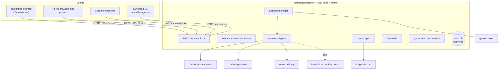

# Architecture

Launchpad is a Rust daemon that owns everything stateful, a React UI served by that daemon, and a thin desktop shell that shows the UI in a native window.



## Design principles

1. **Never wait on the network to show something.** Every screen renders from the local database first and refreshes in the background.
2. **Launching an agent is the main action.** A minimal launch is a prompt and a click.
3. **The core does not depend on a harness.** Claude Code, Codex and OpenCode are adapters behind one session model.
4. **Local first, then follow GitHub.** New work stays local until you publish it. Once work is on GitHub (a published Local PR, or a pull request launched with **Push to PR**), agents keep pushing to that same branch, never with force. Comments, reviews and PR state changes always need your click.
5. **Click only.** Every action is a visible button. The only keyboard shortcuts are `Ctrl+F` in Files, `Ctrl+T` for a terminal and normal text and terminal keys.
6. **One user, move fast.** No multi-user model, no versioning, no data migrations. Few tests.

## Processes

- **Daemon** (`launchpad daemon`): a systemd user service on Linux, launchd agents on macOS, a detached process on Windows. It owns SQLite, the agent processes, terminals, GitHub polling, quota monitoring and notifications. It listens on `127.0.0.1` by default. At startup, it reads the environment of your login shell, so agents see the same tools as in a terminal.
- **Desktop shell** (`launchpad-desktop`): a small Tauri v2 app. It starts the daemon if needed and loads the UI from it. Closing the window hides it, so the next click shows it at once. Links to other sites open in the system browser.
- **Agent processes**: children of the daemon. **Restarting the daemon interrupts running turns**; sessions become Interrupted and resume with one click through the harness's native resume.

Closing the window never affects running agents.

## Roles

The [Home and runners plan](https://wauplin-launchpad-bots-research.static.hf.space/index.html) splits the daemon into two roles of the same binary, selected with `launchpad daemon --role`:

- **Home** holds every record and runs no agents or terminals: starting one there fails with "connect a runner".
- **Runner** runs agents and terminals in its own folders and keeps only caches. Harness discovery uses an empty home in the runner data folder, separate from the laptop's existing sign-ins. The daemon's Codex updater runs only in the combined `all` role.
- **All** (default) keeps both in one process, as before.

A runner pairs with `launchpad connect` (a code approved on Home; Home stores the SHA-256 of the runner's secret) and keeps one outbound WebSocket to `/api/runners/tunnel`, authenticated with `X-Launchpad-Runner`. Home sends API requests over it (`runners::Hub::request`), which the runner answers by calling its own router as its local owner. A runner and Home compare `role::PROTOCOL` and the build commit: another protocol cannot connect; another build of the same protocol keeps its running sessions but takes no new ones. The runner guard (accept launches, pause) lives in the runner's folder and is reported to Home.

Replication (`replica.rs`): on a runner, `Sessions::store` and `Sink::emit` also queue the record or event in `home_outbox`, in the same transaction. The tunnel sends the outbox in order; Home applies each item and records its number in `runner_ack` in one transaction (`Sessions::apply_replica`), then sends `Ack`; the runner deletes acknowledged items and resends the rest after a reconnection. On Home, sessions with a `runner_id` are replicas: startup never interrupts them, and items of an older `generation` are ignored. Folders registered on a runner replicate the same way (`project.runner_id` on Home). Home owns workspaces: it sends `Workspaces` snapshots to runners, and runner windows forward workspace changes to Home (`home_client::forward_writes`).

On Home, `runners::relay` sends launches to the runner of the folder (or the first available runner) and every session or folder request to its runner, except the record, events, images and trace, which Home serves. Relayed requests carry only `Idempotency-Key` and are marked `X-Launchpad-From-Home`, which the runner logs for launches.

Home Git (`home_git.rs`): Home (and an `all` daemon) keeps a bare mirror per Git folder in `<data_dir>/git/<id>.git`. Its fetch refspecs follow every branch and tag of the folder's remote except `lp/*` and `lp-scratch/*`; a `pre-receive` hook accepts pushes only to those and `refs/lp-snapshots/*`. Runners speak Git's smart HTTP protocol to `/api/git/<id>.git` (served by `git http-backend`, authenticated by the runner credential, session named by `X-Launchpad-Session`); after each `receive-pack`, Home compares the Launchpad refs, keeps every replaced tip as `refs/kept/<ms>/<branch>` (pruned after 30 days) and pushes followed branches (`git_follow`: published Local PRs, Push to PR sessions) to GitHub. `/api/home-git/<id>/…` serves refresh, branches, Restore, delete, merge and pull request branches (Home reads the pull request itself). When a session's runner is offline or its Burst job stopped, `away.rs` answers its Changes, worktree list, Merge and Create Local PR on Home from the mirror and the last handoff's worktree records.

Runner side (`repo_cache.rs`, `worktrees.rs`): `<data_dir>/repos/<id>` is a clone whose `origin` is the runner-local endpoint `/git/<id>.git` and whose `upstream` is the folder's remote (fetched first for objects). The endpoint accepts only HMAC tokens derived from the daemon token (`daemon`, or `session:<id>` in each worktree's `config.worktree`) and forwards to Home with the runner credential; an `all` daemon serves its mirrors directly. `worktrees::plan` records a worktree at launch; `prepare` (background start task) syncs and adds it; every turn end pushes with `--force-with-lease`; a five-minute task pushes snapshots (a commit of all files built in a temporary index); removal pushes first and saves uncommitted files to `lp-scratch/…`.

Local PRs (`predrafts.rs`) are Home records for `(folder, lp branch)`; detail, Merge (`home_git::merge`) and Publish (`home_git::push` of the reviewed commit) read the mirror. Runners forward `/api/predrafts` to Home, except `create`/`resolve` by worktree. `change_set` is the creating session; `publish_set` publishes the open members and links the pull requests. Home backups add one bundle per mirror; `git_restore.json` lists the bundles a restored Home applies when it recreates each mirror.

Plain and asset folders (`plain.rs`): Home keeps each store's tree in `plain_file`, contents by SHA-256 in `<data_dir>/blobs/sha256/`, and every change in `plain_history` (30 days; Restore re-commits the old content). `plain_lock` gives one session a store. Runners call `/api/plain/<id>/{tree,blob,commit,lock,unlock}` over HTTP with the runner credential; `sync_down` writes Home's version into the copy (`<data_dir>/plain/<id>`, or an asset path of a worktree) and commits a local Git baseline for Changes; `sync_up` hashes the copy and sends what changed since the last sync. Backups list live blobs as `plain/<sha>` objects; a restored Home reads missing blobs from the backup store.

## Credentials and the jail

Home keeps a vault in `state.db` (`vault.rs`): harness logins (a Claude setup token, a Codex `auth.json`), tokens and the SSH key, all write-only, plus the tool registry (`tool` table: install recipe, variables that get a placeholder, host rules, granted workspaces). Settings → Credentials and tools edits them; runners forward those requests to Home.

Before a harness starts, `contain::apply` asks Home for the session's lease (`FromRunner::Call` "lease" through the tunnel; Home checks the session's runner and generation and records `vault_lease`). The lease holds the login's token, the granted tools and their tokens, the Git identity and whether Home has an SSH key. The runner keeps it in `proxy::Proxy` memory, renews it every ten minutes and drops it after an hour without Home, on Stop/Archive (`release`) or at once on Revoke (`ToRunner::Revoke`).

The runner proxy (`proxy.rs`) listens on `127.0.0.1`. Jailed processes get `HTTPS_PROXY` with a per-lease key and the runner CA in their CA variables; on a host with a credential the proxy terminates TLS with a leaf certificate from the runner's CA (`<data_dir>/proxy/`), sets the token (Bearer, Basic, header or query) and streams the request upstream; every other host is a plain `CONNECT` tunnel. Harness logins use base URLs on the proxy (`/lp/<key>/<host>/…`): Claude Code gets `ANTHROPIC_BASE_URL` and a placeholder `CLAUDE_CODE_OAUTH_TOKEN`; Codex gets an `auth.json` with placeholders and an unsigned ID token, and `config.toml` pointing at the proxy (adapters own this in `Harness::contained_login`). Requests that received a token go to Home's `access_log` (through `replica::Item::Access` on a runner); known actions become session notices. Home refreshes Codex logins itself and runs one quota monitor per vault login (`vault:<id>`, plus `vault:default:<harness>`), sent to runners as `ToRunner::Quotas`.

The jail (`jail.rs`) is bubblewrap with system folders, PATH folders and toolchain folders read-only, and the session's folders read-write: its working folders, `<data_dir>/worktrees`, `<data_dir>/repos`, its harness home (`<data_dir>/sessions/<id>/home`: `HOME`, `CLAUDE_CONFIG_DIR`, `CODEX_HOME`), its `/tmp` and its workspace's cache. Only a short list of machine variables passes. Jailed CLIs receive an HMAC credential in a separate signing domain, bound to session ID and generation; the server limits it to context and inert preparation, checking session ownership for worktree mutations. `UserEnv::jailed` makes `exec::Cmd` wrap the program in `bwrap`; adapters start every native process with `StartSpec::process_env`, and title requests and harness TUIs use the same lease and jail. The SSH key stays in an `ssh-agent` on Home: the session's `SSH_AUTH_SOCK` is a runner socket whose list and sign requests go to Home. Tools install once per recipe into `<data_dir>/tools/` (downloads by the runner, package managers in a jail). With `[runner] boundary = "vm"` (a Local VM, `packaging/local-vm.sh`) the VM is the boundary: no jail, Docker allowed, same lease and proxy.

Bots (`bots.rs`) are Home records (`bot` table: workspace, slug) whose files live in a plain store `bot-<id>` with history: `BOT.md` (instructions) and `bot.toml` (`BotSettings`: name, profile, model, folder, permission mode), the only source of their settings. A bot's thread is the sessions whose `LaunchSpec.bot` names it; `bots::message` sends to the newest open one (`runners::send_anywhere`) or, on the first message, a profile or folder change, an archived session or New session, closes it and launches a new one (`runners::launch_anywhere`) with a `BotLaunch` (name, slug, `BOT.md`, previous session). The runner's `resolve` appends the bot instruction and the previous session's trace reference; a runner forwards `GET /api/sessions/<id>/trace` for sessions it does not have to Home. Bot sessions are normal sessions in every list; the sidebar shows only a state dot. Home's backups also write readable copies of knowledge bases and bot files under `<workspace>/` in the bucket (`home_backup::readable`).

Routines (`crons.rs`, table `cron_agent`, one JSON record each) live on Home. A `Trigger` starts a run: the record's 5-field schedule (`crons::spawn` checks every 5 s), new Inbox threads after an Inbox sync (`crons::inbox_synced`, watermark `github_seen`), or a turn ending Done (`crons::turn_ended`, called from `Sink::set_status` on `all` and from `Sessions::apply_replica` on Home). Each run is claimed as a `RoutineRun` history entry before it starts; `turn_ended` settles it (Report, No update, Failed, Interrupted, Stopped). A routine with `bot_id` (or an Assistant target) sends `crons::bot_message` to that thread; others launch their spec with `LaunchSpec.routine`, whose prompt gets `crons::instruction`. A paused bot sets `bot_paused` on its routines. A schedule runs in the record's IANA `time_zone` (chrono-tz; the saving browser's zone, else `[home] time_zone`, else the host's).

On Home, every start goes through `runners::launch_anywhere` (browser launches, Ask threads, accepted proposals, routines, scheduled launches, bot messages), sent once and never retried. When no runner takes it, or the composer chose Burst, `burst::launch` stores a Starting placeholder record and starts a job; the runner then creates the session with the same ID and its record replaces the placeholder.

The tunnel (`server::wire`) is the same protocol whichever side dialed. Burst runners (`burst.rs`) are HF Jobs from Home's own image, with a runner record Home creates and a secret derived from its daemon token; Home dials `/api/runner/reverse` through the HF Jobs proxy (`server::burst`). They hold no credential: a lease for a Burst runner has no secrets (`relayed`), the runner proxy sends those requests as `HttpOpen` exchanges with a `Lease` target, and `token_relay` adds the token on Home, sends the request and records it. Home Git, plain-folder and handoff requests of a Burst runner go to a local relay (`127.0.0.1:<port>`, `home_link::load`) and then through the tunnel to Home's router (`exchange::home`, runner-authenticated paths only). The job runs agents without a jail. `burst::tick` stops a job after the session's final handoff and a newer complete Home backup, and records its cost (`burst_run`); a message to that session starts a new job and moves the session there.

Moves (`handoff.rs`): runners post a handoff (native conversation files from `Harness::native_trace`, worktree records) to `/api/handoff/<id>` at each turn end when it changed, and a final one before a planned move (branches pushed, leftovers saved, folders removed, process stopped). `handoff::move_to` increases the session's generation and names the new runner (`Sessions::reassign`), then asks it to adopt: it fetches the record and handoff, rewrites folder paths for its own data folder, records the worktrees as Removed (cloned again from their branches on the next message) and calls `Harness::restore_native`.

MCP (`mcp.rs`): servers live in `mcp_server` with their token as a `mcp-<id>` vault entry. A lease names granted servers; `Harness::contained_mcp` points the harness at `/lp/<key>/mcp/<id>` on the runner proxy, which sends each request as an exchange with an `Mcp` target (in process on `all`). The gateway checks the lease and grant, refuses `tools/call` and filters `tools/list` for tools that are off, adds the token, streams the answer back and logs each call.

The knowledge base (`kb.rs`) is the only agent memory. Runners mirror each workspace's knowledge base to `<data_dir>/knowledge/<workspace name>/` (every minute, before a session starts and after each write); the jail mounts it read-only as `$LAUNCHPAD_KB`, and `Harness::contained_memory` turns the harness's own memory off and writes its user instructions (the knowledge base and `INDEX.md`). `launchpad kb` posts writes to the runner (`/api/kb`), which uploads contents as blobs and sends the writes to Home (`FromRunner::Call` "kb"); Home checks the session's runner, takes the author from its own session record and applies writes one at a time. A write whose base changed is kept as a `.concurrent-<id>` sibling. Owner edits in a runner's mirror are sent as the owner's.

## Sessions and harnesses

Every harness maps to the same model:

- A **launch spec** describes what to run: the prompt, target folder, context, profile, model, options and start conditions. The composer, schedules, crons and Ask proposals all produce launch specs.
- A **session** is the durable record: status, usage, title, folder, native conversation ID.
- **Events** are the normalized conversation (messages, tool calls, questions, approvals, subagents), stored in order with a sequence number and pushed to every client over the event bus. Clients reconnect with the last sequence number they received and get what they missed.

Adapters (`crates/core/src/harness/`) translate each native protocol into these events and own everything native: startup, resume, model discovery, quota readings, terminal commands. See [Harness adapters](harness-adapters.md).

A launch only does local work in the request: it records the session (Starting) and its planned worktrees, then returns. A background task has Home refresh its mirror, clones or fetches the runner's repository cache, adds the worktrees, runs worktree setup and starts the harness; Stop cancels it between steps. A worktree that cannot be prepared fails the session visibly. Merges and publications run on Home and never touch a checkout of the owner.

## Storage

| Store | Content | Lifetime |
| --- | --- | --- |
| `config.toml` | Settings, profiles, presets | Edited in Settings or by hand |
| `state.db` (SQLite, WAL) | Sessions, events, drafts, Local PRs, suggestions, Outbox messages, channels and hooks, schedules, devices | Your data; back it up |
| `cache.db` (SQLite) | GitHub payloads as JSON | Disposable, rebuilt on demand |
| Home backup (`home_backup.rs`) | `state.db` copies (`VACUUM INTO`), `config.toml` and Home Git bundles by content hash, one manifest per backup, written last | Home only; last day kept, restored on an empty boot |
| Harness folders | Native conversations: per session in `<data_dir>/sessions/<id>/home` for contained sessions, else `~/.claude`, `~/.codex`, OpenCode data | Owned by each harness |
| Knowledge base (`kb.rs`) | One per workspace, stored by Home like a plain folder (store `kb-<workspace>`, history with author and line counts in `plain_history.meta`); a read-only mirror on each runner | Home; changes restorable 30 days |
| Bots (`bots.rs`) | `bot` rows on Home; `BOT.md` and `bot.toml` stored like a plain folder (store `bot-<id>`), with history; readable copies in the bucket | Home; changes restorable 30 days |
| Ask Launchpad (`ask_bot.rs`) | its `BOT.md` in the plain store `assistant`, with history (the default until the first edit); profile, model and mode in `[assistant]` of config.toml | Home; changes restorable 30 days; Reset to default |
| Vault (`vault.rs`) | Credentials (write-only), tools, leases, access log, in `state.db` | Home only |

Rust types shared with the UI derive `ts_rs::TS`, so the API is typed end to end without an OpenAPI spec.

## Security model

The Home-only Space POC (`deploy/hf-home/`) runs the daemon behind the private Hub gate, with backups on a separate private bucket volume. Its gateway runs the first-start setup (`onboarding.py` and `setup.html`): HF device login and the `LP_HOME_KEY` credential key (a passphrase the owner generates or types; the gateway derives the AES key with scrypt and passes it to the daemon as `LAUNCHPAD_HOME_KEY`), required before admitting app or runner requests; GitHub device login; an SSH key generated into the vault; the Git identity; a first profile through a Claude `setup-token` or Codex device login stored in the vault; a workspace and a cloned folder. Optional steps pair a runner and launch a first agent through the normal API. The gateway also serves `/_home/runner/install.sh` and Home's own binary, so runners install the exact build Home runs. With `LAUNCHPAD_HOME_KEY`, Home seals only vault secrets (AES-256-GCM) inside backup copies of `state.db`; other backup data stays plain for browsing and deduplication. The gateway keeps Home's HF and GitHub logins encrypted in the bucket, and rejects disabling or redirecting Home backups. Its image includes the pinned harness, GitHub and Hugging Face CLIs for discovery and quota checks; agent turns still run on runners. It does not use the combined-daemon Space connector or its update/resume mechanism. See its README for isolation and recovery limits.

- Launchpad has one user. Every paired browser has full access.
- The daemon listens on loopback. Remote access goes through a private network (Tailscale) or a proxy you control, with an exact allowed origin.
- Browsers authenticate with an HttpOnly device cookie after pairing. The CLI uses a bearer token from the data folder.
- The Ask Launchpad assistant gets a restricted token: read state and write proposals only. Its owner-editable `BOT.md` only shapes how it works; the built-in rules around it are not editable and win.
- GitHub publication, merges and setup commands always require an owner click.
- Channels live on Home. Messages to other people (outgoing webhooks, GitHub suggestions) wait in the Outbox for a click and are never retried; messages to the owner's own bound Telegram chat go out directly. Home long-polls Telegram, so it needs no inbound endpoint. Incoming hooks (`/hooks/<id>`) skip the browser sign-in and authenticate with their own secret (behind a private Space, also an HF token). Hook and Telegram messages to a busy bot or Ask Launchpad thread wait in `queued_message` (`hooks::deliver`) until its turn ends; each is claimed (deleted) before its single send.
- Agents run contained: a bubblewrap jail on Linux runners (or a Local VM). They see their session's folders, their own harness home and the machine's toolchains, never your home folder, keys, logins or Launchpad's data. Their network goes through the runner proxy, which adds Home's tokens on known hosts; agents only hold placeholders. Token scopes decide what a request may do; a steered agent can still leak what it reads or misuse a token within its scopes. SSH host sessions are not contained yet.

## Repository layout

```text
crates/
├── core/        domain and services: sessions, harness adapters, GitHub, worktrees, quota, terminals, hosts
├── server/      axum routes, WebSocket, authentication, embedded UI
└── cli/         the launchpad binary: daemon and agent-facing subcommands
web/             React app (Vite, TanStack Query/Router/Virtual, Tailwind)
├── src/features/   one folder per feature
├── src/demo/       demo mode: an in-browser fake daemon for the tour
└── src/gen/        TypeScript types generated from Rust
desktop/         Tauri v2 shell
extension/       Chrome extension
deploy/hf-space/ Hugging Face Space connector
packaging/       installers, systemd unit, icons
skills/launchpad/ the agent skill for the launchpad CLI
```
