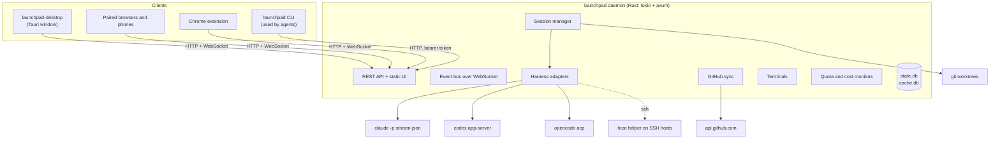

# Architecture

Launchpad is a Rust daemon that owns everything stateful, a React UI served by that daemon, and a thin desktop shell that shows the UI in a native window.



## Design principles

1. **Never wait on the network to show something.** Every screen renders from the local database first and refreshes in the background.
2. **Launching an agent is the main action.** A minimal launch is a prompt and a click.
3. **The core does not depend on a harness.** Claude Code, Codex and OpenCode are adapters behind one session model.
4. **Local first, then follow GitHub.** New work stays local until you publish it. Once work is on GitHub (a published Local PR, or a pull request launched with **Push to PR**), agents keep pushing to that same branch, never with force. Comments, reviews and PR state changes always need your click.
5. **Click only.** Every action is a visible button. The only keyboard shortcuts are `Ctrl+F` in Files, `Ctrl+T` for a terminal and normal text and terminal keys.
6. **One user, move fast.** No multi-user model, no versioning, no data migrations. Few tests.

## Processes

- **Daemon** (`launchpad daemon`): a systemd user service on Linux, launchd agents on macOS, a detached process on Windows. It owns SQLite, the agent processes, terminals, GitHub polling, quota monitoring and notifications. It listens on `127.0.0.1` by default. At startup, it reads the environment of your login shell, so agents see the same tools as in a terminal.
- **Desktop shell** (`launchpad-desktop`): a small Tauri v2 app. It starts the daemon if needed and loads the UI from it. Closing the window hides it, so the next click shows it at once. Links to other sites open in the system browser.
- **Agent processes**: children of the daemon. **Restarting the daemon interrupts running turns**; sessions become Interrupted and resume with one click through the harness's native resume.

Closing the window never affects running agents.

## Roles

The [Home and runners plan](https://wauplin-launchpad-bots-research.static.hf.space/index.html) splits the daemon into two roles of the same binary, selected with `launchpad daemon --role`:

- **Home** holds every record and runs no agents or terminals: starting one there fails with "connect a runner".
- **Runner** runs agents and terminals in its own folders and keeps only caches.
- **All** (default) keeps both in one process, as before.

A runner pairs with `launchpad connect` (a code approved on Home; Home stores the SHA-256 of the runner's secret) and keeps one outbound WebSocket to `/api/runners/tunnel`, authenticated with `X-Launchpad-Runner`. Home sends API requests over it (`runners::Hub::request`), which the runner answers by calling its own router as its local owner. A runner and Home compare `role::PROTOCOL` and the build commit: another protocol cannot connect; another build of the same protocol keeps its running sessions but takes no new ones. The runner guard (accept launches, pause) lives in the runner's folder and is reported to Home.

Replication (`replica.rs`): on a runner, `Sessions::store` and `Sink::emit` also queue the record or event in `home_outbox`, in the same transaction. The tunnel sends the outbox in order; Home applies each item and records its number in `runner_ack` in one transaction (`Sessions::apply_replica`), then sends `Ack`; the runner deletes acknowledged items and resends the rest after a reconnection. On Home, sessions with a `runner_id` are replicas: startup never interrupts them, and items of an older `generation` are ignored. Folders registered on a runner replicate the same way (`project.runner_id` on Home). Home owns workspaces: it sends `Workspaces` snapshots to runners, and runner windows forward workspace changes to Home (`home_client::forward_writes`).

On Home, `runners::relay` sends launches to the runner of the folder (or the first available runner) and every session or folder request to its runner, except the record, events, images and trace, which Home serves. Relayed requests carry only `Idempotency-Key` and are marked `X-Launchpad-From-Home`, which the runner logs for launches.

## Sessions and harnesses

Every harness maps to the same model:

- A **launch spec** describes what to run: the prompt, target folder, context, profile, model, options and start conditions. The composer, schedules, crons and Ask proposals all produce launch specs.
- A **session** is the durable record: status, usage, title, folder, native conversation ID.
- **Events** are the normalized conversation (messages, tool calls, questions, approvals, subagents), stored in order with a sequence number and pushed to every client over the event bus. Clients reconnect with the last sequence number they received and get what they missed.

Adapters (`crates/core/src/harness/`) translate each native protocol into these events and own everything native: startup, resume, model discovery, quota readings, terminal commands. See [Harness adapters](harness-adapters.md).

A launch only does local work in the request: it creates the worktree from the local base, saves the session as Starting and returns. A background task then makes a bounded, best-effort fast-forward update of the base from its upstream (falling back to the same branch on `origin`), fast-forwards the untouched task branch, runs worktree setup and starts the harness; Stop cancels it between steps. Dirty or busy base checkouts stay unchanged. Successful task and Local PR merges save local success first, then push the exact merged commit in a background task outside the session action lock. Sync uses host-aware process groups, noninteractive credentials and a 10-second timeout per Git command; failures are recorded in the UI and session notices and never undo a local merge. Task branches (`lp/`) are never synchronized automatically.

## Storage

| Store | Content | Lifetime |
| --- | --- | --- |
| `config.toml` | Settings, profiles, presets | Edited in Settings or by hand |
| `state.db` (SQLite, WAL) | Sessions, events, drafts, Local PRs, suggestions, schedules, devices | Your data; back it up |
| `cache.db` (SQLite) | GitHub payloads as JSON | Disposable, rebuilt on demand |
| Home backup (`home_backup.rs`) | `state.db` copies (`VACUUM INTO`) and `config.toml` by content hash, one manifest per backup, written last | Home only; last day kept, restored on an empty boot |
| Harness folders | Native conversations (`~/.claude`, `~/.codex`, OpenCode data) | Owned by each harness |

Rust types shared with the UI derive `ts_rs::TS`, so the API is typed end to end without an OpenAPI spec.

## Security model

- Launchpad has one user. Every paired browser has full access.
- The daemon listens on loopback. Remote access goes through a private network (Tailscale) or a proxy you control, with an exact allowed origin.
- Browsers authenticate with an HttpOnly device cookie after pairing. The CLI uses a bearer token from the data folder.
- The Ask Launchpad assistant gets a restricted token: read state and write proposals only.
- GitHub publication, merges and setup commands always require an owner click.
- Agents run as your user with your credentials. Launchpad is not a sandbox for hostile code.

## Repository layout

```text
crates/
├── core/        domain and services: sessions, harness adapters, GitHub, worktrees, quota, terminals, hosts
├── server/      axum routes, WebSocket, authentication, embedded UI
└── cli/         the launchpad binary: daemon and agent-facing subcommands
web/             React app (Vite, TanStack Query/Router/Virtual, Tailwind)
├── src/features/   one folder per feature
├── src/demo/       demo mode: an in-browser fake daemon for the tour
└── src/gen/        TypeScript types generated from Rust
desktop/         Tauri v2 shell
extension/       Chrome extension
deploy/hf-space/ Hugging Face Space connector
packaging/       installers, systemd unit, icons
skills/launchpad/ the agent skill for the launchpad CLI
```
