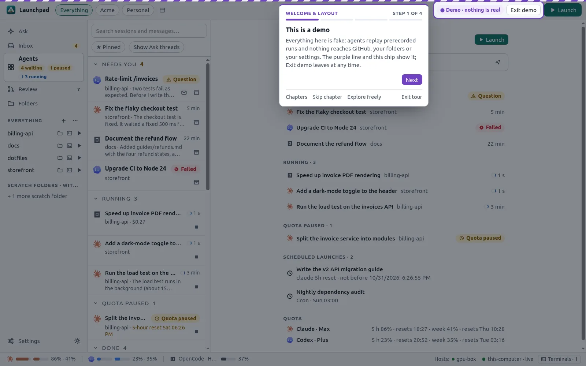
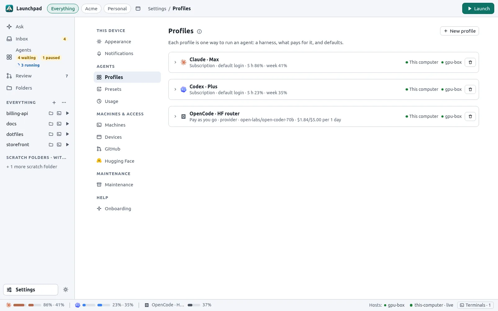
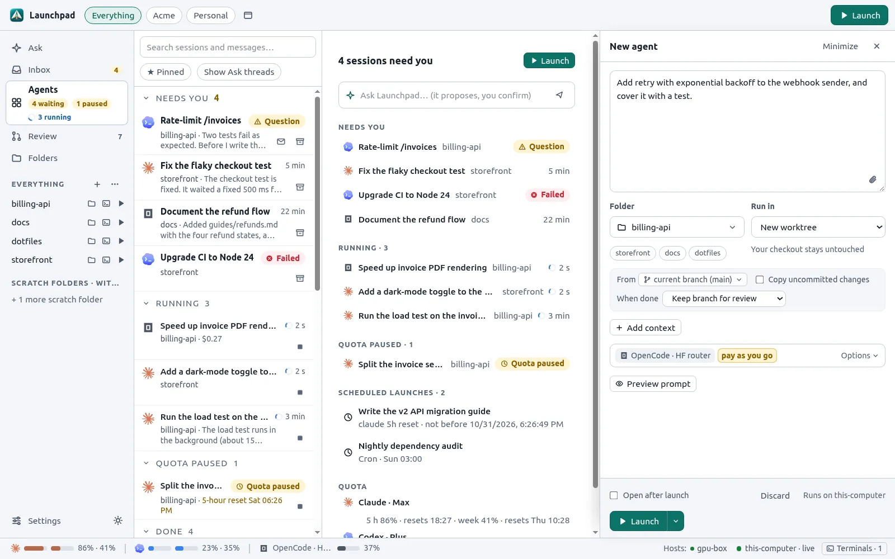

# Getting started

This guide installs Launchpad, takes you through the first run and launches a first agent.

## Requirements

- Linux (Ubuntu 22.04 or newer, the primary platform), macOS or Windows.
- Git and the [GitHub CLI](https://cli.github.com/) (`gh`).
- At least one coding agent CLI: [Claude Code](https://code.claude.com/), [Codex](https://developers.openai.com/codex) or [OpenCode](https://opencode.ai/).

Launchpad never installs these tools or signs you in by itself. The setup checklist (see below) shows what is missing and runs the official command in a visible terminal when you click.

## Install

### From source

You need Rust 1.93 or newer, Node 24 with pnpm (through Corepack) and the [Tauri prerequisites](https://v2.tauri.app/start/prerequisites/). On Ubuntu: `libwebkit2gtk-4.1-dev librsvg2-dev libayatana-appindicator3-dev build-essential`.

```sh
git clone https://github.com/Wauplin/launchpad.git
cd launchpad
packaging/install.sh
```

| Platform | Command | What it installs |
| --- | --- | --- |
| Linux | `packaging/install.sh` | `launchpad` and `launchpad-desktop` in `~/.local/bin`, the systemd user unit `launchpad.service`, an application entry and an autostart entry |
| macOS | `bash packaging/install.sh` | The binaries in `~/.local/bin`, launchd login agents and `~/Applications/Launchpad.app` |
| Windows | `powershell -ExecutionPolicy Bypass -File packaging/install.ps1` | The binaries in `%USERPROFILE%\.local\bin`, Start menu and login shortcuts |

Run the same command again to update. The installer restarts the daemon, which interrupts running agents.

### Prebuilt packages

CI builds packages for Linux x86_64, macOS (Apple Silicon and Intel) and Windows x86_64 on tagged commits. Download the artifact from the [GitHub Actions runs](https://github.com/Wauplin/launchpad/actions/workflows/ci.yml), extract it and run:

```sh
bash packaging/install.sh --prebuilt                                     # Linux, macOS
powershell -ExecutionPolicy Bypass -File packaging/install.ps1 -Prebuilt  # Windows
```

### Other ways to run it

- **Headless server**: `packaging/install.sh --headless` installs only the daemon and the CLI. See [Remote access](remote-access.md#run-on-a-headless-server).
- **Hugging Face Space**: a private Space with browser-only setup and backups. See [Hugging Face](hugging-face.md#run-launchpad-in-a-space).

## First run

Open **Launchpad** from your applications. The window connects to the background daemon, which keeps running when you close the window. Closing the window only hides it.

### The tour

On a fresh install, a welcome dialog offers:

- **Essentials tour** (about 3 minutes): launch an agent, answer it and review its work.
- **Full tour** (about 10 minutes): adds GitHub, Ask Launchpad, terminals, workspaces, automation and settings.
- **Skip the tour**: go straight to the setup checklist.



The tour runs in demo mode: a fictional organization with prerecorded agent runs. Nothing reaches the daemon, GitHub or your folders. A purple line at the top shows that you are in the demo, and **Exit demo** returns to the real app. You can replay any chapter later from **Settings → Onboarding**.

### The setup checklist

**Finish setup** in the sidebar (route `/setup`) checks this computer and each SSH host:

- Git identity, GitHub CLI sign-in, Git credentials and SSH key.
- Each harness: installed and signed in.
- A first profile.

Items that are already done show what was found and where. For missing items, a button runs the official command in a visible terminal. The checklist never overwrites an existing Git identity, credential, SSH key or harness login.

### Create a profile

A profile says how an agent runs: the harness, what pays for the work and the default model. Launchpad ships no profiles. Open **Settings → Profiles → New profile**, choose how the work is paid (a subscription, an API key or another provider), then pick a template.



See [Profiles](agents.md#profiles) for the details.

### Add a folder

Click **+ Add folder** in the sidebar. You can browse any folder on this computer or an SSH host, or **Clone from GitHub** into the folders root (`~/projects` by default). Clone suggestions list repositories with recent GitHub notifications first, then your recently pushed repositories.

### Launch your first agent

1. Click **Launch** in the top bar.
2. Write the task. Type `@` to mention files, `/` for skills and `#` for folders, agent traces and GitHub items.
3. Choose the folder. **Run in → New worktree** (the default in Git folders) gives the agent its own branch.
4. Click **Launch**.



The agent appears in **Agents → Running**. When it finishes, it moves to **Needs you** until you have looked at it. See [Agents](agents.md) for everything that happens next.

### Connect GitHub

Run `gh auth login` on the machine that runs the daemon. Launchpad reads the token from `gh auth token` and fills the inbox in the background. See [GitHub](github.md).

### Open Launchpad on your phone

Open **Settings → Devices → Create pairing link** and scan the QR code. See [Remote access and phones](remote-access.md).

## Troubleshooting

- **Logs**: `journalctl --user -u launchpad -f` on Linux.
- **Daemon status**: `launchpad status` prints JSON.
- **Sign a browser in on this computer**: `launchpad url` prints a link that signs the browser in.
- **Restarting the daemon** interrupts running agents. Interrupted sessions can be resumed with one click.
