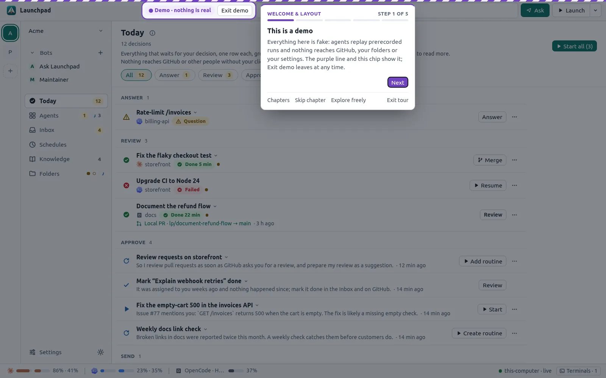
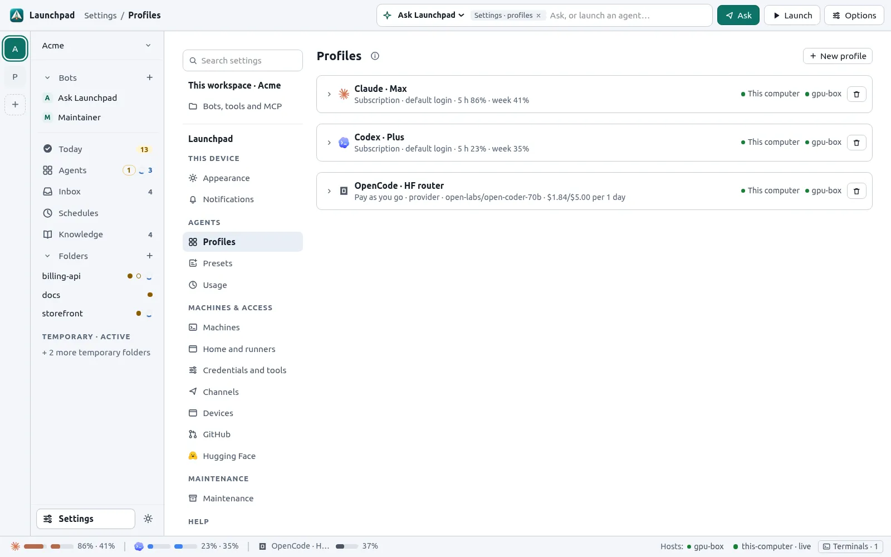
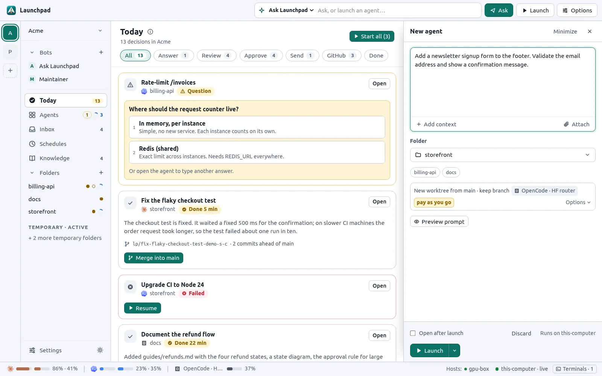

# Getting started

This guide installs Launchpad, takes you through the first run and launches a first agent.

## Requirements

- Linux (Ubuntu 22.04 or newer, the primary platform), macOS or Windows.
- Git and the [GitHub CLI](https://cli.github.com/) (`gh`).
- At least one coding agent CLI: [Claude Code](https://code.claude.com/), [Codex](https://developers.openai.com/codex) or [OpenCode](https://opencode.ai/).

Launchpad never installs these tools or signs you in by itself. The setup checklist (see below) shows what is missing and runs the official command in a visible terminal when you click.

## Install

### From source

You need Rust 1.93 or newer, Node 24 with pnpm (through Corepack) and the [Tauri prerequisites](https://v2.tauri.app/start/prerequisites/). On Ubuntu: `libwebkit2gtk-4.1-dev librsvg2-dev libayatana-appindicator3-dev build-essential`.

```sh
git clone https://github.com/Wauplin/launchpad.git
cd launchpad
packaging/install.sh
```

| Platform | Command | What it installs |
| --- | --- | --- |
| Linux | `packaging/install.sh` | `launchpad` and `launchpad-desktop` in `~/.local/bin`, the systemd user unit `launchpad.service`, an application entry and an autostart entry |
| macOS | `bash packaging/install.sh` | The binaries in `~/.local/bin`, launchd login agents and `~/Applications/Launchpad.app` |
| Windows | `powershell -ExecutionPolicy Bypass -File packaging/install.ps1` | The binaries in `%USERPROFILE%\.local\bin`, Start menu and login shortcuts |

Run the same command again to update. The installer restarts the daemon, which interrupts running agents.

### Prebuilt packages

CI builds packages for Linux x86_64 only on tagged commits (macOS and Windows packages are paused; build from source on those systems). Download the artifact from the [GitHub Actions runs](https://github.com/Wauplin/launchpad/actions/workflows/ci.yml), extract it and run:

```sh
bash packaging/install.sh --prebuilt
```

### Other ways to run it

- **Headless server**: `packaging/install.sh --headless` installs only the daemon and the CLI. See [Remote access](remote-access.md#run-on-a-headless-server).
- **Hugging Face Space**: a private Space with browser-only setup and backups. See [Hugging Face](hugging-face.md#run-launchpad-in-a-space).

## First run

Open **Launchpad** from your applications. The window connects to the background daemon, which keeps running when you close the window. Closing the window only hides it.

### The tour

On a fresh install, a welcome dialog offers:

- **Essentials tour** (about 3 minutes): launch an agent, answer it and review its work.
- **Full tour** (about 10 minutes): adds GitHub, Ask Launchpad and bots with their routines, terminals, workspaces, automation, settings, and Home with its runners and credentials.
- **Skip the tour**: go straight to the setup checklist.



The tour runs in demo mode: a fictional organization with prerecorded agent runs. Nothing reaches the daemon, GitHub or your folders. A purple line at the top shows that you are in the demo, and **Exit demo** returns to the real app. You can replay any chapter later from **Settings → Onboarding**.

### The setup checklist

**Finish setup** in the sidebar (route `/setup`) checks this computer and each SSH host:

- Git identity, GitHub CLI sign-in, Git credentials and SSH key.
- Each harness: installed and signed in.
- A first profile.
- On Linux, where every agent runs contained: bubblewrap installed and able to create a jail (on Ubuntu 24.04, the AppArmor profile that allows it), a login in the vault for each profile's agent, and the Git identity of agents (both in **Settings → Credentials and tools**). Agents in the jail never use this computer's sign-ins or Git configuration.

Items that are already done show what was found and where. For missing items, a button runs the official command in a visible terminal. The checklist never overwrites an existing Git identity, credential, SSH key or harness login.

### Create a profile

A profile says how an agent runs: the harness, what pays for the work and the default model. Launchpad ships no profiles. Open **Settings → Profiles → New profile**, choose how the work is paid (a subscription, an API key or another provider), then pick a template.



See [Profiles](agents.md#profiles) for the details.

### Add a folder

Home starts with one workspace, **Personal**; the rail at the left edge shows your workspaces (see [Workspaces](agents.md#workspaces)). Open **Folders** in the sidebar and click **Add folder**. The sidebar lists **Bots** first (its chevron collapses the group on this device), then Today, Agents, Inbox, Schedules, Knowledge and Folders. The Folders page lists the folders of the workspace and its temporary folders. **Clone from GitHub** (the first tab) clones into the folders root (`~/projects` by default); you can also browse any folder on this computer or an SSH host. Clone suggestions list repositories with recent GitHub notifications first, then your recently pushed repositories.

### Launch your first agent

1. Click **Launch** next to the field in the top bar, with the field empty: the composer opens. (Typing the task in the field first and clicking **Launch** starts at once with the page as context and the folder's defaults.)
2. Write the task. Type `@` to mention files, `/` for skills and `#` for folders, agent traces and GitHub items.
3. Choose the folder. The options line under the prompt says where the agent runs, for example "New worktree from main · keep branch": in Git folders, a new worktree (the default) gives the agent its own branch. Click the line to change **Run in**, **From** or **When done**.
4. Click **Launch**.



The agent appears in **Agents → Running**. When it finishes, a card waits in **Today** until you have looked at it or merged its branch. See [Agents](agents.md) for everything that happens next.

### Find your way

- **One action per row.** Lists show one button per row or card: **Done** on Inbox rows, **Launch** on Folders rows, the main action on Today cards. Hover the row, or focus it with the keyboard, for the other actions (on Folders: **Files**, **Terminal** and **⋯**). On touch screens they are always visible.
- **Page explanations.** A page explains itself under its title on your first visit on this device. After that, click **ⓘ** next to the title to read it again.
- **Settings search.** On a laptop, Settings replaces the sidebar with its pages (**Back to Launchpad** returns to the page you were on); the field at the top finds pages by name and by keyword: "telegram" finds Channels and "ssh" finds Machines.

### Connect GitHub

Run `gh auth login` on the machine that runs the daemon. Launchpad reads the token from `gh auth token` and fills the inbox in the background. See [GitHub](github.md).

### Open Launchpad on your phone

Open **Settings → Devices → Create pairing link** and scan the QR code. See [Remote access and phones](remote-access.md).

## Troubleshooting

- **Logs**: `journalctl --user -u launchpad -f` on Linux.
- **Daemon status**: `launchpad status` prints JSON.
- **Sign a browser in on this computer**: `launchpad url` prints a link that signs the browser in.
- **Restarting the daemon** interrupts running agents. Interrupted sessions can be resumed with one click.
