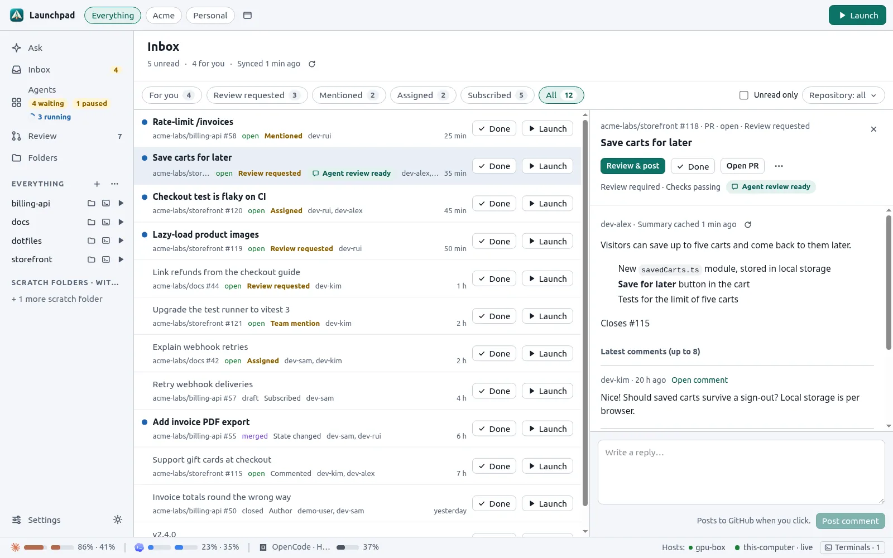
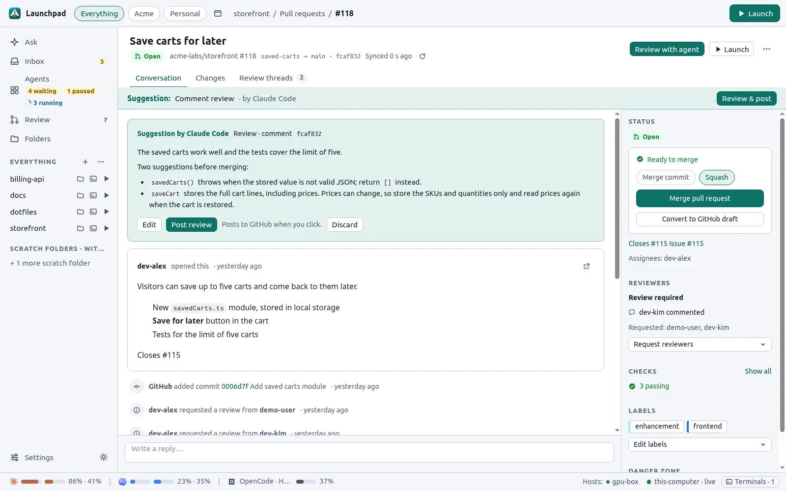
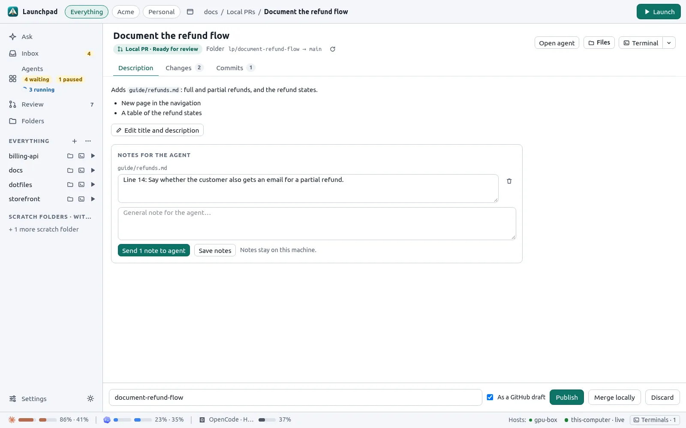
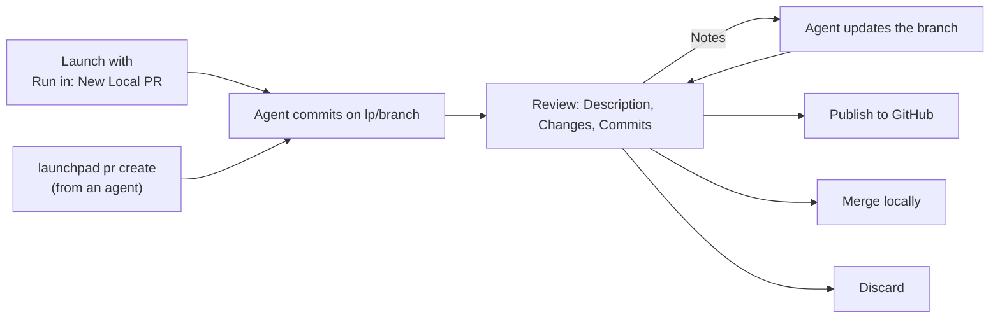
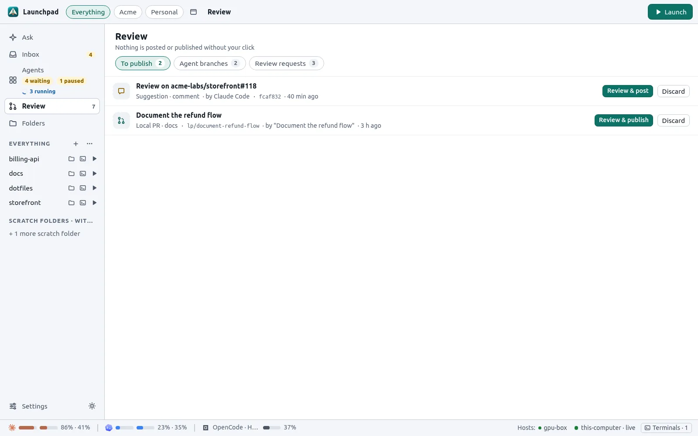

# GitHub

Launchpad replaces the parts of the GitHub UI used every day: notifications, issues, pull requests, reviews and merges. GitHub data is cached locally in `cache.db`, so every screen renders at once and refreshes in the background.

Sign in with `gh auth login` on the machine that runs the daemon. Launchpad reads the token with `gh auth token` and calls the GitHub REST and GraphQL APIs directly.

**Rule: nothing reaches GitHub without your click.** Agents can write comments, reviews and pull requests, but they stay local until you publish them.

## Inbox



- Filter by reason: **Review requested**, **Mentioned**, **Assigned**, **Subscribed** or **All**, plus **Unread only** and a repository filter.
- Each row has **✓ Done**, **▶ Launch** (start an agent with this item as context) and **+ Add** (add it to the current draft).
- The preview shows the latest comments and a reply box. **Read/Unread** and **Unsubscribe** are in the preview.
- The sidebar count is unread review requests, mentions and assignments.

GitHub's API cannot mirror the web inbox exactly, so Launchpad tracks inbox membership locally. Read and Done changes made on github.com may not appear.

## Issues and pull requests



An item page has **Conversation**, **Changes** and **Review threads** tabs, and a side panel with status, checks, reviewers and labels.

- **Changes** loads the diff from local Git first (`pull/N/head`), with the GitHub API as fallback. Files load one at a time, so very large PRs stay fast. Viewed markers and unsent review comments are saved by the daemon and shared across your devices.
- **Merge** is the primary button only when GitHub reports the PR as mergeable and clean. Otherwise the panel shows the blocking reason.
- **Review with agent** opens the composer with the PR head and review instructions. The agent writes its review as a suggestion. If the PR head changes, the suggested review is blocked.
- Folder pages list the 30 most recently updated open issues and PRs of the folder's repository. Select several to launch one agent with all of them.

## Suggestions

Agents write comments and reviews with the `launchpad suggest` CLI. They are saved as suggestions, never posted:

```sh
launchpad suggest review --repo owner/repo --number 123 --head <commit> --body-file review.md --event approve
```

A suggestion appears as a card on the item's Conversation tab and in **Review → To publish**. **Edit**, then **Post review** (or **Post comment**) publishes it under your account. **Discard** deletes it.

## Local PRs

A Local PR is a pull request that exists only on your machine: a branch in its own worktree, a title, a description and review notes. Publish it to GitHub when it is worth it, or merge it locally.





- **Create**: choose **Run in → New Local PR** in the composer, or let an agent run `launchpad pr create`.
- **Review**: the agent keeps the title and description up to date with `launchpad pr update`. **Notes** (general or per file) go back to the agent as one message.
- **Publish**: choose a remote branch name and GitHub draft or ready, then confirm. Launchpad pushes the branch and creates the PR.
- **Merge locally**: rebases the branch onto the local base branch and fast-forwards it. Nothing is pushed.

Publication and merges wait until the agents are idle and the worktree is clean.

## Review

**Review** collects everything waiting for your decision, scoped to the current workspace:

- **To publish**: unposted suggestions and unpublished Local PRs.
- **Agent branches**: worktrees with unmerged work from finished agents.
- **Review requests**: PRs where your review is requested.


