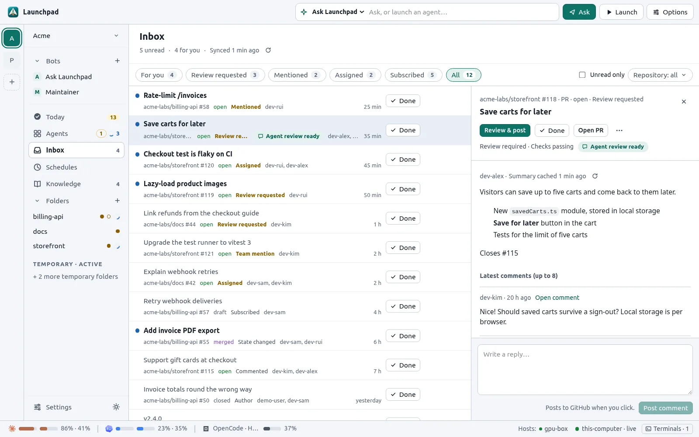
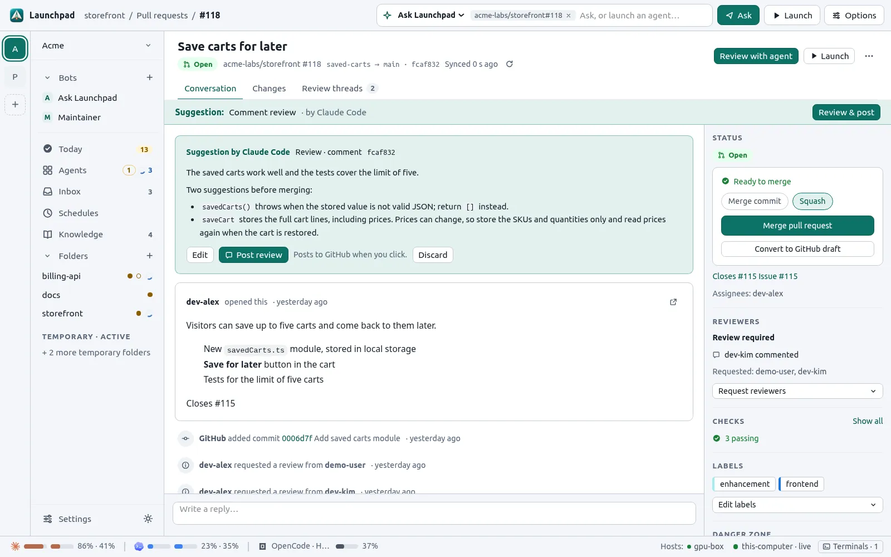
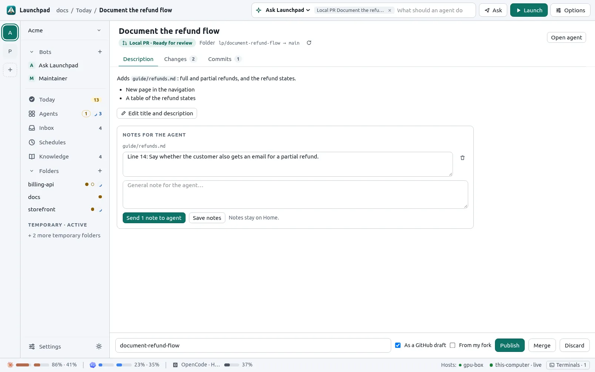
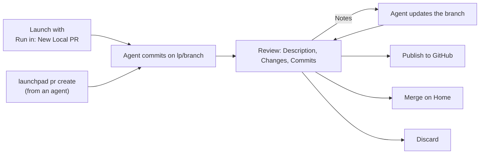

# GitHub

Launchpad replaces the parts of the GitHub UI used every day: notifications, issues, pull requests, reviews and merges. GitHub data is cached locally in `cache.db`, so every screen renders at once and refreshes in the background.

Sign in with `gh auth login` on the machine that runs the daemon. Launchpad reads the token with `gh auth token` and calls the GitHub REST and GraphQL APIs directly.

**Rule: nothing reaches GitHub without your click.** Agents can write comments, reviews and pull requests, but they stay local until you publish them. Once a branch is on GitHub, agents you launch on it push their commits to it (see [Continue a pull request](#continue-a-pull-request)).

## Inbox



- The Inbox (`/inbox`) lists the notifications of the workspace's repositories. Notifications of a repository that has no folder appear in no Inbox: **Settings → GitHub → Repositories without a folder** lists those repositories with their notification count and last activity, with **Add to ▾** (clone it as a folder of a workspace) and **Open on GitHub** in **⋯**.
- Filter by reason: **Review requested**, **Mentioned**, **Assigned**, **Subscribed** or **All**, plus **Unread only** and a repository filter. On the phone, the bar's **⋯** holds the counts, the sync state, **Unread only** and the repository filter, so the list starts at the reason chips.
- Each row shows **✓ Done** and **⋯**, which holds **Launch** (start an agent with this item as context) and, while a draft is open, **Add to the draft**. **⋯** shows when you hover the row or focus it with the keyboard. On the phone, a row has only **✓ Done**: open the preview for **Launch**.
- The preview shows the latest comments and a reply box. **Read/Unread** and **Unsubscribe** are in the preview.
- The sidebar count is unread review requests, mentions and assignments.

GitHub's API cannot mirror the web inbox exactly, so Launchpad tracks inbox membership locally. Read and Done changes made on github.com may not appear.

Home polls GitHub for notifications. A poll reads the newest page first and stops at the first page it already holds unchanged, so a quiet poll costs one or two requests. It only adds or updates threads. A full pass reads the whole history every 3 hours and at each Home start, and replaces the local copy. So a thread that left GitHub's history, or a thread on an older page that you marked read on github.com, can take up to 3 hours to update. A bot that should clear threads itself uses `launchpad inbox done` or `launchpad inbox unsubscribe` (see [Bots](bots.md#the-launchpad-cli-tool)), which marks them done in both places.

## Issues and pull requests



An item page has **Conversation**, **Changes** and **Review threads** tabs, and a side panel with status, checks, reviewers, labels and agents whose launch named the item. In a narrow window the panel hides: **Status, checks and labels** above the conversation opens it over the page.

- **Your review** holds one pending review per PR on Home: summary, event, line comments and any agent source. Changes and Review threads show the panel at laptop widths from 1100 px; **Review (n)** opens it in a smaller window or a phone sheet. Android back closes the sheet and keeps the draft. Conversation keeps a one-line **Write a comment** box for plain comments.
- Click a diff line to write a comment under it. Comments have **Edit** and **Delete**; unfinished text stays with each file. **Approve ▾** also offers **Comment** and **Request changes**, remembering the choice per repository. Summary and current-head line comments post together only on your click. **Then squash and merge** appears only for Approve and asks for confirmation. If GitHub refuses the review (or the PR moved), nothing is posted and the review stays editable; when the result is unknown, the panel asks you to check GitHub before another attempt.
- **Changes** loads the diff from local Git first (`pull/N/head`), with the GitHub API as fallback. Files load one at a time, so very large PRs stay fast. Viewed markers and unsent review comments are saved by the daemon and shared across your devices.
- **Merge pull request** is the primary button only when GitHub reports the PR as mergeable and clean and no suggestion waits to be posted. Otherwise the panel shows the blocking reason.
- **Review with agent** opens the composer with the PR head and review instructions. The agent writes its review as a suggestion. If the PR head changes, the suggested review is blocked.
- Folder pages list the 30 most recently updated open issues and PRs of the folder's repository. Select several to launch one agent with all of them.

## Continue a pull request

Paste a link to a pull request, or to one of its comments, in the composer prompt (or add it as context) and say what to change. When the folder's `origin` or `upstream` is the PR's repository and **Run in** is **New worktree**, **Push to PR #N** is checked by default:

- Home reads the PR on GitHub with its own login (runners need no GitHub credential), fetches its head (`pull/N/head`) into the session's branch, and the runner creates the worktree from it.
- The agent commits; its branch goes to Home at the end of every turn, and Home pushes it to the PR branch (`origin`, or the fork's URL derived from it). Home never force-pushes; if the PR branch moved, the session shows it and the agent rebases on it.
- The worktree is never merged by Launchpad and cannot become a Local PR: the pull request is the review.
- Uncheck **Push to PR** to keep the work on Home in a normal worktree.

Pushing to a fork's branch needs write access to it ("Allow edits by maintainers" or your own fork).

## Suggestions

Agents write comments and reviews with the `launchpad suggest` CLI. They are saved as suggestions, never posted:

```sh
launchpad suggest review --repo owner/repo --number 123 --head <commit> --body-file review.md --event approve --comments-file comments.json
```

`--comments-file` (reviews only) holds the review's line comments, a JSON array of `{"path", "line", "side", "start_line", "body"}` (`side` is `RIGHT` by default or `LEFT` for a removed line; `start_line` is optional, for a range). A comment body may hold a ```` ```suggestion ```` block. On a Local PR, the line comments become notes on those lines.

A suggested review is a Today card (and a line in its bot's chat): **Review** shows its summary and line comments, **Edit** changes the summary and event or removes line comments, and **Post review** sends the summary and every line comment to GitHub as one review at the commit the agent reviewed. **Edit in pull request** opens it on the PR page instead. There, it appears in **Your review**, with **Use** to copy its summary, event, follow-up and line comments into the pending review (where you edit them like your own), and **Drop** to discard it. The Inbox, the PR banner and the session's next steps show **Review ready · n comments**, which opens the panel. Posting a suggestion claims it, so it cannot be posted again from the other place. Suggested plain comments keep their Conversation card. Agent text published from a source suggestion ends with its [attribution line](agents.md#attribution).

A suggested follow-up enters the panel with **Use**. Approvals can **then squash and merge**; `--run-ci` suggests approving the waiting CI runs instead. Uncheck the follow-up to post only the review. Follow-ups run after the review is recorded as posted. A failure reports that the review was posted and never retries the follow-up.

When workflow runs of a pull request wait for approval, its **Checks** section shows **Approve and run workflows**. Agents can prepare the same click as a ready card (`github.run-ci`, see [Bots](bots.md#proposals)). It runs the pull request's code in the repository's CI, so it stays your click, like GitHub's own button.

## Local PRs

A Local PR is a pull request that exists only in Launchpad: a branch on Home Git, a title, a description and review notes. Review and publish it from any device, also while the machine that ran the agent sleeps. Publish it to GitHub when it is worth it, or merge it on Home.





- **Create**: choose **Run in → New Local PR** in the composer's options, or let an agent run `launchpad pr create` in its worktree. Local PRs opened by one agent form a **change set**: their pages link to each other, and **Publish all** publishes them together and links the pull requests to each other. Publish all first checks that every branch is still at the commit you reviewed, and publishes nothing when one moved.
- **Review**: line notes store their path, line and side separately from editable text. Notes save on Home without a Save notes button. **Publish…** opens branch, draft and fork options; the bar also has **Merge** and **⋯ → Discard**. The agent keeps the title and description up to date with `launchpad pr update`. **Notes** (general or per file) go back to the agent as one message. While notes wait, **Send notes to agent** is the primary button; otherwise **Publish** is.
- **Publish**: choose a remote branch name and GitHub draft or ready, then confirm. Home pushes exactly the commit you reviewed (a newer push asks you to review again) and creates the PR, its description ending with the agent's [attribution line](agents.md#attribution). Check **From my fork** when you cannot push to `origin`: Home pushes to your existing GitHub fork and opens the PR from it. After publication, the Local PR stays open to agents: new commits on its branch reach the published branch through Home, never forced. Until GitHub has the newest commit, the Local PR and the agent's branch show **Not on GitHub yet**, with the last push error; **Refresh** retries. If the push fails and the remote shows that nothing arrived, the Local PR unlocks itself. Otherwise a banner offers **Unlock**, and a branch that was already pushed keeps its name for the next Publish.
- **Merge**: Home pushes the reviewed commit to the base branch on the folder's remote, then fast-forwards the base branch on Home. When the remote refuses the push (a protected branch, for example), nothing is merged and the Local PR shows why; publish it instead. It never forces or retries automatically. If the base branch moved, send a note asking the agent to rebase.
- **Discard** deletes the branch on Home. Its tip stays restorable for 30 days (folder page → Launchpad branches).

Publication and merges wait until the Local PR's agent is idle.

## What waits for you

[Today](today.md) lists what waits for your decision in the current workspace:

- **GitHub**: unposted suggestions, and open PRs where your review is requested (**Open PR** opens Changes; **Review with agent** is in ⋯).
- **Review**: finished agents with their branch (**Merge** when it is safe) or their Local PR (**Local PR** opens it), and Local PRs not yet published whose agent does not need you.

The **Branches** tab of a folder page lists the agent branches with work to look at: commits ahead of their base, uncommitted files or a merge request. Each row has **Changes**, which opens the agent's Changes, and **⋯ → Open agent**.
