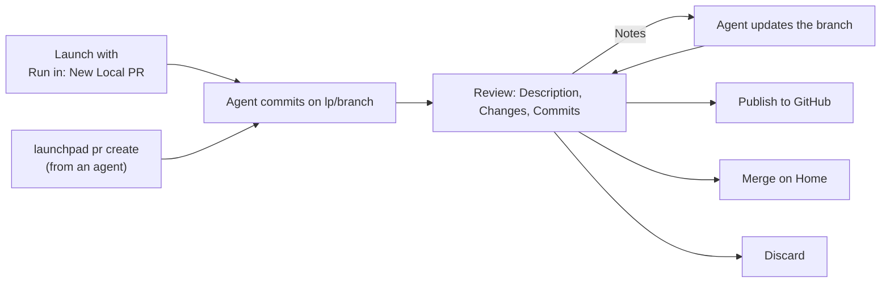
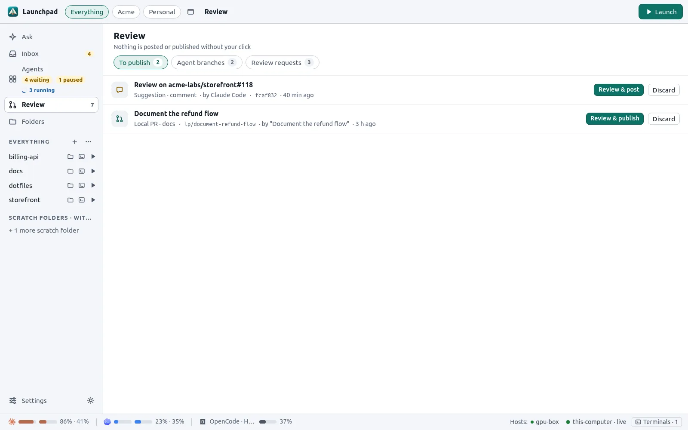

# GitHub

Launchpad replaces the parts of the GitHub UI used every day: notifications, issues, pull requests, reviews and merges. GitHub data is cached locally in `cache.db`, so every screen renders at once and refreshes in the background.

Sign in with `gh auth login` on the machine that runs the daemon. Launchpad reads the token with `gh auth token` and calls the GitHub REST and GraphQL APIs directly.

**Rule: nothing reaches GitHub without your click.** Agents can write comments, reviews and pull requests, but they stay local until you publish them. Once a branch is on GitHub, agents you launch on it push their commits to it (see [Continue a pull request](#continue-a-pull-request)).

## Inbox


- Filter by reason: **Review requested**, **Mentioned**, **Assigned**, **Subscribed** or **All**, plus **Unread only** and a repository filter.
- Each row has **✓ Done**, **▶ Launch** (start an agent with this item as context) and **+ Add** (add it to the current draft).
- The preview shows the latest comments and a reply box. **Read/Unread** and **Unsubscribe** are in the preview.
- The sidebar count is unread review requests, mentions and assignments.

GitHub's API cannot mirror the web inbox exactly, so Launchpad tracks inbox membership locally. Read and Done changes made on github.com may not appear.

## Issues and pull requests


An item page has **Conversation**, **Changes** and **Review threads** tabs, and a side panel with status, checks, reviewers and labels.

- **Changes** loads the diff from local Git first (`pull/N/head`), with the GitHub API as fallback. Files load one at a time, so very large PRs stay fast. Viewed markers and unsent review comments are saved by the daemon and shared across your devices.
- **Merge** is the primary button only when GitHub reports the PR as mergeable and clean. Otherwise the panel shows the blocking reason.
- **Review with agent** opens the composer with the PR head and review instructions. The agent writes its review as a suggestion. If the PR head changes, the suggested review is blocked.
- Folder pages list the 30 most recently updated open issues and PRs of the folder's repository. Select several to launch one agent with all of them.

## Continue a pull request

Paste a link to a pull request, or to one of its comments, in the composer prompt (or add it as context) and say what to change. When the folder's `origin` or `upstream` is the PR's repository and **Run in** is **New worktree**, **Push to PR #N** is checked by default:

- Home reads the PR on GitHub with its own login (runners need no GitHub credential), fetches its head (`pull/N/head`) into the session's branch, and the runner creates the worktree from it.
- The agent commits; its branch goes to Home at the end of every turn, and Home pushes it to the PR branch (`origin`, or the fork's URL derived from it). Home never force-pushes; if the PR branch moved, the session shows it and the agent rebases on it.
- The worktree is never merged by Launchpad and cannot become a Local PR: the pull request is the review.
- Uncheck **Push to PR** to keep the work on Home in a normal worktree.

Pushing to a fork's branch needs write access to it ("Allow edits by maintainers" or your own fork).

## Suggestions

Agents write comments and reviews with the `launchpad suggest` CLI. They are saved as suggestions, never posted:

```sh
launchpad suggest review --repo owner/repo --number 123 --head <commit> --body-file review.md --event approve
```

A suggestion appears as a card on the item's Conversation tab and in **Review → To publish**. **Edit**, then **Post review** (or **Post comment**) publishes it under your account. **Discard** deletes it.

## Local PRs

A Local PR is a pull request that exists only in Launchpad: a branch on Home Git, a title, a description and review notes. Review and publish it from any device, also while the machine that ran the agent sleeps. Publish it to GitHub when it is worth it, or merge it on Home.




- **Create**: choose **Run in → New Local PR** in the composer, or let an agent run `launchpad pr create` in its worktree. Local PRs opened by one agent form a **change set**: their pages link to each other, and **Publish all** publishes them together and links the pull requests to each other.
- **Review**: the agent keeps the title and description up to date with `launchpad pr update`. **Notes** (general or per file) go back to the agent as one message.
- **Publish**: choose a remote branch name and GitHub draft or ready, then confirm. Home pushes exactly the commit you reviewed (a newer push asks you to review again) and creates the PR. Check **From my fork** when you cannot push to `origin`: Home pushes to your existing GitHub fork and opens the PR from it. After publication, the Local PR stays open to agents: new commits on its branch reach the published branch through Home, never forced. If the push fails and the remote shows that nothing arrived, the Local PR unlocks itself. Otherwise a banner offers **Unlock**, and a branch that was already pushed keeps its name for the next Publish.
- **Merge**: Home pushes the reviewed commit to the base branch on the folder's remote, then fast-forwards the base branch on Home. When the remote refuses the push (a protected branch, for example), nothing is merged and the Local PR shows why; publish it instead. It never forces or retries automatically. If the base branch moved, send a note asking the agent to rebase.
- **Discard** deletes the branch on Home. Its tip stays restorable for 30 days (folder page → Launchpad branches).

Publication and merges wait until the Local PR's agent is idle.

## Review

**Review** collects everything waiting for your decision, scoped to the current workspace:

- **To publish**: unposted suggestions and unpublished Local PRs.
- **Agent branches**: worktrees with unmerged work from finished agents.
- **Review requests**: PRs where your review is requested.


