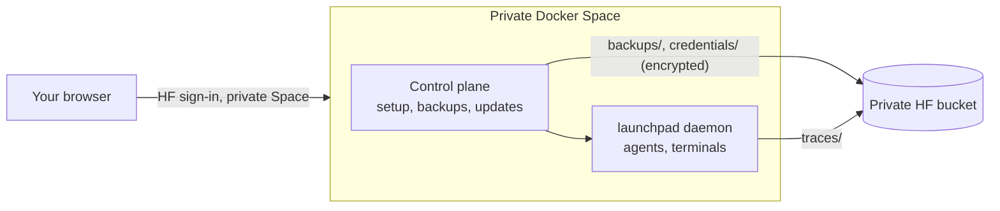

# Hugging Face

Launchpad integrates with Hugging Face in three ways:

- **Open models**: run Claude Code on open models through Hugging Face Inference Providers.
- **Trace sync**: export agent traces to a Hugging Face bucket, and import traces from your other Launchpad instances.
- **Spaces**: run a complete Launchpad in a private Hugging Face Space, usable from any browser.

## Open models through Inference Providers

In **Settings → Profiles → New profile**, choose **Another model provider**, then **Claude Code · Hugging Face**. The profile points Claude Code to `https://router.huggingface.co` and lists the available tool-capable models (Kimi, GLM, Qwen, DeepSeek and others), with prices, context size and throughput per provider. Usage is billed to your Hugging Face account.

The token comes from `HF_TOKEN`, or from the token saved by `hf auth login`. OpenCode profiles can use the same router.

## Trace sync to a bucket

Open **Settings → Hugging Face**. Launchpad checks the `hf` CLI and its sign-in (`hf auth whoami`) on the daemon's machine. Turn on trace sync and choose a bucket (default `<your account>/launchpad-traces`). Missing buckets are created private; Launchpad never changes the visibility of an existing bucket.

Each session is uploaded to:

```text
hf://buckets/<namespace>/<bucket>/<folder name>/<YYYYMMDD_HHMM>_<session id>/
├── <native trace files>          # Claude JSONL, Codex rollout-*.jsonl or OpenCode export, unchanged
├── launchpad.json                # run record: launch settings, prompt, usage, status, timestamps
└── launchpad-events-<seq>.jsonl  # Launchpad's normalized events, append-only chunks
```

- Native traces keep their original format, so tools that read those formats work on them directly.
- The worker runs every minute, uploads only what changed and retries failures without blocking agents.
- Disabling sync or archiving a session never deletes remote data.
- Traces can contain sensitive data: prompts, tool output and file paths. Keep the bucket private.

**Sync between machines**: instances that use the same bucket import each other's traces for folders with the same name. Imported sessions appear as **Synced trace** in Agents. They are read-only: use **New agent here** or **Use trace as context** to continue the work locally. Credentials, profiles, settings and worktrees are never synced.

## Run Launchpad in a Space

A private Docker Space runs a headless Launchpad with a small control plane in front of it: browser-only setup, encrypted credential backups to a private bucket, and explicit updates.



### Setup

1. Create a private Docker Space from the template: duplicate the published template Space, or use `hf-space-template.zip` from the [`hf-space-channel`](https://github.com/Wauplin/launchpad/tree/hf-space-channel) branch. Keep it **Private**: everyone who can open the Space controls your agents.
2. Choose paid CPU hardware and disable sleep if agents must run while the tab is closed. Free CPU Spaces sleep and lose running processes.
3. Open the Space and sign in to Hugging Face: the page runs `hf auth login` and shows a link and a code. Launchpad saves the sign-in as a Space secret and refreshes it automatically, creates a private backup bucket and an encryption key, then restarts once (about a minute).
4. **Connect your first agent**: your Hugging Face account (open models), Claude Code, Codex or OpenCode (their sign-in runs in a terminal on the page), or an API key. GitHub is offered next.

A bar above the app shows the Space name and the backup state. **Space settings** opens accounts, backups, updates and Space actions.

### Backups

- State is saved every minute when it changed, the workspace archive every five minutes, and a final checkpoint runs when the Space stops.
- Credentials are encrypted (AES-256-GCM) with a key that only the control plane can read.
- Keep projects inside `/home/agent`: other folders are not backed up. Rebuildable folders (`node_modules`, `target`, virtual environments) are skipped.
- If no backup succeeded for ten minutes, new launches and replies pause.

### Updates

Every commit on `main` that passes the image build becomes a version. The Space checks for updates at startup and about every six hours; **Check now** in Space settings checks immediately. **Update available · Review** shows the change. Updates need your click, idle agents and terminals, and a verified backup. If the new version does not start within five minutes, **Roll back** restores the previous image and data.

Developer details (layout, build, recovery without the app) are in [`deploy/hf-space/README.md`](../deploy/hf-space/README.md).
