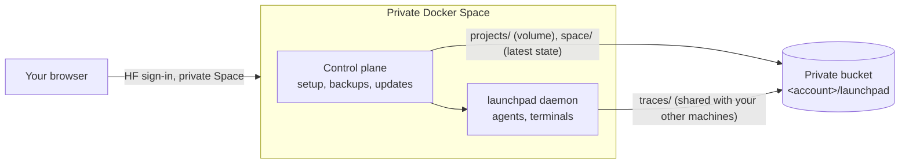

# Hugging Face

Launchpad integrates with Hugging Face in three ways:

- **Open models**: run Claude Code on open models through Hugging Face Inference Providers.
- **Trace sync**: export agent traces to a Hugging Face bucket, and import traces from your other Launchpad instances.
- **Spaces**: run a complete Launchpad in a private Hugging Face Space, usable from any browser.

## Open models through Inference Providers

In **Settings → Profiles → New profile**, choose **Another model provider**, then **Claude Code · Hugging Face**. The profile points Claude Code to `https://router.huggingface.co` and lists the available tool-capable models (Kimi, GLM, Qwen, DeepSeek and others), with prices, context size and throughput per provider. Usage is billed to your Hugging Face account.

The token comes from `HF_TOKEN`, or from the token saved by `hf auth login`. OpenCode profiles can use the same router.

## Trace sync to a bucket

Open **Settings → Hugging Face**. Launchpad checks the `hf` CLI and its sign-in (`hf auth whoami`) on the daemon's machine. Turn on trace sync and choose a bucket and prefix (default `<your account>/launchpad`, prefix `traces`: the same place a Launchpad Space exports to, so every machine and Space syncs into one bucket). Missing buckets are created private; Launchpad never changes the visibility of an existing bucket.

Each session is uploaded to:

```text
hf://buckets/<namespace>/<bucket>/<prefix>/<folder name>/<YYYYMMDD_HHMM>_<session id>/
├── <native trace files>          # Claude JSONL, Codex rollout-*.jsonl or OpenCode export, unchanged
├── launchpad.json                # run record: launch settings, prompt, usage, status, timestamps
└── launchpad-events-<seq>.jsonl  # Launchpad's normalized events, append-only chunks
```

- Native traces keep their original format, so tools that read those formats work on them directly.
- The worker runs every minute, uploads only what changed and retries failures without blocking agents.
- Disabling sync or archiving a session never deletes remote data.
- Traces can contain sensitive data: prompts, tool output and file paths. Keep the bucket private.

**Sync between machines**: instances that use the same bucket and prefix import each other's traces for folders with the same name. Imported sessions appear as **Synced trace** in Agents. They are read-only: use **New agent here** or **Use trace as context** to continue the work locally. Credentials, profiles, settings and worktrees are never synced.

## Run Launchpad in a Space

A private Docker Space runs a headless Launchpad with a small control plane in front of it: browser-only setup, `~/projects` kept live in a private bucket, encrypted credential backups and explicit updates.



### Setup

1. Create a private Docker Space from the template: duplicate the published template Space, or use `hf-space-template.zip` from the [`hf-space-channel`](https://github.com/Wauplin/launchpad/tree/hf-space-channel) branch. Keep it **Private**: everyone who can open the Space controls your agents.
2. Choose paid CPU hardware and disable sleep if agents must run while the tab is closed. Free CPU Spaces sleep and lose running processes.
3. Open the Space and paste a Hugging Face **write** token. Launchpad saves it as a Space secret, creates the private `<your account>/launchpad` bucket (if missing), an encryption key and the `~/projects` volume, then restarts once (about a minute).
4. **Connect your first agent**: your Hugging Face account (open models), Claude Code, Codex or OpenCode (their sign-in runs in a terminal on the page), or an API key. GitHub is offered next.
5. **Clone your repositories** (optional): tick repositories to clone into `~/projects`. Each becomes a folder in Launchpad. When GitHub is connected, repositories with recent notifications come first, then your recently pushed ones. You can also type `owner/name`.

A bar above the app shows the Space name and the backup state. **Space settings** opens accounts, folders (the same repository picker), backups, updates and Space actions.

### Backups

- `~/projects` is a Space volume on the bucket's `projects/` folder: files are written to the bucket as you work, with no snapshots. Everything in it is stored, including `node_modules`, `target` and `.env` files, in readable form.
- Launchpad's state, settings and agent history (`~/.claude`, `~/.codex`, OpenCode, `~/.agents`) are saved every minute when they changed, as one latest copy; caches and logs are skipped. A final save runs when the Space stops.
- Credentials are encrypted (AES-256-GCM) with a key that only the control plane can read.
- Keep folders in `~/projects`: other folders and other files in the home folder are lost on restart.
- If no backup succeeded for ten minutes, new launches and replies pause.
- Spaces set up before the projects volume show **Move projects and restart** once. After the restart, the old backup is restored a last time and its projects are written into the volume. The old `backups/` and `credentials/` folders are no longer used; you can delete them once the new setup works.

### Updates

Every commit on `main` that passes the image build becomes a version. The Space checks for updates at startup and about every six hours; **Check now** in Space settings checks immediately. The Updates section shows the installed and available versions, with a link to the changes.

**Update…** opens a confirmation that lists what will happen: the running agents are stopped (like the Stop button), open terminals close, a backup is saved and verified, the Space switches to the new version and restarts, and the stopped agents resume in their own sessions with “Continue the unfinished turn.”. Space settings shows each step while it runs, then the result: the new version, the resumed agents and any agent that could not resume (open it and click **Resume**).

- If a step fails before the restart, the current version keeps running and the stopped agents resume on it.
- If the new version does not start within five minutes, **Roll back** restores the previous image and its pre-update backup; agents that were not resumed yet resume on the previous version.
- Agents resume only once, and not when the Space comes back more than one hour after the update.
- Sessions paused for quota or open in a terminal block the update until you stop or close them.

Developer details (layout, build, recovery without the app) are in [`deploy/hf-space/README.md`](../deploy/hf-space/README.md).
