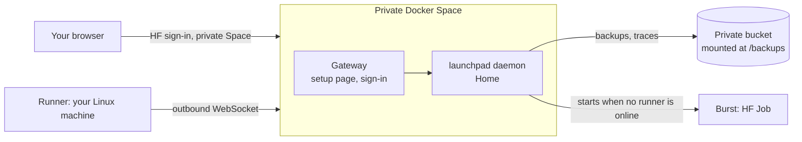

# Hugging Face

Launchpad integrates with Hugging Face in three ways:

- **Open models**: run Claude Code on open models through Hugging Face Inference Providers.
- **Traces**: Home copies the original conversation of every agent to its bucket, one file per trace.
- **Spaces and Jobs**: run Home in a private Hugging Face Space, usable from any browser, and run agents on Burst (HF Jobs) when no runner is online.

## Open models through Inference Providers

In **Settings → Profiles → New profile**, choose **Another model provider**, then **Claude Code · Hugging Face**. The profile points Claude Code to `https://router.huggingface.co` and lists the available tool-capable models (Kimi, GLM, Qwen, DeepSeek and others), with prices, context size and throughput per provider. Usage is billed to your Hugging Face account.

The token comes from `HF_TOKEN`, or from the token saved by `hf auth login`. OpenCode profiles can use the same router.

## Traces in the Home bucket

Home copies the original conversation of every agent to its backup destination (on a hosted Home, the private bucket mounted at `/backups`), one file per trace, next to the backups. The bucket view on Hugging Face opens these files in its trace viewer.

```text
<workspace>/traces/<folder>/<YYYYMMDD_HHMM>_<session id>/
├── <native trace files>   # Claude Code JSONL, Codex rollout-*.jsonl or OpenCode export, unchanged
└── launchpad.json         # session record: workspace and folder names, launch settings, prompt, usage, status, timestamps
```

- The start time is in UTC, so the sessions of a folder sort by start time. Bot sessions without a folder are under `bot <slug>`.
- A runner sends the conversation of a session to Home at the end of every turn (the handoff). After each backup, Home uploads the files that changed since the last pass. A failed upload is retried after the next backup and shows in **Settings → Hugging Face**.
- Renaming a workspace or folder moves the copies of its sessions. Archiving a session never deletes them.
- Home never reads the copies back: `state.db` in the backups stays the source. Settings → Hugging Face shows the layout and any copy error.
- Home keeps the list of copied files in the bucket too (`home/copies/`). A Home restored from the bucket starts from that list and does not copy every trace again.
- Traces can contain sensitive data: prompts, tool output and file paths. Keep the bucket private.

## Run Home in a Space

A private Docker Space runs Home: records, credentials, Home Git, the GitHub cache and the app. It runs no agents: they run on your runners, or on **Burst**, HF Jobs that Home starts from its own image when no runner is online. A private bucket mounted at `/backups` holds Home's backups and the trace copies.



- **Deploy**: one command with the hf CLI creates the private bucket and Space and deploys the latest release (see the [README](../README.md#try-it-yourself)). Run it again to update, or use **Update Home** in **Settings → Home and runners**. **Update Home** takes a backup first. If that backup fails, Home is not updated and the error says why: the new Home would restart from an older backup.
- **Setup**: the setup page leads from an empty Home to a first agent: Hugging Face sign-in, the credential key, GitHub, the Git identity of agents, an agent login and profile, workspaces, a first folder, then a runner and a first agent (both optional).
- **Runners**: **Settings → Home and runners → Add a runner** shows a one-line install command for a Linux machine. See [Home and runners](home-and-runners.md#pair-a-runner).
- **Backups**: Home backs up to the bucket when something changed (the database at most every 10 minutes), and keeps at most 10 backups: the two newest, one at least an hour old and one per day for the last 7 days ([retention](home-and-runners.md)). Credentials are encrypted with your key; everything else stays readable.

See [deploy/hf-home/README.md](../deploy/hf-home/README.md) for the details: setup steps, keys, deploy options, updates and the runner script.
