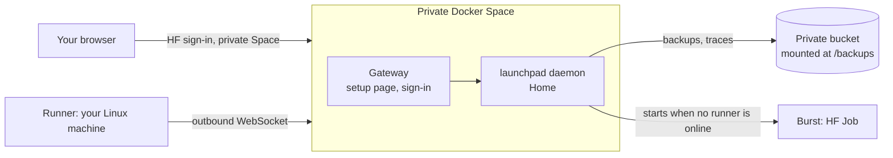

# Hugging Face

Launchpad integrates with Hugging Face in four ways:

- **Open models**: run Claude Code on open models through Hugging Face Inference Providers.
- **Traces**: Home copies the original conversation of every agent to its bucket, one file per trace.
- **Spaces and Jobs**: run Home in a private Hugging Face Space, usable from any browser, and run agents on Burst (HF Jobs) when no runner is online.
- **Shared folios**: **Share…** publishes a read-only snapshot of a [folio](folios.md#share-a-snapshot) as a static Space under your namespace, private by default, deleted after 30 days unless you keep it.

## Open models through Inference Providers

In **Settings → Profiles → New profile**, choose **Another model provider**, then **Claude Code · Hugging Face**. The profile points Claude Code to `https://router.huggingface.co` and lists the available tool-capable models (Kimi, GLM, Qwen, DeepSeek and others), with prices, context size and throughput per provider. Usage is billed to your Hugging Face account.

Agents on runners get the token of the **Hugging Face CLI** tool (Settings → Credentials and tools on Home): the session sees a placeholder in `HF_TOKEN`, and the runner's proxy adds the real token on requests to `huggingface.co` and `router.huggingface.co` only. Hugging Face tools saved before the router was part of the tool get `router.huggingface.co` once, at Home's next start. OpenCode profiles can use the same router.

## Traces in the Home bucket

Home copies the original conversation of every agent to its backup destination (on a hosted Home, the private bucket mounted at `/backups`), one file per trace, next to the backups. The bucket view on Hugging Face opens these files in its trace viewer.

```text
<workspace>/traces/<folder>/<YYYYMMDD_HHMM>_<session id>/
├── <native trace files>   # Claude Code JSONL, Codex rollout-*.jsonl or OpenCode export, unchanged
└── launchpad.json         # session record: workspace and folder names, launch settings, prompt, usage, status, timestamps
```

- The start time is in UTC, so the sessions of a folder sort by start time. Bot sessions without a folder are under `bot <slug>`.
- A runner sends the conversation of a session to Home at the end of every turn (the handoff). After each backup, Home uploads the files that changed since the last pass. A failed upload is retried after the next backup and shows in `launchpad home` (`backup.traces_error`) and `launchpad failures`.
- Renaming a workspace or folder moves the copies of its sessions. Archiving a session never deletes them.
- Home never reads the copies back: `state.db` in the backups stays the source.
- Home keeps the list of copied files in the bucket too (`home/copies/`). A Home restored from the bucket starts from that list and does not copy every trace again.
- Traces can contain sensitive data: prompts, tool output and file paths. Keep the bucket private.

## Run Home in a Space

A private Docker Space runs Home: records, credentials, Home Git and the app. It runs no agents: they run on your runners, or on **Burst**, HF Jobs that Home starts from its own image when no runner is online. A private bucket mounted at `/backups` holds Home's backups and the trace copies.



- **Deploy**: one command with the hf CLI creates the private bucket and Space and deploys the latest release (see the [README](../README.md#try-it-yourself)). Run it again to update, or use **Update Home** in **Settings → Home and runners**. **Update Home** first pauses every change (a banner shows in every window, drafts stay, and the CLI and agents get a retryable error), lets running requests finish, saves a final backup and checks it in the bucket itself, and only then commits the new version. If any step fails, Home is not updated, accepts changes again and says why. Changes stay paused until the new Home runs (the whole build, several minutes). They resume earlier only when the update can no longer replace Home: the Hub refused the commit, or the Space reports it runs another version again. A failed build or a lost answer does not resume them, since a later build could still restart Home from its checkpoint; **Cancel update** puts the previous version back on the Space, which then usually restarts with it, losing nothing. An agent that asked for the update is woken once Home accepts work again.
- **Setup**: the setup page leads from an empty Home to a first agent: Hugging Face sign-in, the credential key, GitHub, the Git identity of agents, an agent login and profile, workspaces, a first folder, then a runner and a first agent (both optional).
- **Runners**: **Settings → Home and runners → Add a runner** shows a one-line install command for a Linux machine. See [Home and runners](home-and-runners.md#pair-a-runner).
- **Chrome extension**: the [extension](../extension/README.md) finds your Home with Sign in with Hugging Face. It looks for Spaces tagged `launchpad-home`, a tag that `deploy.sh` and **Update Home** put on the Space card. On **Connect**, the gateway checks your Hugging Face token and creates a device for the extension, listed in **Settings → Devices**. The gateway lets the extension reach the API with that device only, never with Home's own credential.
- **Desktop companion**: the Linux desktop companion connects the same way, through the gateway's `POST /_home/desktop/connect`, and gets a device of its own. The gateway recognizes it by its `X-Launchpad-Client: desktop/<version>` header and lets it reach the API with its device only.
- **Devices**: on a Space, **Settings → Devices** lists the connected apps (the extension and the desktop companion) with their kind and last activity, and **Revoke** signs one out. Your browsers need no pairing: the Hub's sign-in admits them.
- **Backups**: Home backs up to the bucket when something changed (the database at most every 10 minutes), and keeps at most 13 backups: the two newest, one at least an hour old and one per day for the last 10 days ([retention](home-and-runners.md)). Credentials are encrypted with your key; everything else stays readable.

See [deploy/hf-home/README.md](../deploy/hf-home/README.md) for the details: setup steps, keys, deploy options, updates and the runner script.
