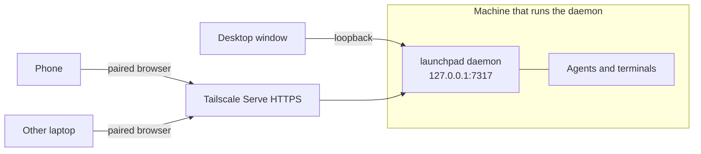

# Remote access and phones

One daemon runs everything: agents, terminals, the GitHub cache and the UI. The desktop window, your phone and other browsers are all clients of that daemon. They see the same agents, drafts and review state.



By default the daemon listens only on `127.0.0.1`. Every paired browser has full access to Launchpad, so only pair your own devices and keep the daemon on a private network.

## Pair a device

1. On a paired device, open **Settings → Devices → Create pairing link** (or run `launchpad pair` on the host to print a QR code).
2. Scan the QR code with your phone, or open the link in the other browser.
3. Enter a device name and click **Pair browser**.

Pairing links work once and expire after five minutes. Browser credentials last one year. **Settings → Devices** lists paired browsers and revokes them.


**Reverse pairing**: on the unpaired browser, choose **Show pairing code**. On a paired device, enter the eight-character code in **Settings → Devices** and click **Approve browser**. Keep the requesting tab open until approval. Only approve a code you can see on your own device.

## Reach the daemon from other devices

### Tailscale (recommended)

With [Tailscale](https://tailscale.com/) running on the host, Launchpad discovers it at startup:

- If a private [Tailscale Serve](https://tailscale.com/kb/1312/serve) HTTPS route points to the daemon's port, pairing links use that HTTPS URL.
- Otherwise the daemon also listens on its tailnet IP, and pairing links use plain HTTP on the tailnet.

To set up HTTPS, open **Settings → Devices → Pair a device** and click **Run command**. Launchpad runs a fixed `tailscale serve --bg` command for this daemon only. It never overwrites other routes and refuses public Funnel ports. You can also run it yourself:

```sh
tailscale serve --bg 7317
```

HTTPS is required for installing Launchpad as an app on a phone. Set `[server] auto_tailnet = false` to disable discovery.

### Another reverse proxy

Set the exact external origin in `config.toml` and restart the daemon:

```toml
[server]
bind = "127.0.0.1"
public_origin = "https://launchpad.example.com"
```

- Serve Launchpad at the root of a host name, not under a path prefix.
- Forward `/`, `/api/*`, `/ws` and `/api/terminals/*/ws` to `http://127.0.0.1:7317`, with WebSocket upgrades and long-lived connections.
- Preserve the browser's `Host` and `Origin` headers.
- Never expose port 7317 directly to the internet. Put a VPN or an identity-aware proxy in front.

When the daemon is reachable from other machines, the `[commands]` section of `config.toml` can only be changed in the file.

## Phone layout

Screens narrower than 720 px get a phone layout (or choose it in **Settings → Appearance** on a laptop, **Settings → This device → Layout** on the phone):

- Tabs: **Today** (what waits for you, with the card buttons in place), **Agents**, **Ask**, **Inbox** and **More**.
- **Ask** opens the chat of your default Ask bot (the same bot as the laptop's Ask field) full screen, with no back button. Over the message box, quick chips send common questions (**What needs me?**, **How are my agents doing?**) or start a message for you to finish (**Start an agent…**, **Status of…**). They are normal messages.
- **More** lists Bots, Schedules, Folders, Knowledge, Terminals, Settings and Finish setup, each with its state (for example a bot that needs you or a failed routine), and the current workspace with **Change**.
- The workspace button at the top left opens the workspace sheet: one row per workspace with the count of what waits in it; tap one to switch, or **New workspace**. The button shows how many items wait in the other workspaces.
- Each screen has one title bar. On a tab page (Today, Agents, Ask, Inbox, More and the pages listed in More), it shows the workspace button, the section title, the page's main button and **⋯** when it has them (**New bot** on Bots, **Add folder** on Folders, **⋯** on Knowledge and Inbox), and the status button. The page content starts right under the bar. On a detail page (an agent, a bot, a Local PR, a folder, an Inbox thread, a pull request, Files, a Settings page, Terminals, Setup, a routine or a scheduled launch), it shows **‹**, the page title and **⋯** with the page's other actions. **‹** is the only way back: it returns to the page you came from, or to the page's list when you opened it from a link or a notification. Files goes back to the page that opened it, even after you opened several files.
- The status button turns amber with a count when something is wrong: no connection, Home unreachable, outdated or offline runners, a missing harness that a profile uses, quota near its limit or without a fresh reading, a spending limit reached, or a low GitHub rate limit. Its sheet says why, with a link to the page that fixes it. On a detail page, the status button shows only while something is wrong.
- **Files** shows the open file right under the bar. The bar holds the file name and the tree button (**Tree and search**); the row under it has the folder path, **Find**, **Preview** and **⋯** as icons. Each opened file is a step of **‹**, so there are no file tabs.
- Short status messages (with **Undo** when there is one) show under the title bar, so they never cover the tab bar.
- Bot pages show the chat; the header's **⋯** menu opens Memory, Proposals, Routines and Settings in place of the chat.
- Session pages have Summary, Trace and Changes and a terminal key bar. **⋯ → Rename** renames the agent. A bottom bar holds **Reply** and the session's main action, or **Merge into** the base branch when merging is safe and no question is open; the next steps in Summary then do not repeat Merge. **Reply** opens the message box; it stays open while it holds a draft, and opens by itself when you answer a question. In Summary or Trace, tap the expand icon beside the view tabs to fill the screen with a compact header. Tap collapse to restore the layout and your draft.
- **Settings** is a list in three groups: **This device** (theme, layout, notifications, devices), **On the phone** (Channels, Workspace, presets, GitHub, usage) and **On a computer** (profiles, Home and runners, credentials, Hugging Face, Disk cleanup, the setup checklist). The last group shows only a status: open Launchpad on a computer to change these. On a Settings page, **‹** goes back to Settings.

<table>
  <tr>
    <td></td>
    <td></td>
  </tr>
</table>

### Install as an app and get notifications

Open the paired HTTPS origin in the phone's browser and use **Install** or **Add to Home Screen**.

Get finished agents and routine reports on your phone through Telegram: bind your chat in **Settings → Channels** ([Channels](channels.md)). On the phone, **Settings → Notifications** shows the Telegram card first; **Desktop notifications** is the switch for the machine that runs the agent.

## Run on a headless server

On a Linux server (a VPS, a home server or a desktop that stays on), install only the daemon and the CLI:

```sh
packaging/install.sh --headless             # build from source
packaging/install.sh --headless --prebuilt  # from an extracted prebuilt package
```

This installs `~/.local/bin/launchpad` and the systemd user unit, and enables lingering so the daemon starts at boot and survives logout. Then:

1. Set up Tailscale Serve (see above) or a private reverse proxy.
2. Run `launchpad pair` over SSH and scan the QR code.
3. Open **Finish setup** to sign in to each harness and the GitHub CLI. Sign-in commands run in a terminal on the page.
4. Routines run in the time zone of the browser that saved them; set `[home] time_zone` (or the server's time zone) for the rest.

Operations:

- Restarting the daemon interrupts running agents. Update when no agent is running.
- Back up `state.db` while the daemon runs: `sqlite3 ~/.local/share/launchpad/state.db ".backup /backups/launchpad-state.db"`. `cache.db` can be rebuilt.
- Logs: `journalctl --user -u launchpad -f`.

## Several devices at once

- Only a window that you used in the last minute marks sessions as seen or suppresses notifications, so an unattended laptop does not hide work from your phone.
- Composer drafts, PR viewed markers and unsent review comments are stored by the daemon and shared between devices.
- A terminal follows the size of the device that typed last. Other devices see it letterboxed, with a **Use this size** button.
- After a network drop, the UI reconnects, replays missed updates and resumes terminals from the last byte received.
