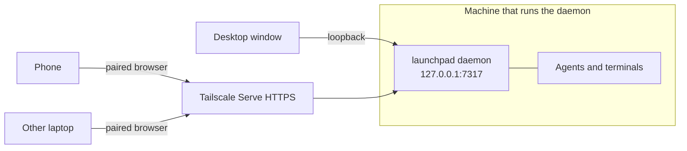
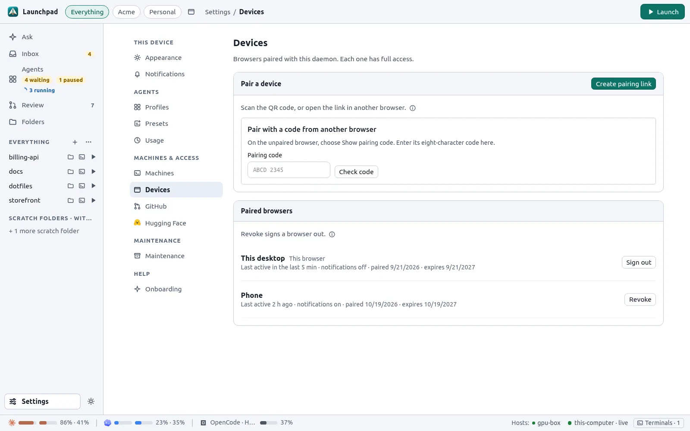
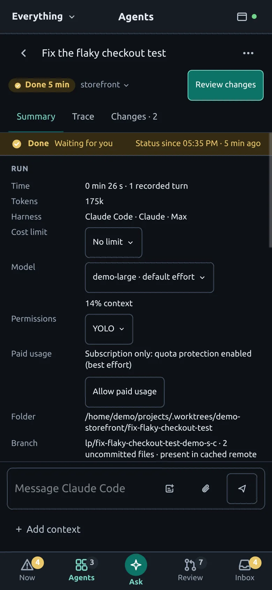

# Remote access and phones

One daemon runs everything: agents, terminals, the GitHub cache and the UI. The desktop window, your phone and other browsers are all clients of that daemon. They see the same agents, drafts and review state.



By default the daemon listens only on `127.0.0.1`. Every paired browser has full access to Launchpad, so only pair your own devices and keep the daemon on a private network.

## Pair a device

1. On a paired device, open **Settings → Devices → Create pairing link** (or run `launchpad pair` on the host to print a QR code).
2. Scan the QR code with your phone, or open the link in the other browser.
3. Enter a device name and click **Pair browser**.

Pairing links work once and expire after five minutes. Browser credentials last one year. **Settings → Devices** lists paired browsers and revokes them.



**Reverse pairing**: on the unpaired browser, choose **Show pairing code**. On a paired device, enter the eight-character code in **Settings → Devices** and click **Approve browser**. Keep the requesting tab open until approval. Only approve a code you can see on your own device.

## Reach the daemon from other devices

### Tailscale (recommended)

With [Tailscale](https://tailscale.com/) running on the host, Launchpad discovers it at startup:

- If a private [Tailscale Serve](https://tailscale.com/kb/1312/serve) HTTPS route points to the daemon's port, pairing links use that HTTPS URL.
- Otherwise the daemon also listens on its tailnet IP, and pairing links use plain HTTP on the tailnet.

To set up HTTPS, open **Settings → Devices → Pair a device** and click **Run command**. Launchpad runs a fixed `tailscale serve --bg` command for this daemon only. It never overwrites other routes and refuses public Funnel ports. You can also run it yourself:

```sh
tailscale serve --bg 7317
```

HTTPS is required for Web Push notifications and for installing Launchpad as an app on a phone. Set `[server] auto_tailnet = false` to disable discovery.

### Another reverse proxy

Set the exact external origin in `config.toml` and restart the daemon:

```toml
[server]
bind = "127.0.0.1"
public_origin = "https://launchpad.example.com"
```

- Serve Launchpad at the root of a host name, not under a path prefix.
- Forward `/`, `/api/*`, `/ws` and `/api/terminals/*/ws` to `http://127.0.0.1:7317`, with WebSocket upgrades and long-lived connections.
- Preserve the browser's `Host` and `Origin` headers.
- Never expose port 7317 directly to the internet. Put a VPN or an identity-aware proxy in front.

When the daemon is reachable from other machines, the `[commands]` section of `config.toml` can only be changed in the file.

## Phone layout

Screens narrower than 720 px get a phone layout (or choose it in **Settings → Appearance**):

- **Now**: what needs you, with answer buttons in place, and open terminals.
- **Agents**, **Ask**, **Review** and **Inbox** tabs.
- Session pages with Summary, Trace and Changes, a reply box and a terminal key bar.

<table>
  <tr>
    <td></td>
    <td></td>
  </tr>
</table>

### Install as an app and get notifications

1. Open the paired HTTPS origin in the phone's browser and use **Install** or **Add to Home Screen**. On iOS, notifications only work for apps added to the Home Screen.
2. Open **Settings → Notifications** and turn on notifications for this browser.

Notifications contain the status and the folder name. Session titles appear only if you allow them for that device. They never contain code or messages.

## Run on a headless server

On a Linux server (a VPS, a home server or a desktop that stays on), install only the daemon and the CLI:

```sh
packaging/install.sh --headless             # build from source
packaging/install.sh --headless --prebuilt  # from an extracted prebuilt package
```

This installs `~/.local/bin/launchpad` and the systemd user unit, and enables lingering so the daemon starts at boot and survives logout. Then:

1. Set up Tailscale Serve (see above) or a private reverse proxy.
2. Run `launchpad pair` over SSH and scan the QR code.
3. Open **Finish setup** to sign in to each harness and the GitHub CLI. Sign-in commands run in a terminal on the page.
4. Set the server's time zone on purpose: crons and start times use it.

Operations:

- Restarting the daemon interrupts running agents. Update when no agent is running.
- Back up `state.db` while the daemon runs: `sqlite3 ~/.local/share/launchpad/state.db ".backup /backups/launchpad-state.db"`. `cache.db` can be rebuilt. Keep `vapid.json` to keep Web Push subscriptions.
- Logs: `journalctl --user -u launchpad -f`.

## Several devices at once

- Only a window that you used in the last minute marks sessions as seen or suppresses notifications, so an unattended laptop does not hide work from your phone.
- Composer drafts, PR viewed markers and unsent review comments are stored by the daemon and shared between devices.
- A terminal follows the size of the device that typed last. Other devices see it letterboxed, with a **Use this size** button.
- After a network drop, the UI reconnects, replays missed updates and resumes terminals from the last byte received.
