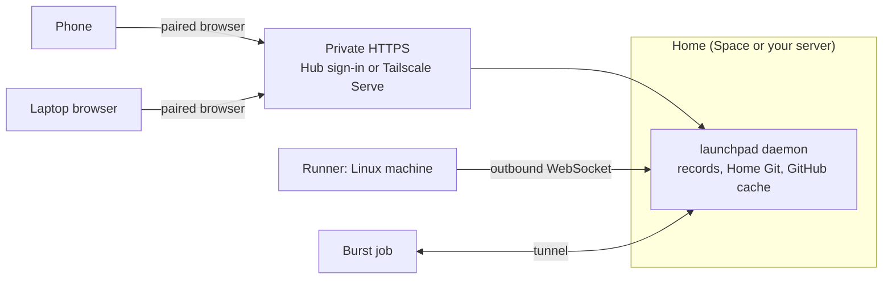
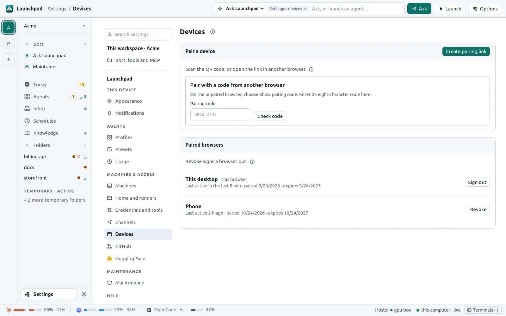
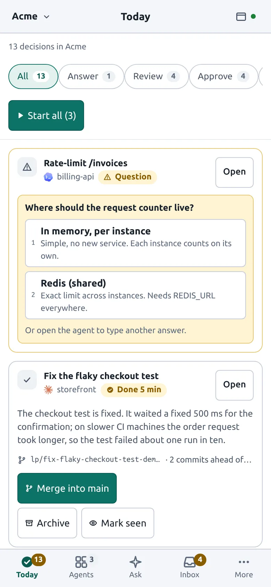
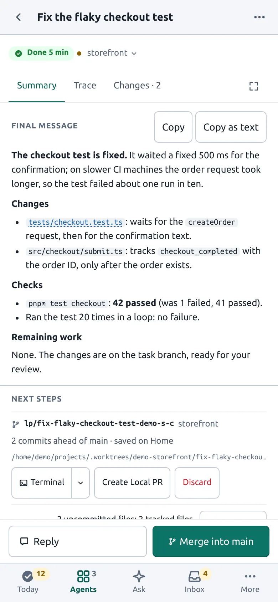

# Remote access and phones

Home serves the app, the GitHub cache and every record. Your browsers and phones are clients of Home: they see the same agents, drafts and review state. Agents run on runners, which connect to Home on their own (see [Home and runners](home-and-runners.md)).



A Home in a Hugging Face Space is reached at the Space's address, behind the Hub's sign-in. The rest of this page is about a self-hosted Home.

By default the daemon listens only on `127.0.0.1`. Every paired browser has full access to Launchpad, so only pair your own devices and keep the daemon on a private network.

## Pair a device

1. On a paired device, open **Settings → Devices → Create pairing link** (or run `launchpad pair` on Home's machine to print a QR code).
2. Scan the QR code with your phone, or open the link in the other browser.
3. Enter a device name and click **Pair browser**.

Pairing links work once and expire after five minutes. Browser credentials last one year. **Settings → Devices** lists paired browsers and revokes them.



**Reverse pairing**: on the unpaired browser, choose **Show pairing code**. On a paired device, enter the eight-character code in **Settings → Devices** and click **Approve browser**. Keep the requesting tab open until approval. Only approve a code you can see on your own device.

## Reach Home from other devices

### Tailscale (recommended)

With [Tailscale](https://tailscale.com/) running on Home's machine, Launchpad discovers it at startup:

- If a private [Tailscale Serve](https://tailscale.com/kb/1312/serve) HTTPS route points to the daemon's port, pairing links use that HTTPS URL.
- Otherwise the daemon also listens on its tailnet IP, and pairing links use plain HTTP on the tailnet.

To set up HTTPS, open **Settings → Devices → Pair a device** and click **Run command**. Launchpad runs a fixed `tailscale serve --bg` command for this daemon only. It never overwrites other routes and refuses public Funnel ports. You can also run it yourself:

```sh
tailscale serve --bg 7317
```

HTTPS is required for installing Launchpad as an app on a phone. Set `[server] auto_tailnet = false` to disable discovery.

### Another reverse proxy

Set the exact external origin in `config.toml` and restart the daemon:

```toml
[server]
bind = "127.0.0.1"
public_origin = "https://launchpad.example.com"
```

- Serve Launchpad at the root of a host name, not under a path prefix.
- Forward `/`, `/api/*` and `/ws` (runners use `/api/runners/tunnel`) to `http://127.0.0.1:7317`, with WebSocket upgrades and long-lived connections.
- Preserve the browser's `Host` and `Origin` headers.
- Never expose port 7317 directly to the internet. Put a VPN or an identity-aware proxy in front.

## Phone layout

Screens narrower than 720 px get a phone layout (or choose it in **Settings → Appearance** on a laptop, **Settings → This device → Layout** on the phone):

- Tabs: **Today** (what waits for you, with the card buttons in place), **Chats**, **Agents**, **Inbox** and **More**. A tab shows an amber count when something there needs you.
- **Chats** lists the workspace's bots like a messaging app: your default Ask bot (the same bot as the laptop's Ask field) pinned first, then the others by their last activity, each with its state dot, its last message and its time, bold while unseen, and an amber count when it needs you. **New bot** creates one. Tap the tab again to open the last chat. A bot's Today card and its Telegram notifications open its chat; the full trace stays in Agents (**⋯ → Open in Agents**), and a bot's session page there links back to the chat. In Ask Launchpad's chat, over the message box, quick chips send common questions (**What needs me?**, **How are my agents doing?**) or start a message for you to finish (**Start an agent…**, **Status of…**). They are normal messages, hidden once the box has text, attachments, context or presets.
- **More** lists Schedules, Folders, Knowledge, Terminals, Settings and Finish setup, each with its state (for example a failed routine).
- The workspace button at the top left opens the workspace sheet: one row per workspace with the count of what waits in it; tap one to switch, or **New workspace**. The button shows how many items wait in the other workspaces.
- Each screen has one title bar. On a tab page (Today, Chats, Agents, Inbox, More and the pages listed in More), it shows the workspace button, the section title, the page's main button and **⋯** when it has them (**New bot** on Bots, **Add folder** on Folders, **⋯** on Knowledge and Inbox), and the status button. The page content starts right under the bar. On a detail page (an agent, a bot, a Local PR, a folder, an Inbox thread, a pull request, Files, a Settings page, Setup, a routine or a scheduled launch), it shows **‹**, the page title and **⋯** with the page's other actions. **‹** returns to the page you came from, or to the page's list when you opened it from a link or a notification. Files goes back to the page that opened it, even after you opened several files.
- Android's back button does the same as **‹**, one step at a time: it first closes the topmost menu, sheet, the composer (its draft is kept), the full-screen or Reply mode of a session, an opened Today card, the Files tree or an image; then it goes back one page (an Inbox thread back to the Inbox, a note back to Knowledge, a pull request file back to its file list). From any tab, back goes to Today, and back on Today leaves the app. A page opened from a link or notification has Today and its list under it. Unsaved text in an editor (BOT.md, a note, a Local PR description) is kept when back closes it and shows "Draft kept" when you return.
- Pull down Today, the Inbox or Agents from the top to refresh them. Today keeps its scroll position and open cards while you visit other pages.
- The status button turns amber with a count when something is wrong: no connection, Home unreachable, outdated, offline or refused runners, a missing harness that a profile uses, quota near its limit or without a fresh reading, a spending limit reached, or a low GitHub rate limit. Its sheet says why, with a link to the page that fixes it. On a detail page, the status button shows only while something is wrong.
- **Files** shows the open file right under the bar. The bar holds the file name and the tree button (**Tree and search**); the row under it has the folder path, **Find**, **Preview** and **⋯** as icons. Each opened file is a step of **‹**, so there are no file tabs.
- Short status messages (with **Undo** when there is one) show under the title bar, so they never cover the tab bar.
- Bot pages show the chat; the header's **⋯** menu opens Memory, Proposals, Routines and Settings in place of the chat, and **Next message starts a new session** (a chip over the message box shows it is set).
- Session pages have Summary, Trace and Changes. **⋯ → Rename** renames the agent. A bottom bar holds **Reply** and the session's main action, or **Merge into** the base branch when merging is safe and no question is open; the next steps in Summary then do not repeat Merge. **Reply** opens the message box; it stays open while it holds a draft, and opens by itself when you answer a question. In Summary or Trace, tap the expand icon beside the view tabs to fill the screen with a compact header. Tap collapse to restore the layout and your draft. **Stop** of an agent that asks a question is in **⋯**.
- The Local PR bar holds one button: **Publish** (its branch name and draft options are in its sheet) for a folder on GitHub, else **Merge**; the others are in **⋯**. Today's **Start all** shows in the Approve filter.
- Tap an image in a trace or chat to view it full screen (pinch to zoom, **Download**, **✕** or back to close).
- **Settings** is a list in three groups: **This device** (theme, layout, devices), **On the phone** (Channels, Workspace, presets, GitHub, usage) and **On a computer** (profiles, Home and runners, credentials, Hugging Face, Disk cleanup, the setup checklist). The last group shows only a status: open Launchpad on a computer to change these. On a Settings page, **‹** goes back to Settings.

<table>
  <tr>
    <td></td>
    <td></td>
  </tr>
</table>

### Install as an app and get notifications

Open the paired HTTPS origin in the phone's browser and use **Install** or **Add to Home Screen**.

On Android, open Home in Chrome and use the menu → **Install app**. A long press on the app icon shows the shortcuts **Ask**, **Today** and **New agent**, and other apps can share a link or text to Launchpad: it opens the composer with the shared text as the prompt. The installed app keeps its page and assets, so it still opens when the phone is offline and shows the lists it saved last. On a private Hugging Face Space, the page fetches the manifest with your Hub sign-in. If Chrome still offers only **Add to Home Screen**, open `chrome://inspect` on a computer with the phone plugged in, inspect the page and read the reason under **Application → Manifest**.

Notifications come only through Telegram: bind your chat in **Settings → Channels** ([Channels](channels.md)) to get finished, failed and interrupted agents and routine reports on your phone. Launchpad shows no desktop or Web Push notifications.

## Run Home on your own server

On a Linux server (a VPS, a home server or a desktop that stays on), install Home:

```sh
packaging/install.sh --headless             # build from source
packaging/install.sh --headless --prebuilt  # from an extracted prebuilt package
```

This installs `~/.local/bin/launchpad` and the systemd user unit, which runs Home (`launchpad daemon`), and enables lingering so Home starts at boot and survives logout. Then:

1. Set up Tailscale Serve (see above) or a private reverse proxy.
2. Run `launchpad pair` over SSH and scan the QR code.
3. Sign Home in to GitHub with `gh auth login` on the server, and open **Finish setup** for the other steps.
4. Pair at least one runner (see [Home and runners](home-and-runners.md#pair-a-runner)). Home runs no agents.
5. Routines run in the time zone of the browser that saved them; set `[home] time_zone` (or the server's time zone) for the rest.

Operations:

- Restarting Home does not stop agents: they keep running on their runners, which resend what Home missed when the link is back. Restarting a runner interrupts its running turns.
- Set `[home] backup` to a folder (or a bucket) for Home backups, or back up `state.db` while Home runs: `sqlite3 ~/.local/share/launchpad/state.db ".backup /backups/launchpad-state.db"`. `cache.db` can be rebuilt.
- Logs: `journalctl --user -u launchpad -f`.

## Several devices at once

- Only a window that you used in the last minute marks sessions as seen or suppresses notifications, so an unattended laptop does not hide work from your phone.
- Composer drafts, PR viewed markers and unsent review comments are stored by the daemon and shared between devices.
- After a network drop, the UI reconnects and replays missed updates.
