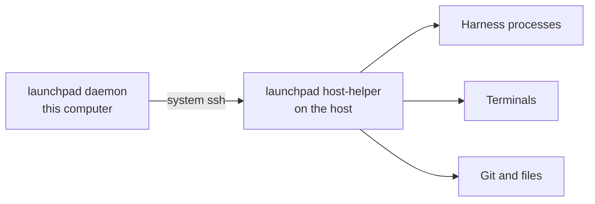

# SSH hosts

Launchpad can run agents, worktrees and terminals on other machines, for example a GPU box or a cloud VM, while the daemon and the UI stay on your computer.

## Add a host

Open **Settings → Machines** and add a host from `~/.ssh/config` or as `user@host`. Launchpad uses the system `ssh`, so jump hosts, certificates and agent keys work as usual. Password and host key prompts appear in a dialog and are never stored.

On first connection, Launchpad uploads its own helper (the same `launchpad` binary) to `~/.local/share/launchpad-host/` on the host. Nothing else is installed.

## Check the host

Each host shows read-only checks for the helper, Git, the GitHub CLI and each harness. For a missing tool or sign-in, a button runs the official install or sign-in command in a visible terminal on the host. Launchpad never copies your credentials to a host: each host keeps its own sign-ins. Profile environment values that use `${NAME}` are read from the host's login shell, unless the profile enables **Send credentials to SSH hosts**.

## Folders on a host

Add a folder on a host from **+ Add folder** (browse it, or clone from GitHub on the host). A host folder is written `<host>:<absolute path>`.

Everything for that folder then runs on the host: agents, task worktrees, merges, terminals, Changes and Files. Rows, headers and terminal tabs show the host name.

## When the connection drops

- The helper owns the processes, so a turn continues on the host while your computer sleeps. The trace catches up when the connection returns.
- While a host is unreachable, its sessions stay Running with an explanation. A process lost with its host becomes Interrupted.
- Scheduled launches and crons wait while your computer sleeps.
- Restarting the daemon still interrupts host turns.
